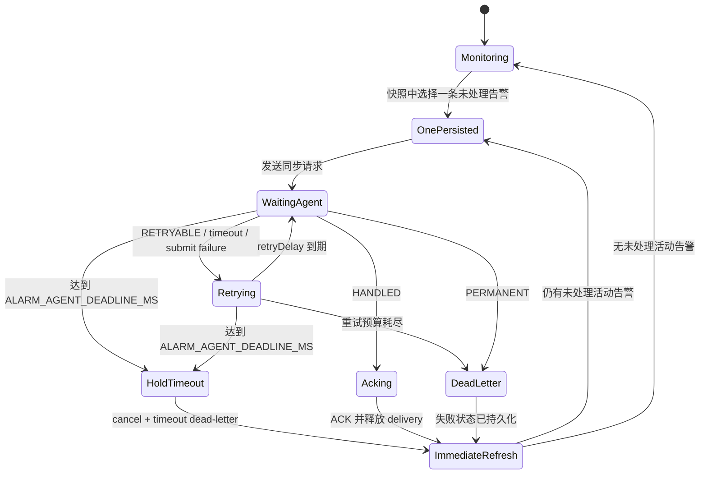

# Alarm 单条处理并复查后继续监控：修改方案

> 实施状态：已完成。2026-09-15 在 WSL 中完成构建，并通过 Alarm 单测、polling/subscription E2E 及 17 项全量 CTest。

## 1. 目标流程

同一快照出现一条或多条告警时，每轮只接管和处理一条。Agent 处理完成后，释放该条告警的持久化 delivery，立即重新查询一次当前活动告警，再决定是否处理下一条。

```text
查询活动告警快照
    |
    +-- 无新告警：按原方式继续监控（polling 等待 5 秒 / subscription 等待事件）
    |
    +-- 一条或多条新告警：只选择第一条未处理 occurrence
            |
            +-- 持久化该条 delivery
            +-- 暂停新的 ASP 监控
            +-- 发送 Agent 并等待处理结果
            +-- HANDLED 后完成 ACK、释放 delivery
            +-- 立即重新查询一次活动告警
                    |
                    +-- 其他告警已联动解除：不再处理
                    +-- 仍有未处理告警：再选择一条，重复上述流程
```

这样可以避免同一原因产生的多条告警被一次性加入队列：处理第一条后，如果设备修改使其他告警同步解除，下一次实时快照中它们已经不存在，不会再发送给 Agent。

## 2. 当前实现与差异

当前 `src/alarm/alarm_service.c` 有两个线程：

- `listen_main` 持续从 ASP 获取活动告警；polling 默认每 5 秒一次。
- `dispatch_main` 使用 `LITE_REPLY_SYNC` 把 delivery 发送 Agent，并通过 `DispatchResponseEx` 等待结果。

当前主要有两个不符合目标的地方：

1. `accept_notify` 会遍历同一快照的整个 `almlist`，把所有新 occurrence 一次性持久化到 `deliveries[64]`。
2. dispatcher 等待 Agent 时，独立 listener 仍可能继续请求 ASP。

本次需要同时改为“单条接管”和“处理期间暂停监控”。

## 3. 详细语义

### 3.1 同一快照只接管一条

仍然先完整校验整个 `almlist`。任何 occurrence 缺关键字段时，拒绝整批，避免从损坏快照中选择告警。

校验通过后，按 ASP 返回顺序查找第一条满足以下条件的 occurrence：

- 不在 durable `seen` 中；
- 不在当前 pending delivery 中；
- 有空闲 delivery slot。

只持久化这一条并停止遍历。本次快照中的其他 occurrence 不进入 spool，等待处理完成后的新查询重新确认它们是否仍然存在。

如果列表前面的 occurrence 已经在 `seen` 中，应继续向后查找第一条未处理 occurrence，不能因为第一条是重复项就认为本轮没有新告警。

### 3.2 暂停起点

第一条新 occurrence 被 Alarm 接管并写入 delivery 后，listener 在发起下一次 ASP 请求前进入等待。

暂停点不能放到 `IngressSubmit` 成功之后，否则 listener 和 dispatcher 的并发窗口中可能额外发起一次查询。

### 3.3 “解除持久”的含义

Agent 返回 `HANDLED` 后沿用现有两阶段 ACK：

1. 持久化 `handled=1` replay barrier；
2. 将 occurrence key 写入 `seen`，释放当前 delivery slot，再持久化 spool。

释放的是当前告警的 pending delivery，不删除整个 spool，也不删除 `seen` 去重记录。否则同一个仍出现在下一次活动快照中的 occurrence 会被重复发送给 Agent。

### 3.4 处理完成后立即复查

当前告警完成 ACK 后，不等待 polling 的下一个 5 秒周期，而是立即发起一次 canonical active-alarm 查询：

- 如果快照为空，恢复普通 5 秒 polling；
- 如果仍有未处理 occurrence，再接管其中一条并继续阻塞式处理；
- 如果原快照中的其他告警已经因同一原因同步解除，它们不会再进入 delivery；
- 已处理 occurrence 即使仍活动，也会被 `seen` 跳过，不重复运行 Agent。

### 3.5 subscription 模式

subscription 模式也必须在 Agent 完成后先做一次主动活动告警查询，不能只重新建立 long poll。暂停期间没有订阅连接时可能错过变化事件，而其他仍活动的告警也未必会再次产生事件。

当前 client 的 `begin` 在 subscription 模式下只能先建立订阅，因此需要增加一个“强制活动快照查询”入口，供 Agent 完成后的复查使用。普通 subscription 流程保持“事件触发后再查 canonical active list”。

### 3.6 非成功结果

保留现有可靠投递语义：

- `RETRYABLE`、等待超时、Ingress 暂态失败：当前 delivery 不释放，监控保持暂停，按现有预算重试；
- `PERMANENT`：进入 dead-letter，然后立即复查并恢复监控；
- 首次加 3 次尝试全部失败：进入 dead-letter，然后立即复查并恢复监控；
- `handled=1` 但第二阶段 ACK 落盘失败：只重试 ACK，不重放 Agent；ACK 收敛后再复查。

dead-letter 不能作为永久暂停条件，否则一条失败告警会让监控永远停止。

### 3.7 `ALARM_AGENT_DEADLINE_MS` 最大持有时间

从当前 delivery **首次成功发送给 Agent** 时开始计算绝对持有上限，直接复用 `ALARM_AGENT_DEADLINE_MS = 2100000`（35 分钟）。该上限覆盖 Agent 等待、retry delay 和后续重试，重试不能重新开始计时。

在 `ALARM_AGENT_DEADLINE_MS` 内收到终态回复时，按正常 HANDLED/PERMANENT 流程处理。超过该期限仍没有终态回复时：

1. 调用 `RequestCancel(activeRequestId)` 取消仍在等待的 Agent 请求；
2. 将当前 delivery 标记为 timeout dead-letter 并持久化，不能伪造 HANDLED；
3. 清除 `activeRequestId` 和监控持有状态；
4. 唤醒 listener，立即重新查询一次活动告警；
5. 后续迟到的 Agent 回复由现有 response registry/cancel 机制拒绝，不能再次 ACK 或改变该 delivery。

当前代码会在每次重试时重新设置 2100 秒 deadline，因此累计持有时间可能远超 2100 秒。修改后，`ALARM_AGENT_DEADLINE_MS` 是整个 delivery 的总持有预算，不是每次 attempt 都重新获得的预算。每次 `DispatchResponseEx` 的 timeout 必须取：

```text
距离首次发送后 2100000 毫秒绝对截止点的剩余毫秒数
```

如果 Agent 一直不回复，第一次等待到 2100000 毫秒截止点后便直接解除持有，不再发起新 retry。只有 Agent 在截止前明确返回 `RETRYABLE` 时，才可在剩余总预算内重试。

“解除持有”只表示 Alarm 恢复监控；超时 delivery 仍以 dead-letter 留在 spool，避免同一个 occurrence 立即再次触发 Agent。日志需要明确记录 delivery id、request id、首次发送时间和 `hold_timeout_ms=2100000`。

为了让 `ALARM_AGENT_DEADLINE_MS` 总上限在进程重启后仍然成立，首次发送时间必须持久化。建议 spool 格式从 `LCRALM3` 升级并保存 `firstDispatchEpochMs`；加载旧版本记录时可在首次恢复发送时初始化该时间。不能使用 monotonic 时间落盘，因为它跨进程重启没有可比性。

### 3.8 重启恢复

启动加载 spool 后，如果存在未完成、非 dead-letter delivery，先处理这一条恢复项，listener 暂不访问 ASP。恢复项收敛后立即查询一次活动告警，再进入普通监控。

旧版本 spool 可能已经保存多条 pending delivery。升级加载时只保留第一条可执行 pending；其余旧 pending 从队列释放且不写入 `seen`，由第一条收敛后的实时活动快照重新发现。这样仍活动的告警不会丢失，已经联动解除的告警也不会绕过新规则继续执行。旧 `handled` barrier 会直接收敛到 `seen`，dead-letter 保持不变。

## 4. 状态流转



## 5. 需要修改的位置

### 5.1 `src/alarm/alarm_service.c`

核心改动：

1. 将 `accept_single` 改为返回接管结果，例如 `ACCEPTED / SKIPPED / NO_SLOT`，让调用方知道是否已经选中一条。
2. `accept_notify` 保留第一遍整批校验；第二遍遇到第一条成功接管的 occurrence 后立即 `break`，不再把余下告警写入 spool。
3. 增加 listener 的 condition-variable 门控；存在当前可执行 delivery 时，`listen_main` 不调用 client `begin`。
4. 增加 `refreshRequired` 状态：HANDLED ACK、PERMANENT、重试耗尽或恢复项收敛后置位。
5. listener 被 dispatcher 唤醒后，如果 `refreshRequired`，立即发起活动快照查询；快照处理结束后清除该标记。
6. `finalize_handled_locked` 成功释放 delivery，以及 delivery 进入 dead-letter 时，广播 `service->wake`。
7. 门控等待必须同时检查 `quiescing`，保证 stop 能立即唤醒 listener。
8. 加载旧 spool 时只恢复第一条可执行 pending，释放其余旧 pending 且不写 `seen`；后续立即刷新活动快照，仍活动的 occurrence 会重新进入单条接管流程。
9. 为 delivery 增加首次发送时间，并以 `ALARM_AGENT_DEADLINE_MS` 计算绝对截止点；每次等待只使用剩余预算，到期后 cancel、持久化 timeout dead-letter、广播 `wake` 并解除监控持有。
10. 使用 wall-clock epoch 保存首次发送时间，运行期计算时防御系统时间回拨：时间异常时不得延长已经建立的 2100000 毫秒内存截止点。

不修改 `LITE_REPLY_SYNC`、`DispatchResponseEx`、重试预算、Agent deadline、durable spool 和两阶段 HANDLED ACK 的基本语义。

### 5.2 `include/litecrab/alarm.h`

扩展 `AspAlarmClientVTable`，增加主动获取活动快照的方法，例如：

```c
int (*begin_snapshot)(AspAlarmClient*, uint64_t generation);
```

它只用于绕过 subscription 等待、立即查询 canonical active-alarm list。该接口变更需要同步所有生产和测试 client 实现。

不新增 timeout 常量，直接使用现有 `ALARM_AGENT_DEADLINE_MS 2100000`。实现语义从“每次 Agent attempt 的 deadline”收紧为“整个 delivery 从首次发送起的总持有 deadline”。

### 5.3 `src/alarm/asp_client.c`

1. 抽取带目标 phase 的 launch 逻辑，避免临时改写 `c->cfg.mode`。
2. 普通 `begin` 保持原行为：polling 发活动查询，subscription 发 long poll。
3. 新增 `begin_snapshot`：无论当前配置是 polling 还是 subscription，都直接进入活动告警查询；如果尚未登录，则先登录，登录完成后继续本次强制快照，而不是转回 subscription。
4. 为强制快照保存明确的 pending phase，避免登录完成后丢失“立即查询”的意图。

### 5.4 `tests/test_alarm.c`

扩展 mock client，记录 begin、snapshot 和 poll 次数，新增测试：

- 同一快照含 A、B，只将 A 送入 inbound bus；A 未回复期间不开始新监控；
- A 完成后立即 snapshot refresh；若新快照只剩空列表，B 永不发送；
- A 完成后新快照仍含 B，则随后只发送 B；
- 快照首项为 seen A、第二项为新 B 时，能正确选择 B；
- RETRYABLE 期间不刷新，HANDLED 后才刷新；
- PERMANENT/dead-letter 后能刷新，不会永久阻塞；
- 门控等待时 quiesce/stop 正常退出；
- 重启 pending 优先处理，完成后立即刷新；
- 旧 spool 多 pending 时，刷新确认已消失项不会被 Agent 执行。
- 首次发送后一直不回复，达到 `ALARM_AGENT_DEADLINE_MS` 时 request 被取消、delivery 进入 timeout dead-letter、listener 恢复；测试通过可注入的短 timeout 完成，不能真的等待 35 分钟。
- Agent 在截止前返回 `RETRYABLE` 时，下一次 retry 只允许使用总 deadline 的剩余时间，不能重新获得完整 2100000 毫秒。
- 服务重启后从 spool 恢复首次发送时间，总持有预算不能重置。

### 5.5 `tests/test_alarm_e2e.py`

让 LLM mock 支持延迟响应，并覆盖 polling 与 subscription：

1. ASP 同时返回 A、B；
2. 确认只产生 A 的 LLM 请求；
3. 挂起 A 的 Agent 响应，确认 ASP 查询/订阅没有继续；
4. 模拟 A 的处理使 B 从活动快照消失；
5. 释放 A 响应，确认服务立即复查且不会发送 B；
6. 再发布 C，确认普通监控已经恢复；
7. 另测 B 在复查时仍存在，则 B 才会成为下一条 Agent 请求。

现有 burst 测试需要改写。原测试依赖一次快照预先入队 20 条；新语义下应验证“一次一条、每条之间重新查询”，不能继续假设 20 条都会无条件执行。

### 5.6 `src/alarm/monitor.h`

如果强制快照 phase 只封装在 `asp_client.c` 内，则本文件无需变化；如果实现选择公开 transport phase enum，再在此处增加内部声明。优先保持它不变。

### 5.7 `docs/alarm/alarm_module_architecture.md`

代码完成并验证后同步更新：

- listener/dispatcher 流程图；
- snapshot 接收策略由“全部入队”改为“整批校验、只接管第一条未处理 occurrence”；
- Agent 处理期间暂停监控；
- 完成后立即刷新 active snapshot；
- subscription 强制复查；
- spool 恢复和旧 pending 兼容策略；
- 新告警发现延迟和瞬时告警风险。

## 6. 不需要修改的位置

- `src/hub/hub.c`：同步回复注册和等待已经满足需求；
- `src/kernel/kernel.c`：completion status 已能区分 HANDLED、RETRYABLE、PERMANENT；
- `src/alarm/alarm_app.c`：生命周期调用顺序不变；
- `src/alarm/polling/polling.c`、`src/alarm/subscription/subscription.c`：URL 和 occurrence 解析规则不需要改变。

## 7. 风险与约束

- **监控延迟**：Agent 当前最长 deadline 为 2100 秒，处理期间不会发现新的活动告警，这是本次串行策略的直接结果。
- **瞬时告警遗漏**：Agent 处理期间新出现、又在复查前自行消失的短时告警不会被活动快照发现。
- **排序饥饿**：已处理项会被 `seen` 跳过，因此只要 ASP 返回稳定列表，后续未处理项仍可被选中；测试必须覆盖这一点。
- **subscription 事件丢失**：依靠完成后的强制 active refresh 补偿，不能只依赖重新订阅。
- **持久化含义**：释放 delivery 后仍保留 `seen`。若把 `seen` 也删除，同一未消失 occurrence 会循环触发 Agent。
- **旧 spool 兼容**：升级前已经积压的多条 delivery 需要活动性复核，不能直接串行执行。
- **deadline 超时不是成功**：超时项进入 dead-letter，不写入 `seen`；由于它仍是 pending/dead-letter identity，同一次 occurrence 不会立即重投。后续需要人工查看或重放 dead-letter。
- **时间基准**：持久化使用 epoch 时间，进程内同时保留 monotonic 截止点，避免系统时间回拨意外延长当前持有。

## 8. 验收标准

1. 无告警时保持原 polling 5 秒或 subscription 行为。
2. 一个快照有多条新告警时只持久化、发送其中一条。
3. Agent 未返回终态前不发起新的 ASP 查询或 subscription。
4. 当前告警 ACK/失败收敛后立即查询一次，不等待 5 秒。
5. 联动解除的其他告警不会再发送 Agent。
6. 复查后仍活动的未处理告警每次只选择一条继续处理。
7. 同一个已处理但仍活动的 occurrence 不会重复执行。
8. retry、dead-letter、重启恢复和停机不会造成永久阻塞。
9. polling 与 subscription E2E 均覆盖强制复查。
10. durable spool、去重和两阶段 ACK 的可靠性保持不变。
11. 从首次发送起达到 `ALARM_AGENT_DEADLINE_MS = 2100000` 仍没有终态回复时，Agent request 被取消，告警进入 timeout dead-letter，监控自动恢复并立即复查。
12. retry 和进程重启都不会重置已经开始的 2100000 毫秒总持有预算。

## 9. 实施文件总结

预计修改：

```text
src/alarm/alarm_service.c
include/litecrab/alarm.h
src/alarm/asp_client.c
tests/test_alarm.c
tests/test_alarm_e2e.py
docs/alarm/alarm_module_architecture.md
```

本方案按“处理一条 -> 释放当前 delivery -> 立即重新查询 -> 再决定下一条”实施，不会预先持久化同一快照的其余告警。

## 10. 已实施语义

1. “解除持久”是释放当前 pending delivery，但保留 `seen` 去重记录。
2. Agent 返回 `HANDLED` 后立即复查；`RETRYABLE`/timeout 期间仍暂停并先完成重试。
3. 同一快照按 ASP 顺序选择第一条尚未处理的 occurrence。
4. 其他告警只有在下一次实时快照中仍存在时才会被处理。
5. polling 和 subscription 都执行相同的“完成后立即主动复查”。
6. 首次发送后达到 `ALARM_AGENT_DEADLINE_MS = 2100000` 仍没有终态回复时，取消请求并以 timeout dead-letter 解除持有，不将其记为 HANDLED。

以上语义已实现并同步到 Alarm 架构文档。
