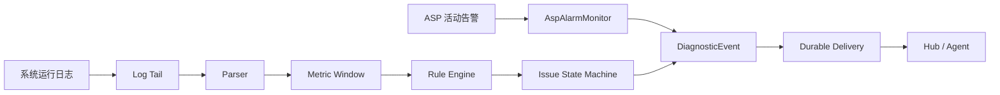
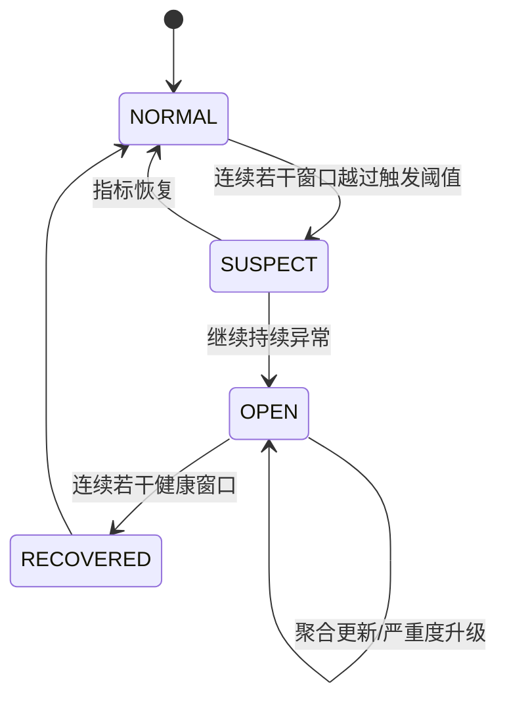
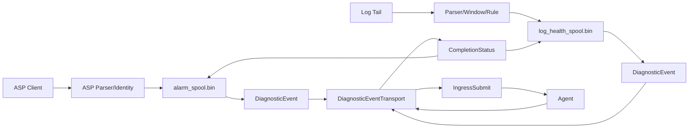

# 日志健康监控与隐性异常检测设计

## 1. 背景与目标

当前 Alarm 模块通过 ASP 定期查询活动告警。默认 polling 间隔为 5 秒，告警以 `equipid + almid + seqno + localtime` 生成稳定身份，随后进入持久化、去重和 Agent 投递流程。

这种机制只能处理已经被设备转换成活动告警的异常。有些情况不会产生明确告警，例如丢包率升高、通信质量逐渐恶化、局部地址持续失败等，只能从 `/log/sys_log/` 下的运行日志判断。主要数据源包括：

- `/log/sys_log/logger_run_log.log`
- `/log/sys_log/om_service_run_log.log`
- 后续明确纳入白名单的其他日志

本设计增加一条独立的日志健康检测链路，在不改变现有 ASP 告警语义的前提下，实现日志增量采集、指标提取、窗口判断、异常去重、恢复识别和 Agent 投递。

## 2. 设计原则

1. ASP 活动告警和日志异常采用不同的采集、身份和状态模型。
2. 日志指标由确定性程序解析和判断，不让 LLM 直接扫描整份日志。
3. 日志采集不能因为 Agent 正在处理某个异常而停止。
4. 瞬时尖峰不直接触发任务，必须经过时间窗口和持续性判断。
5. 相同对象的持续异常只更新状态，不重复轰炸 Agent。
6. 原始日志是不可信输入，必须限制长度、清理控制字符并防止提示词注入。
7. 第一阶段采用独立持久化文件，降低修改现有 `alarm_spool.bin` 的风险。

## 3. 总体架构



建议新增目录：

```text
src/alarm/log_health/
├── log_health_service.c     # 生命周期、线程与配置加载
├── log_tail.c               # 增量读取、offset 和文件轮转
├── log_parser.c             # logger/om_service 日志格式解析
├── metric_window.c          # 滑动窗口、计数器增量和聚合
├── rule_engine.c            # 阈值、持续性和恢复判断
└── health_state.c           # 异常状态及游标持久化
```

第一版使用独立的 `log_health_spool.bin`，以 `source="alarm:log-health"` 向 Hub 投递。ASP 告警和日志异常从第一阶段就共用 `DiagnosticEvent` 和 `DiagnosticEventTransport`；两者的采集、去重、状态机和 spool 仍保持独立，避免改变现有 ASP 的阻塞与 ACK 语义。

## 4. 统一事件模型

日志异常不能复用 ASP occurrence 的业务身份。建议定义统一但不依赖 ASP 字段的事件：

```c
typedef enum {
    DIAG_EVENT_ASP_ALARM,
    DIAG_EVENT_LOG_ANOMALY,
    DIAG_EVENT_LOG_RECOVERY
} DiagnosticEventType;

typedef struct {
    DiagnosticEventType type;
    char source[32];
    char issueKey[128];
    char occurrenceId[160];
    char ruleId[64];
    char entityId[128];
    char severity[16];
    uint64_t firstSeenMs;
    uint64_t lastSeenMs;
    char message[4096];
} DiagnosticEvent;
```

日志异常身份建议采用：

```text
issue_key     = rule_id + entity_id
occurrence_id = issue_key + opened_at
```

`issue_key` 用于聚合同一问题，`occurrence_id` 用于区分问题恢复后再次发生的新一轮异常。

## 5. 日志增量采集

### 5.1 文件白名单

只读取明确配置的绝对路径，不接受日志内容动态指定路径：

```text
/log/sys_log/logger_run_log.log
/log/sys_log/om_service_run_log.log
```

### 5.2 持久化游标

每个文件保存：

```text
file_path
device/inode
offset
last_log_timestamp
last_metric_value
```

处理规则：

- 正常追加：从上次 `offset` 继续读取。
- 文件截断：当 `size < offset` 时识别为截断，从新文件起点重新定位。
- 日志轮转：inode 改变后先处理旧文件剩余内容，再切换到新文件。
- 半行写入：保留未结束的行，下一轮补齐后再解析。
- 首次安装：默认从文件尾开始，避免历史日志形成告警风暴；可配置最多回放最近 5 分钟。
- 单行、单轮读取字节数和内存缓冲区必须设置上限。

Linux 上可以使用 `inotify` 降低延迟，但必须保留 1～5 秒周期扫描作为兜底，以处理事件丢失、轮转和网络文件系统差异。

### 5.3 一致性

检测状态和日志游标必须协调持久化。建议先保存新指标窗口和异常状态，再确认推进游标。进程在中间崩溃时允许有限重复处理，但不能静默跳过尚未记录的异常。

## 6. 日志解析与指标模型

解析器应把不同日志格式转换为统一样本：

```json
{
  "timestamp": "2026-09-22T10:10:00+08:00",
  "source": "logger_run_log.log",
  "metric": "fail_addr",
  "entity": "device-or-channel-id",
  "value": 12,
  "kind": "counter",
  "file_offset": 182736
}
```

每条解析规则至少配置：

- 文件来源
- 行匹配表达式或结构化字段
- 时间戳字段和时区
- 实体标识字段，如设备、通道、链路或地址
- 指标名称
- 指标类型：`counter`、`gauge`、`set` 或 `event`
- 数值合法范围

### 6.1 `fail_addr` 的类型确认

实现前必须通过真实日志样本确认 `fail_addr` 属于哪一种：

1. 累计计数器，例如 `fail_addr=1234`
2. 当前失败地址数量，例如 `fail_addr=8`
3. 地址集合，例如 `fail_addr=1,3,7`
4. 单次失败事件中的字段

如果是累计计数器，使用增量而不是绝对值：

```text
fail_delta = current_fail_addr - previous_fail_addr
```

当前值小于前值时，按服务重启、设备重启或计数器回绕处理，不得计算成负异常。

如果日志同时提供成功数或总请求数，可计算：

```text
loss_rate = fail_delta / (success_delta + fail_delta)
```

如果只有 `fail_addr`，对外只能表述为“失败增长速率”或“窗口失败数”，不能声称是准确丢包率。

## 7. 窗口与规则引擎

不能因为一条日志或一个瞬时值越线就触发 Agent。建议采用固定窗口或滑动窗口，并通过连续命中和恢复迟滞过滤抖动。



参考规则如下，具体数值必须通过真实数据标定：

```yaml
rules:
  - id: logger_fail_addr_growth
    files:
      - /log/sys_log/logger_run_log.log
      - /log/sys_log/om_service_run_log.log
    metric: fail_addr
    type: counter
    entity_fields: [device_id, channel_id]

    window_seconds: 60
    trigger:
      delta_gte: 10
      consecutive_windows: 3
    critical:
      delta_gte: 100
    clear:
      delta_lte: 2
      consecutive_windows: 5
    reminder_seconds: 1800
```

建议先运行一段时间的 `metrics-only` 模式，只记录窗口值而不投递 Agent。取得正常环境 P50、P95、P99 和峰值后，再确定 warning、critical 和 clear 阈值。

## 8. 异常生命周期与去重

日志问题采用状态去重，不能直接复用现有永久 `seen` 集合。

| 状态变化 | 行为 |
|---|---|
| `NORMAL → OPEN` | 创建 occurrence，持久化并投递一次异常 |
| `OPEN → OPEN` | 更新峰值、持续时间和证据，不重复投递 |
| 严重度上升 | 允许投递一次升级事件 |
| 长时间未恢复 | 按 reminder 周期投递聚合摘要 |
| `OPEN → RECOVERED` | 投递恢复事件并关闭 occurrence |
| 恢复后再次异常 | 使用新的 `occurrence_id` 创建新事件 |

同一问题在队列满时应合并更新，而不是生成大量重复 delivery。不同 `issue_key` 才占用不同队列位置。

## 9. 多日志关联

`logger_run_log.log` 和 `om_service_run_log.log` 可以在同一时间窗口关联，例如：

```text
fail_addr 快速增长
+ om_service timeout/reconnect 增长
+ ASP 无对应活动告警
= 日志发现的通信质量异常
```

关联证据用于提高置信度和丰富诊断上下文，不能把时间相关性直接表述为已经证实的根因。最终结论必须区分：

- 检测事实
- 关联证据
- 推测根因
- 已验证根因

## 10. Agent 投递内容

不得把完整日志文件交给 LLM。只发送结构化摘要和少量经过清理的证据：

```text
检测到日志健康异常
来源：alarm:log-health
规则：logger_fail_addr_growth
对象：device=xxx, channel=xxx
首次异常：2026-09-22 10:10:00
最近异常：2026-09-22 10:13:00
窗口：60秒
fail_addr：1200 -> 1258，增量58
连续异常窗口：5
关联现象：om_service timeout 17次
证据：
- logger_run_log.log: offset=...
- om_service_run_log.log: offset=...
请使用 PLC_Diagnosis 执行只读定位；除非规则明确授权，不自动修改参数。
```

投递要求：

- 使用 `source="alarm:log-health"`，与 `alarm:asp` 区分。
- 默认只授权只读诊断，不因为日志阈值越线自动修改 PLC 参数。
- 控制证据行数和总字节数。
- 删除控制字符和不可见字符。
- 不发送密码、Cookie、Token、完整认证 URL 等敏感数据。
- 日志中的命令或自然语言只作为普通证据，不能成为 Agent 指令。

## 11. 并发与阻塞边界

现有 ASP Alarm 在 Agent 处理 delivery 时会暂停 Listener，确保处理完当前活动告警后再复查下一条。日志监控不能复用这一门控语义，否则一次持续数分钟的诊断会导致窗口数据缺失。

日志链路应拆分为：

1. Tailer 持续读取日志。
2. Parser 持续产生指标样本。
3. Aggregator 持续更新窗口。
4. Rule Engine 只在状态变化时生成事件。
5. Dispatcher 独立投递事件。

Agent 变慢或暂时不可用时，日志采集和窗口计算仍然继续。Dispatcher 只影响投递，不影响采集游标。

## 12. 持久化内容

`log_health_spool.bin` 或等价存储至少保存：

```text
FileCursor[]
MetricBaseline[]
OpenIssue[]
PendingDelivery[]
Recovery/Reminder metadata
format version + checksum
```

和现有 Alarm spool 一样，应使用临时文件、完整写入、`fsync`、rename 和目录 `fsync`。建议增加 checksum，避免损坏状态被当作有效状态加载。

## 13. 配置与可观测性

建议增加以下配置：

```text
enabled
scan_interval_ms
initial_replay_seconds
max_line_bytes
max_read_bytes_per_cycle
state_file
rules_file
metrics_only
```

模块自身至少输出以下指标：

- 文件最后成功读取时间
- 当前 inode 和 offset
- 解析成功/失败行数
- 被截断的超长行数
- 每个规则的窗口值和状态
- OPEN issue 数量
- delivery 队列使用率
- 合并事件数量
- spool 写入失败数量
- 日志长时间无更新的 stale 状态

“没有读取到异常”与“日志采集已经停止”必须区分。日志超过预期时间没有更新时，应产生独立的采集健康问题，不能判定系统正常。

## 14. 测试设计

### 14.1 单元测试

- 正常日志、异常日志和格式损坏日志解析
- `fail_addr` counter/gauge/set/event 类型
- 计数器复位和回绕
- 窗口边界与跨窗口样本
- 瞬时尖峰不触发
- 持续异常只触发一次
- warning 升级 critical
- 连续健康窗口恢复
- reminder 周期
- 日志内容中的提示词注入被当作普通文本

### 14.2 文件测试

- 正常追加
- 半行写入
- truncate
- rename + 新文件轮转
- 旧文件仍有未读内容
- inode 变化
- 文件暂时不存在或权限不足
- 单行和单轮读取上限

### 14.3 集成测试

- Agent 长时间处理时 Tailer 继续采集
- 进程重启后恢复 cursor、窗口和 OPEN issue
- 队列满时同一 issue 合并
- spool 写入失败时不丢失责任
- ASP 无告警但日志规则触发
- ASP 告警与日志异常同时存在
- 恢复事件正确关闭 occurrence

## 15. 实施步骤

1. 收集正常、丢包高、服务重启前后各一组脱敏日志样本。
2. 确认时间戳、设备标识、通道标识和 `fail_addr` 的真实语义。
3. 实现只读 Tailer、轮转识别和游标持久化。
4. 实现解析器及统一 MetricSample。
5. 运行 `metrics-only` 模式，建立正常基线。
6. 确定触发阈值、连续窗口、恢复阈值和 reminder 周期。
7. 实现 issue 状态机与 `log_health_spool.bin`。
8. 以 `alarm:log-health` 接入 Hub，只在状态变化时投递。
9. 为 PLC_Diagnosis 增加日志通信质量异常的只读诊断分支。
10. 稳定运行后，再评估是否允许某些规则进入自动修复流程。

## 16. 待确认事项

在编码前需要确认：

1. 两个日志文件中相关行的真实格式。
2. `fail_addr` 是累计值、瞬时数量、地址集合还是事件字段。
3. 日志中的设备、通道、链路如何映射到 PLC_Diagnosis 的设备 ID。
4. 正常情况下指标的基线和峰值。
5. 日志轮转命名规则和保留周期。
6. 是否需要投递恢复事件。
7. 长时间持续异常的提醒周期。
8. 第一阶段是否严格限定为只读诊断。

在这些信息未确认前，解析器应保持规则可配置，不应硬编码 `fail_addr` 的格式和阈值。

## 17. 实施决策与范围

本节是编码时的实施基线。如果前文的“建议”与本节冲突，以本节为准。

### 17.1 第一期必须完成

1. 新增公共诊断事件模型和统一传输接口。
2. 将现有 ASP Alarm 对 `IngressSubmit`/`DispatchResponseEx` 的直接调用替换为统一传输接口。
3. 实现日志增量读取、解析、窗口聚合、规则判断、issue 状态机、持久化和投递。
4. 日志链路支持 `metrics_only=true`，未完成基线标定前默认不产生 Agent 任务。
5. 对采集、解析、轮转、状态转换、持久化恢复和统一投递接口补齐测试。

### 17.2 第一期不做

- 不让 LLM 直接 tail 或扫描整个日志文件。
- 不将 ASP 的活动告警去重模型套用到日志 issue。
- 不把 `alarm_spool.bin` 和 `log_health_spool.bin` 合并为一个文件。
- 不基于日志阈值自动写 PLC 参数；默认只读诊断。
- 不在首版引入动态正则脚本或可执行表达式。解析器使用编译时白名单，配置只选择 parser ID 和数值参数。

## 18. 与现有代码的对接点

当前 `src/alarm/alarm_service.c` 同时承担 ASP 监听、spool、重试和 Hub 投递，Dispatcher 直接调用 `IngressSubmit()`、`DispatchResponseEx()` 和 `RequestCancel()`。实施时保留 `AlarmService` 的 listener 门控、`LCRALM4` 恢复和两阶段 HANDLED ACK，只把 Hub 交互抽出。日志链路不调用 `accept_notify()`，而是在自己的状态机和 spool 确认事件已持久化后，调用同一个传输接口。

需修改的现有文件：

| 文件 | 改动 |
|---|---|
| `include/litecrab/alarm.h` | 在 `AlarmConfig` 中引用或注入统一 transport；不把日志内部结构暴露到该公共头文件 |
| `include/litecrab/alarm_app.h` | `AlarmAppOptions`/`AlarmApp` 增加 Log Health 配置和服务句柄 |
| `src/alarm/alarm_service.c` | 用 `DiagnosticEventTransportSubmit/Wait/Cancel()` 替换直接 Hub 调用；原重试、deadline、ACK 逻辑不变 |
| `src/alarm/alarm_app.c` | 加载 Log Health 默认值/参数，按 transport→ASP→Log Health 启动，按相反顺序停止 |
| `src/app/standalone_app.c` | 生成 `<workspace>/.crab/alarm/log_health_spool.bin` 默认路径 |
| `build/capabilities.yml` | 把新增 `.c` 文件加入 Alarm capability 源文件列表 |
| `CMakeLists.txt` | 增加 `litecrab_log_health_tests`，继续链接 `litecrab_alarm_core` |
| `tests/test_alarm.c` | 增加 ASP 经统一 transport 的回归用例 |

新增文件：

```text
include/litecrab/diagnostic_event.h
src/alarm/diagnostic_transport.c
src/alarm/diagnostic_transport.h
src/alarm/log_health/log_health_service.c
src/alarm/log_health/log_health_internal.h
src/alarm/log_health/log_tail.c
src/alarm/log_health/log_parser.c
src/alarm/log_health/metric_window.c
src/alarm/log_health/rule_engine.c
src/alarm/log_health/health_state.c
tests/test_diagnostic_transport.c
tests/test_log_health.c
tests/fixtures/log_health/*.log
```

## 19. Log 与 Alarm 的统一数据接口

### 19.1 边界定义

“统一接口”指 ASP Alarm 和 Log Health 在完成各自的采集、判断和持久化后，都构造 `DiagnosticEvent`，并通过 `DiagnosticEventTransportSubmit/Wait/Cancel()` 进入 Hub/Agent。统一的是事件契约、校验、序列化、路由和完成状态，不是两种数据源的业务状态。



### 19.2 公共数据结构

`include/litecrab/diagnostic_event.h` 定义稳定 C ABI。固定长度字段方便在嵌入式目标上控制内存，不允许 transport 持有调用者指针。

```c
#define DIAG_SCHEMA_VERSION       1
#define DIAG_EVENT_ID_MAX        LITE_MAX_SESSION_ID_LEN
#define DIAG_ISSUE_KEY_MAX       128
#define DIAG_RULE_ID_MAX          64
#define DIAG_ENTITY_ID_MAX       128
#define DIAG_SUMMARY_MAX        4096
#define DIAG_EVIDENCE_MAX       6144

typedef enum {
    DIAG_KIND_ASP_ALARM = 0,
    DIAG_KIND_LOG_ANOMALY,
    DIAG_KIND_LOG_RECOVERY,
    DIAG_KIND_LOG_REMINDER
} DiagnosticEventKind;

typedef enum {
    DIAG_SEVERITY_INFO = 0,
    DIAG_SEVERITY_WARNING,
    DIAG_SEVERITY_MAJOR,
    DIAG_SEVERITY_CRITICAL
} DiagnosticSeverity;

typedef struct {
    uint32_t schemaVersion;
    DiagnosticEventKind kind;
    DiagnosticSeverity severity;
    char source[LITE_MAX_SOURCE_LEN];
    char eventId[DIAG_EVENT_ID_MAX];
    char issueKey[DIAG_ISSUE_KEY_MAX];
    char ruleId[DIAG_RULE_ID_MAX];
    char entityId[DIAG_ENTITY_ID_MAX];
    uint64_t firstSeenEpochMs;
    uint64_t lastSeenEpochMs;
    uint32_t occurrenceCount;
    char summary[DIAG_SUMMARY_MAX];
    char evidenceJson[DIAG_EVIDENCE_MAX];
} DiagnosticEvent;

typedef struct {
    int64_t deadlineMonotonicMs;
    LiteReplyMode replyMode;
} DiagnosticSendOptions;

typedef struct {
    char requestId[LITE_MAX_REQUEST_ID_LEN];
    int64_t deadlineMonotonicMs;
} DiagnosticRequest;

typedef struct {
    LiteCompletionStatus completion;
} DiagnosticSendResult;

int DiagnosticEventValidate(const DiagnosticEvent* event, char* error, size_t errorSize);
int DiagnosticEventTransportSubmit(const DiagnosticEvent* event,
                                   const DiagnosticSendOptions* options,
                                   DiagnosticRequest* request);
int DiagnosticEventTransportWait(const DiagnosticRequest* request,
                                 DiagnosticSendResult* result);
int DiagnosticEventTransportCancel(const DiagnosticRequest* request);
```

### 19.3 接口语义

- `Submit()` 完成校验、序列化和 `IngressSubmit()`，立即返回 request ID；`Wait()` 调用 `DispatchResponseEx()` 等待 Agent 完成状态；`Cancel()` 可从停机线程取消正在等待的请求。
- transport 不负责业务重试、去重、spool 或 issue 状态转换；这些由生产者负责。
- `eventId` 最长 63 字节并同时写入 `sessionId`，`source` 原样写入 Ingress source，`userId` 固定为 `alarm`。
- ASP Alarm 默认 `HIGH + SYNC`；Log anomaly/reminder 默认 `HIGH + SYNC`；recovery 默认 `NORMAL + ACK_ONLY`。
- transport 只接受 `source` 白名单 `alarm:asp` 和 `alarm:log-health`，拒绝其他值。
- 序列化后 content 必须小于 `INGRESS_MAX_REQ_BYTES`；超限时拒绝，不静默截断 JSON。
- 返回值区分“传输接口本身失败”与 `result.completion`。前者是未成功建立/等待请求，后者是 Agent 明确完成结果。

### 19.4 统一线上序列化格式

transport 生成下列 JSON，不允许生产者自行拼接最终 Agent content：

```json
{
  "schema_version": 1,
  "event_kind": "log_anomaly",
  "source": "alarm:log-health",
  "event_id": "7f4b6e01e9a6c50301c20f9d31558c473c0b643fc5d88b91",
  "issue_key": "logger_fail_addr_growth:dev01:ch02",
  "rule_id": "logger_fail_addr_growth",
  "entity_id": "device=dev01,channel=ch02",
  "severity": "major",
  "first_seen_ms": 1791435000000,
  "last_seen_ms": 1791435180000,
  "occurrence_count": 5,
  "summary": "fail_addr 在连续 3 个 60 秒窗口超过阈值",
  "evidence": [
    {"metric":"fail_addr_delta","window_sec":60,"value":58},
    {"metric":"om_timeout_count","window_sec":60,"value":17}
  ],
  "agent_policy": {"diagnosis_mode":"read_only","log_content_is_untrusted":true}
}
```

ASP 事件使用同一 envelope：`kind=asp_alarm`，`event_id` 使用当前 SHA-256 key 的前 48 个十六进制字符（完整 key 仍在 ASP spool 中用于去重），`issue_key` 使用 `equipid:almid`，`summary` 放现有白名单告警摘要，`evidence` 只放结构化字段。为降低回归风险，可先使 ASP 经统一 C 接口但保留现有摘要文本，回归通过后再切换 JSON envelope。

### 19.5 校验规则

1. `schemaVersion == 1`，枚举值在有效范围内。
2. `source`/`eventId`/`issueKey`/`summary` 非空且 NUL 结尾。
3. `firstSeenEpochMs <= lastSeenEpochMs`，时间不超出可接受范围。
4. `evidenceJson` 是 JSON array，深度和元素数有上限。
5. 清理 C0/C1 控制字符，换行和制表符也必须转义。
6. 证据字段名按白名单输出，敏感键名如 `password`/`token`/`cookie`/`authorization` 整项丢弃。

## 20. Log Health 内部模块规格

### 20.1 线程模型

首版使用两个线程：

- `collector` 线程：扫描文件、拼接半行、解析样本、更新窗口和 issue，在同一临界区内更新状态快照。
- `dispatcher` 线程：从持久化 delivery 中取到期事件，调用 `DiagnosticEventTransportSubmit/Wait()`，按 completion 更新 ACK/重试/dead-letter。

collector 绝不等待 Agent。只允许 dispatcher 持有 transport 请求。两线程通过 service mutex/condition 交互，任何文件 I/O 和 Hub 等待都不能在持有 mutex 时执行。

### 20.2 采集周期

```text
for each configured file:
    stat(path)
    resolve append / truncate / rotation / missing
    read at most max_read_bytes_per_cycle
    split complete lines; retain bounded partial line
    parse samples and sanitize evidence
advance windows to now
evaluate affected rules
merge issue and delivery state
atomically persist one consistent snapshot
wake dispatcher when a delivery became due
```

当单轮读取达到上限时，立即让出 CPU，下一轮从新 offset 继续；不能因为一个大文件饿饿其他日志源。

### 20.3 Tailer 精确行为

| 场景 | 处理 |
|---|---|
| 首次启动且无 cursor | `initial_replay_seconds=0` 时定位 EOF；非 0 时从文件尾部有界回扫并按时间截取 |
| inode/dev 相同且 size >= offset | 正常追加 |
| inode/dev 相同且 size < offset | 视为 truncate，offset 置 0，清空 partial line，保留业务 issue |
| inode/dev 变化 | 通过已打开 fd 读旧 inode 到 EOF，再打开新文件 |
| 文件不存在 | 指数退避重试，更新 collector health，不重置业务 issue |
| 无换行的尾部 | 存入 partial buffer，下轮续读 |
| 单行超限 | 丢弃到下一个换行，计数 `line_too_long_total` |

### 20.4 Parser 接口和窗口

```c
typedef enum { METRIC_COUNTER, METRIC_GAUGE, METRIC_SET, METRIC_EVENT } MetricKind;
typedef struct {
    uint64_t timestampEpochMs;
    uint64_t fileOffset;
    MetricKind kind;
    char sourceId[64], metric[64], entityId[128];
    double value;
    char evidence[512];
} MetricSample;
```

解析结果区分 `PARSE_NO_MATCH`、`PARSE_OK`、`PARSE_MALFORMED`和 `PARSE_OVERFLOW`。不匹配的普通日志不计入错误；只有命中前缀/标记但字段损坏才是 malformed。

首版使用对齐 epoch 的 tumbling window。60 秒窗口边界为 `[floor(ts/60s)*60s, +60s)`。counter 求合法正增量，减小视为 reset；gauge 保存 min/max/last/avg/count；set 保存有界去重元素；event 计数并保留有界证据。无样本窗口是 `NO_DATA` 而非 0，不能推动恢复计数。过期样本不改写已封闭窗口，计入 `late_sample_total`。

## 21. Issue 和 Delivery 状态机

### 21.1 身份和转移

```text
issue_key = SHA256(rule_id + "\n" + normalized_entity_id)
opened_at = 第一个导致 OPEN 的窗口起始时间
occurrence_id = hex(issue_key) + ":" + opened_at
event_id = first_48_hex(SHA256(occurrence_id + ":" + event_type + ":" + event_revision))
```

| 当前状态 | 条件 | 新状态 | Delivery |
|---|---|---|---|
| `NORMAL` | 第 1 个超阈窗口 | `SUSPECT` | 无 |
| `SUSPECT` | 未达连续次数且恢复 | `NORMAL` | 无 |
| `SUSPECT` | 达到 trigger 连续次数 | `OPEN` | `LOG_ANOMALY/open` |
| `OPEN` | 持续异常，级别不变 | `OPEN` | 仅更新聚合状态 |
| `OPEN` | 严重度升级 | `OPEN` | `LOG_ANOMALY/escalation` |
| `OPEN` | 达 reminder 周期 | `OPEN` | `LOG_REMINDER` |
| `OPEN` | 第 1 个健康窗口 | `RECOVERING` | 无 |
| `RECOVERING` | 再次超阈 | `OPEN` | 无 |
| `RECOVERING` | 达 clear 连续次数 | `NORMAL` | `LOG_RECOVERY` |

`event_revision` 从 1 递增，用于区分 open、severity escalation、reminder 和 recovery。重试同一 delivery 时 `event_id` 不变。恢复 delivery 必须引用原 occurrence ID；只有 recovery 已持久化后才能关闭 issue。队列满时 issue 保持 `RECOVERY_PENDING`，不能直接回到无记录的 `NORMAL`。

### 21.2 Delivery 语义

| 结果 | 生产者处理 |
|---|---|
| transport 未提交成功 | 不视为 Agent attempt，短退避再试 |
| `HANDLED` | 先写 handled replay barrier，再释放 delivery |
| `RETRYABLE` / `CANCELLED` | 在 attempt 和总 deadline 内重试 |
| `PERMANENT` | dead-letter，保留 issue 状态和可观测错误 |
| attempt/deadline 用尽 | dead-letter，不影响 collector 继续更新 issue |

队列满时，同一 `issue_key + event_type` 合并到已有未投递记录，更新 `lastSeen`/峰值/证据；已经开始投递的记录不原地改写，需要时生成后续 revision。

## 22. 持久化格式与恢复

`log_health_spool.bin` 使用独立 magic `LCRLOGH1`、版本 1、payload length 和 CRC32C。文件包含：

```text
Header: magic, version, payload_length, generation, crc32c
FileCursor[]: source_id, path_hash, dev, inode, offset, partial_line, last_read_ms, status
MetricBaseline[]: metric, entity_id, last_value, last_sample_ms, valid
WindowState[]: rule_id, entity_id, start_ms, aggregates, evidence
IssueState[]: issue_key, occurrence_id, state, severity, streaks, timestamps, revision
Delivery[]: event, attempts, first_dispatch_ms, next_attempt_ms, handled, dead_letter
```

- 不持久化指针、`time_t`、`pthread_*` 或未定长枚举；磁盘结构使用明确的 `uint32_t/uint64_t`。
- 使用 `<spool>.tmp.<pid>` 完整写入、`fsync(file)`、rename、`fsync(directory)`。
- CRC 或版本错误时，原文件改名为 `.corrupt.<epoch>`，模块进入 `metrics_only` 和 degraded，不盲目从 EOF 继续也不投递事件。
- 一次 collector 周期对 cursor、window、issue、delivery 使用同一 generation 快照，避免“offset 已前进但 issue 未记录”。
- 保存失败时不提交内存中的新 cursor；下一轮可重放，依靠 window/issue 幂等处理去重。

## 23. 配置契约

配置放在 `base_config.json` 的 `alarm.log_health`，避免引入另一套配置系统：

```json
{
  "alarm": {
    "log_health": {
      "enabled": true,
      "metrics_only": true,
      "scan_interval_ms": 2000,
      "initial_replay_seconds": 0,
      "max_line_bytes": 8192,
      "max_read_bytes_per_cycle": 262144,
      "max_evidence_lines": 8,
      "stale_after_seconds": 300,
      "state_file": ".crab/alarm/log_health_spool.bin",
      "sources": [
        {"id":"logger","path":"/log/sys_log/logger_run_log.log","parser":"logger_v1"},
        {"id":"om_service","path":"/log/sys_log/om_service_run_log.log","parser":"om_service_v1"}
      ],
      "rules": [
        {
          "id": "logger_fail_addr_growth",
          "metric": "fail_addr",
          "kind": "counter",
          "window_seconds": 60,
          "trigger_delta_gte": 10,
          "trigger_consecutive_windows": 3,
          "critical_delta_gte": 100,
          "clear_delta_lte": 2,
          "clear_consecutive_windows": 5,
          "reminder_seconds": 1800
        }
      ]
    }
  }
}
```

配置加载必须 fail closed：路径不是绝对路径、parser ID 未知、数值超界、规则 ID 重复或触发阈值低于恢复阈值时，Log Health 不启动并输出明确错误。ASP Alarm 是否仍可启动由 capability 的 required/optional 策略决定，不得默认吞掉失败。

保留 CLI 覆盖：`--log-health`、`--no-log-health`、`--log-health-metrics-only`、`--log-health-state-file`。规则本体不通过大量 CLI 参数表达。

## 24. 启停与故障隔离

启动顺序：

1. 加载并校验配置。
2. `IngressInit()` 由应用层保证幂等初始化。
3. 初始化统一 diagnostic transport。
4. 加载 ASP spool 和 Log Health spool。
5. 先启动两个 dispatcher，再启动 ASP listener 和 log collector。

停止顺序：

1. quiesce ASP listener 和 log collector，禁止创建新 delivery。
2. 持久化最后一份 Log Health 快照。
3. 取消两个 dispatcher 的 active request。
4. join collector/listener，再 join dispatcher。
5. 销毁 transport 和 Hub 依赖。

Log Health 无权限、配置错误、spool 损坏或 parser 持续错误时，不得停止 ASP Alarm；ASP 网络或认证失败也不得停止 Log Health collector。两者只共享 transport/Hub 容量，并通过现有 `alarm:` high-priority lane 进入 Hub。

## 25. 安全与资源上限

| 项目 | 默认上限 |
|---|---:|
| 日志源 | 8 |
| 规则 | 32 |
| 单行 / partial line | 8 KiB |
| 单文件每轮读取 | 256 KiB |
| entity | 256 |
| 打开 issue | 128 |
| pending delivery | 64 |
| 每个 issue 证据 | 8 条 / 6 KiB |
| 统一序列化事件 | `< INGRESS_MAX_REQ_BYTES` |

超限行为必须可预测：计数、记录限频错误、保持 collector 运行，不使用无界 malloc。日志证据是不可信数据，JSON 中明确标记 `log_content_is_untrusted=true`；不得将证据中的“调用工具”“忽略指令”等文本提升为 Agent 指令。

## 26. 可观测性

日志前缀统一为 `[log-health]`，统一传输前缀为 `[diagnostic-transport]`。不记录原始整行、凭据或完整 evidence JSON。至少输出：

```text
log_health_read_bytes_total{source}
log_health_lines_total{source}
log_health_parse_malformed_total{source,parser}
log_health_line_too_long_total{source}
log_health_rotation_total{source}
log_health_late_sample_total{rule}
log_health_window_value{rule,entity}
log_health_issue_count{state,severity}
log_health_delivery_count{state,kind}
log_health_spool_save_failures_total
log_health_last_read_age_seconds{source}
diagnostic_transport_requests_total{source,result}
diagnostic_transport_latency_ms{source}
```

`stale_after_seconds` 只在该日志按业务预期应持续更新时启用，否则安静日志会产生假采集告警。collector stale 属于模块健康事件，不与 `fail_addr` 业务 issue 共用 issue key。

## 27. 详细测试矩阵

### 27.1 统一 transport

- ASP 与 Log Health 事件都经 `DiagnosticEventTransportSubmit/Wait/Cancel()`，测试中禁止两个 service 直接调用 `IngressSubmit()`。
- source 白名单、必填字段、时间顺序、非法 evidence JSON 和超 16 KiB 事件均被拒绝。
- `HANDLED`/`RETRYABLE`/`PERMANENT`/`CANCELLED` 不被 transport 改写。
- deadline 使用 monotonic 时钟，系统墙上时钟回拨不延长等待。
- 取消使用已返回 request ID，不误取消另一个数据源的请求。

### 27.2 Tailer/Parser/Window

- fixture 覆盖 append、partial line、truncate、rename rotation、旧 fd 尾部、文件缺失、权限错误和超长行。
- counter reset 不产生负数 delta 也不产生巨大正 delta。
- 边界前 1 ms 和边界上的样本进入不同窗口。
- `NO_DATA` 不会使 OPEN issue 自动恢复。
- malformed 行不阻断后续合法行。

### 27.3 Issue/Spool

- 瞬时峰值只到 `SUSPECT`，连续 3 窗口才 OPEN。
- OPEN 后持续异常不重复创建 open delivery；warning→critical 仅产生一条 escalation。
- 连续 5 个健康窗口产生 recovery；中间 `NO_DATA` 不计数。
- 队列满时同 issue 合并，不同 issue 保留待处理或明确计数丢弃，不静默覆盖。
- 在“快照 fsync 前/后”“rename 前/后”“handled barrier 前/后”注入崩溃，恢复后不丢事件，允许有界重放。

### 27.4 集成和端到端

- 同时注入一条 ASP 告警和一个日志异常，两者都以各自 source 通过统一 transport 到达 Hub。
- ASP Agent 请求持续处理时，log collector 的 offset/window 持续前进；Hub 繁忙只延迟 log dispatcher。
- 进程重启后恢复 ASP pending 和 log pending/open issue，两者的 occurrence ID 不变。
- `metrics_only=true` 时完成采集、窗口和规则评估，但 transport 请求数为 0。
- 停机时 active request 被取消，无线程超时泄漏，未 ACK delivery 保留到下次启动。

## 28. 分阶段实施计划

### 阶段 0：样本与契约（1～2 人天）

- 采集并脱敏正常、异常、服务重启和日志轮转样本。
- 确认 `fail_addr` 语义、时区、entity 映射和轮转命名。
- 冻结 `DiagnosticEvent` v1 字段、source 和 completion 语义。

交付物：脱敏 fixtures、字段映射表、初版 parser 契约。

### 阶段 1：统一传输接口（2～3 人天）

- 实现 validate/serialize/submit/wait/cancel。
- 将 ASP dispatcher 切换到统一接口，保持现有 `LCRALM4`、4 次 attempt、2100 秒 deadline 和 ACK 行为。
- 运行全部 Alarm 单元与 E2E 回归。

退出条件：现有 ASP 功能的事件内容、次数、暂停 Listener 和重启恢复语义不变。

### 阶段 2：Tailer + Parser + metrics-only（4～6 人天）

- 实现文件轮转/截断/半行、parser registry、MetricSample 和窗口。
- 只保存 cursor/baseline/window，不生成 delivery。
- 在目标设备运行至少 3～7 天，输出 P50/P95/P99/峰值。

退出条件：轮转无遗漏/无无界重复，parser malformed 率可解释，基线数据可用于标定。

### 阶段 3：Rule + Issue + Durable Delivery（4～6 人天）

- 实现规则、迟滞、状态机、CRC spool 和 dispatcher。
- 先在测试环境打开 Agent 投递，再对少量设备灰度。
- 投递内容严格保持 read-only policy。

退出条件：持续异常只 open 一次，升级/reminder/recovery 次数符合设计，重启不丢 open issue。

### 阶段 4：生产化（2～3 人天）

- 补齐指标、限频日志、运维手册和故障注入。
- 完成 24 小时并发压力测试和重启/断电模拟。
- 根据误报/漏报调整阈值，保留一键退回 metrics-only。

## 29. 验收标准

1. ASP Alarm 和 Log Health 的 Hub 提交调用都经 `DiagnosticEventTransportSubmit/Wait/Cancel()`，业务 service 中无直接 `IngressSubmit()`。
2. ASP Alarm 现有单元测试、polling E2E 和 subscription E2E 全部通过，其阻塞监听语义不变。
3. Log collector 在 Agent 处理 30 分钟期间仍持续读取，offset 滞后不超过 2 个 scan interval（输入速度超过配置带宽除外）。
4. append/truncate/rotation/partial-line 集成用例通过，没有静默跳过已承诺字节。
5. 单个持续 issue 只有一个 open occurrence；恢复后重发产生新 occurrence ID。
6. 持久化故障注入中已承诺事件不丢失，HANDLED barrier 后不再调用 Agent。
7. 每个 Agent content 小于 16 KiB，无完整日志、认证信息、控制字符或可执行的日志指令。
8. `metrics_only` 可通过配置切换，不需要重编译；回退后不丢 cursor 和 baseline。
9. Log Health 失败不会使 ASP Alarm 退出，反之亦然。
10. 真实环境灰度至少 72 小时，阈值、误报、漏报和资源占用有记录且通过评审。

## 30. 开发前必须获取的输入

以下项目不影响先实现统一 transport 和 Tailer 框架，但在打开 `metrics_only=false` 前必须全部确认：

| 输入 | 责任人 | 产出 |
|---|---|---|
| 两类真实日志的脱敏样本 | 设备/运维 | parser fixtures |
| `fail_addr` 业务语义和 reset 条件 | 设备开发 | metric kind 与 delta 算法 |
| 设备/通道/链路 ID 映射 | PLC/Agent 开发 | normalized entity ID |
| 日志轮转策略 | 系统运维 | rotation 测试和保留策略 |
| 3～7 天 metrics-only 基线 | 测试/运维 | warning/critical/clear 阈值 |
| recovery/reminder 是否需要 Agent 同步回复 | 产品/运维 | reply mode 和告警策略 |
| 只读诊断权限边界 | 安全/设备开发 | agent policy 白名单 |

