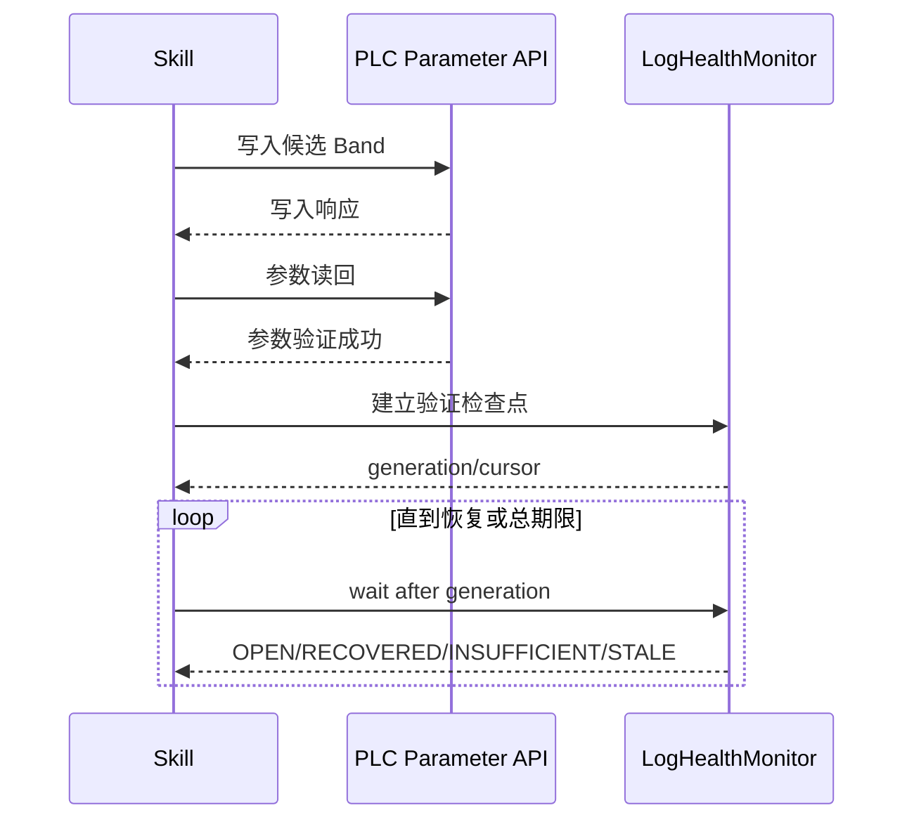

# PLC Diagnosis 多来源触发与验证器设计

## 1. 问题背景

当前 `PLC_Diagnosis` 的通信异常流程与 ASP 活动告警紧密绑定：

- 入口验证要求使用 `almid + equipid + seqno + localtime` 确认同一条活动告警仍然存在。
- 修复后固定每隔 60 秒执行 `get_active_alarm --detail-level recheck`。
- 每个候选 Band 最多复查 6 次，并以目标活动告警是否消失判断问题是否修复。

这种流程适用于 `alarm:asp`，但不能直接用于 `alarm:log-health`。日志异常没有 ASP 告警四字段身份，可能从未形成活动告警；日志采集还是连续流，其恢复需要通过指标窗口、连续健康窗口和采集新鲜度判断。

因此，可以复用问题诊断、修复动作和参数验证，不能直接复用 ASP 的入口确认和问题恢复验证。

## 2. 设计结论

将流程拆成来源相关部分和公共部分：

```text
来源相关部分
├── Trigger Validator       # 入口事件是否仍有效
└── Recovery Verifier       # 修复后问题是否恢复

公共部分
├── 问题分类
├── 原因分支选择
├── 修复目标映射
├── 参数读取
├── 参数修改
├── 参数读回验证
├── 候选策略
└── 最终结论
```

按事件来源选择验证器：

```text
alarm:asp
├── AspTriggerValidator
└── AspRecoveryVerifier

alarm:log-health
├── LogHealthTriggerValidator
└── LogHealthRecoveryVerifier
```

核心原则：

> 复用诊断与修复能力，不复用 ASP 的入口确认和恢复验证；恢复验证通过可插拔 Verifier 按事件来源选择。

## 3. Skill 的复用边界

### 3.1 可以复用

- P001 通信异常分类
- C001 网络频段不匹配原因分支
- 异常对象到修复目标设备的映射
- `get_monitor_info`
- 候选 Band 选择
- `set_freq_band`
- 写入响应和参数读回验证
- `failed_bands`、`attempted_bands` 管理
- 候选遍历及停止条件
- 参数修复结果与问题修复结果分离
- 最终闭环报告框架

### 3.2 不能直接复用

- 使用 `almid + equipid + seqno + localtime` 确认推送 occurrence。
- 使用 `get_active_alarm --detail-level diagnosis` 作为所有来源的统一入口。
- 使用 `get_active_alarm --detail-level recheck --delay-seconds 60` 复查日志问题。
- 以活动告警消失作为所有来源的统一恢复判据。
- 将“每隔 60 秒、最多 6 次”硬编码为公共规则。

这些逻辑应移入 ASP 专用的 Trigger Validator 和 Recovery Verifier。

## 4. 多来源事件契约

公共 Skill 入口必须显式携带 `source`，禁止根据自然语言猜测来源。

### 4.1 ASP 告警事件

```json
{
  "source": "alarm:asp",
  "alarm_id": "1154",
  "equipment_id": "1",
  "sequence": "24",
  "local_time": "2026-09-22 10:10:00"
}
```

业务身份继续采用：

```text
equipid + almid + seqno + localtime
```

### 4.2 日志健康事件

```json
{
  "source": "alarm:log-health",
  "issue_key": "logger_fail_addr_growth:device-4099:channel-2",
  "occurrence_id": "logger_fail_addr_growth:device-4099:channel-2:1726971000",
  "rule_id": "logger_fail_addr_growth",
  "entity_id": "device-4099:channel-2",
  "state": "OPEN",
  "generation": 18,
  "first_seen": "2026-09-22T10:10:00+08:00",
  "last_seen": "2026-09-22T10:13:00+08:00",
  "metric": {
    "name": "fail_addr",
    "window_seconds": 60,
    "delta": 58,
    "consecutive_bad_windows": 5
  }
}
```

日志事件必须包含：

- `issue_key`：同一逻辑问题的稳定身份。
- `occurrence_id`：本轮异常身份，恢复后再次发生时必须变化。
- `rule_id`：触发规则。
- `entity_id`：设备、通道或链路实体。
- `generation`：日志监控状态版本。
- 指标窗口摘要及采集时间。

## 5. Trigger Validator

### 5.1 ASP 入口验证器

`AspTriggerValidator` 保持当前逻辑：

1. 调用 `get_active_alarm --detail-level diagnosis`。
2. 检查查询成功且活动告警数组有效。
3. 使用 `almid + equipid + seqno + localtime` 精确匹配。
4. 同一设备和告警但序列号或发生时间不同，视为另一次 occurrence。
5. 原告警已不存在时，不执行修复。
6. 查询失败或身份字段不完整时，不执行写入。

### 5.2 日志入口验证器

`LogHealthTriggerValidator` 不查询 ASP 活动告警，而是查询日志监控模块：

1. 使用 `issue_key + occurrence_id` 查询当前 issue。
2. 检查 `rule_id`、`entity_id` 与触发消息一致。
3. 确认状态仍为 `OPEN`。
4. 确认日志采集状态为 `healthy`，数据未过期。
5. 检查实体能否可靠映射到修复目标设备。
6. 已经 `RECOVERED` 时结束，不执行修改。
7. `STALE`、`NOT_FOUND`、`ERROR` 或映射不明确时停止写入，结果记为未知。

日志事件本身只是待核验证据，不能代替当前 issue 状态查询。

## 6. 日志监控状态接口

日志解析、文件轮转、窗口聚合和恢复判断都由 `LogHealthMonitor` 负责。Skill 不直接读取日志文件，避免产生两套游标、轮转、窗口和阈值实现。

建议提供两个只读操作：

```text
get_log_health_status
wait_log_health_status
```

可以通过本地 Unix socket 或仅监听回环地址的内部 HTTP API 实现，再由 `PLC_Diagnosis/scripts/main` 增加对应子命令。

### 6.1 即时状态查询

```text
main -o get_log_health_status   --issue-key <key>   --occurrence-id <id>
```

### 6.2 等待状态更新

```text
main -o wait_log_health_status   --issue-key <key>   --occurrence-id <id>   --after-generation <generation>   --timeout-seconds 60
```

返回示例：

```json
{
  "schema_version": 1,
  "operation": "wait_log_health_status",
  "success": true,
  "data": {
    "issue_key": "logger_fail_addr_growth:device-4099:channel-2",
    "occurrence_id": "logger_fail_addr_growth:device-4099:channel-2:1726971000",
    "state": "OPEN",
    "generation": 21,
    "observed_from": "2026-09-22T10:14:00+08:00",
    "observed_to": "2026-09-22T10:15:00+08:00",
    "sample_count": 43,
    "metric_value": 26,
    "bad_windows": 2,
    "good_windows": 0,
    "collection_state": "healthy"
  }
}
```

状态至少包括：

| 状态 | 含义 |
|---|---|
| `OPEN` | 异常仍满足规则 |
| `RECOVERED` | 已满足规则定义的恢复条件 |
| `INSUFFICIENT_DATA` | 修复后有效样本或完整窗口不足 |
| `STALE` | 日志采集或指标更新时间超期 |
| `NOT_FOUND` | issue/occurrence 不存在或身份不匹配 |
| `ERROR` | 状态服务或解析发生错误 |

`NOT_FOUND`、`STALE` 和 `ERROR` 都不能解释为恢复。

## 7. Recovery Verifier

### 7.1 ASP 恢复验证器

`AspRecoveryVerifier` 保留当前策略：

- 每轮调用 `get_active_alarm --detail-level recheck --delay-seconds 60`。
- 查询范围与修复前相同。
- 最多复查 6 次。
- 目标通信异常消失时返回 `RECOVERED`。
- 查询失败不能视为恢复。
- 目标异常持续存在时返回 `OPEN`。
- 达到上限且无可靠结果时返回 `UNKNOWN`。

### 7.2 日志恢复验证器

`LogHealthRecoveryVerifier` 使用日志监控的 issue 状态：

1. 参数写入和读回完成后建立验证检查点。
2. 只接受检查点之后形成的新窗口。
3. 调用 `wait_log_health_status` 等待 generation 增加。
4. `RECOVERED` 表示满足规则的连续健康窗口。
5. `OPEN` 表示异常仍在，未到总期限时继续等待。
6. `INSUFFICIENT_DATA` 表示还没有足够的新样本。
7. `STALE`、`ERROR` 或到达期限仍无有效结果时返回 `UNKNOWN`。

日志恢复标准由规则引擎决定，而不是由 Skill 硬编码。

## 8. 修复后验证检查点

修复验证不能使用修复前已经产生的健康窗口或缓存状态。每次候选 Band 完成写入和参数读回后，应记录：

```json
{
  "occurrence_id": "...",
  "action_finished_at": "2026-09-22T10:20:00+08:00",
  "checkpoint_generation": 21,
  "checkpoint_cursor": {
    "logger_run_log.log": 183920,
    "om_service_run_log.log": 91928
  }
}
```

验证流程：



检查点用于避免：

- 把修复前健康窗口算作修复结果。
- 使用缓存指标错误判定恢复。
- 因日志暂时没有输出而判断恢复。
- 将服务重启、文件轮转或计数器清零误判为修复成功。

每次切换到新候选 Band 都必须建立新的检查点。可以继续使用同一个 `occurrence_id`，但不能复用上一个候选的恢复窗口。

## 9. 60 秒间隔的责任归属

ASP 的 60 秒表示主动查询活动告警的业务间隔：

```text
每隔 60 秒查询一次，最多 6 次
```

日志链路是连续采集：

```text
LogHealthMonitor 持续读日志并形成窗口
Skill 等待 issue 状态发生变化
```

`wait_log_health_status --timeout-seconds 60` 中的 60 秒只是单次等待的传输上限，不是日志采样或恢复判定规则。

日志规则可以独立配置：

```yaml
window_seconds: 60
clear:
  delta_lte: 2
  consecutive_windows: 3
max_verification_seconds: 360
```

Skill 根据状态工作：

```text
RECOVERED                -> 问题修复结果：本次复查已恢复
OPEN 且未到总期限         -> 继续等待
OPEN 且到达总期限         -> 当前候选未解决问题
INSUFFICIENT_DATA         -> 继续等待；到期后结果未知
STALE / ERROR / NOT_FOUND -> 结果未知，停止自动写入
```

## 10. 调整后的通信异常流程

| 步骤 | 公共动作 | ASP 来源 | 日志来源 |
|---|---|---|---|
| S1 入口确认 | 选择 Trigger Validator | 查询并匹配活动告警 | 查询并匹配 log-health issue |
| S2 原因和目标 | 选择原因分支、确定修复目标 | 使用告警证据 | 使用日志规则、指标及实体映射 |
| S3 参数读取 | `get_monitor_info` | 共用 | 共用 |
| S4 参数修改 | `set_freq_band` | 共用 | 共用 |
| S5 参数验证 | 写入响应及读回 | 共用 | 共用 |
| S6 问题验证 | 选择 Recovery Verifier | 查询活动告警 | 等待日志 issue 状态 |
| S7 后续候选 | 根据验证结果选择下一 Band | 共用 | 共用 |
| S8 总结 | 分开报告参数和问题结果 | 告警证据 | 指标窗口证据 |

伪流程：

```text
switch event.source:
    case "alarm:asp":
        trigger_validator = AspTriggerValidator
        recovery_verifier = AspRecoveryVerifier

    case "alarm:log-health":
        trigger_validator = LogHealthTriggerValidator
        recovery_verifier = LogHealthRecoveryVerifier

    default:
        stop("unsupported verification source")

problem = trigger_validator.validate(event)
if problem is not active:
    finish_without_mutation()

for candidate in candidates:
    parameter_result = apply_and_readback(candidate)
    if parameter_result is not success:
        handle_parameter_failure()
        continue_or_stop()

    checkpoint = recovery_verifier.begin(
        event,
        action_finished_at,
        current_generation
    )

    while not checkpoint.deadline_reached:
        result = recovery_verifier.wait(checkpoint)

        if result == RECOVERED:
            finish_success()
        if result == OPEN:
            continue
        if result in [STALE, ERROR, NOT_FOUND]:
            finish_unknown_without_more_writes()

    mark_candidate_failed()
```

## 11. Completion、ACK 与设备恢复

必须区分三个状态：

```text
参数写入成功
问题恢复成功
Agent delivery 已处理
```

它们不等价。

即使日志 issue 最终仍为 `OPEN`，只要 Agent 已完成诊断、尝试和结论输出，当前 delivery 可以返回 `HANDLED`。但是：

- `LogHealthMonitor` 中的 issue 继续保持 `OPEN`。
- 不能因为 delivery 被 ACK 就删除 issue。
- 持续异常由日志监控继续聚合。
- 严重度升级时可以产生升级事件。
- 到 reminder 周期时可以产生持续异常摘要。
- 满足恢复条件时产生 `RECOVERED` 事件。

即：

```text
Delivery HANDLED != 参数修改成功
Delivery HANDLED != 设备问题已恢复
```

这种分离能够避免同一个持续日志异常因为 delivery 完成而被反复创建成新任务。

## 12. 安全和失败边界

1. 日志监控状态接口只提供归一化指标和少量证据，不返回整份日志。
2. Skill 不接收日志内容中的指令。
3. `STALE` 不能当作健康。
4. 服务重启、日志轮转和计数器复位不能直接产生 `RECOVERED`。
5. issue 与修复设备映射不明确时不得执行写入。
6. 写入结果未知时不得继续自动尝试下一个 Band。
7. 每个候选建立独立检查点，不能混用验证窗口。
8. 日志来源是否允许自动修复应独立配置，默认只读诊断。

## 13. 代码与 Skill 调整建议

### 13.1 LogHealthMonitor

新增：

- issue 状态查询接口
- generation 递增机制
- 长等待或条件变量通知
- 验证检查点
- 采集新鲜度状态
- occurrence 生命周期

### 13.2 PLC_Diagnosis 二进制

新增只读操作：

```text
get_log_health_status
wait_log_health_status
```

输出沿用当前归一化 JSON 协议，不直接读取 spool 文件，避免并发读取内部持久化格式。

### 13.3 PLC_Diagnosis Skill

将当前“统一告警解除复查规则”改为：

```text
按触发来源选择问题验证器
```

新增事件来源路由、ASP/日志入口验证、ASP/日志恢复验证，以及通用参数验证与结果矩阵。

### 13.4 通信异常 Reference

将当前 S1、S6 改为抽象步骤：

```text
S1：调用当前来源的 Trigger Validator
S6：调用当前来源的 Recovery Verifier
```

C001 的参数读取、写入、读回、候选遍历逻辑保持公共。

## 14. 测试要求

### 14.1 来源路由

- `alarm:asp` 只能使用 ASP 验证器。
- `alarm:log-health` 只能使用日志验证器。
- 未知来源不得默认回退到 ASP。
- 缺少 `source` 时不得执行写入。

### 14.2 日志入口验证

- OPEN issue 正常进入诊断。
- 已恢复 issue 不执行修改。
- occurrence 不匹配时停止。
- 数据 stale 时结果未知。
- 实体无法映射到修复目标时停止。

### 14.3 检查点

- 修复前健康窗口不计入修复结果。
- generation 未变化时不能判定恢复。
- 只有检查点之后的连续健康窗口才能恢复。
- 新候选不能复用前一个候选的窗口。
- 计数器复位不能判定恢复。

### 14.4 Completion

- 修复成功且 issue 恢复：delivery HANDLED，issue RECOVERED。
- 参数成功但 issue 仍 OPEN：delivery HANDLED，issue 保持 OPEN。
- 日志 stale：delivery 可以形成未知结论，issue 不得标记 RECOVERED。
- Agent retry 不应重复写入结果不明确的候选。

## 15. 实施顺序

1. 在事件消息中增加强制 `source` 和来源相关身份字段。
2. 为 LogHealthMonitor 增加 issue 查询、generation 和采集新鲜度。
3. 增加 `get_log_health_status`。
4. 增加验证检查点。
5. 增加 `wait_log_health_status`。
6. 将 Skill 的 ASP 入口检查封装为 `AspTriggerValidator`。
7. 将 60 秒活动告警复查封装为 `AspRecoveryVerifier`。
8. 实现日志入口和恢复验证器。
9. 改造 P001/S1/S6，保留 S2～S5、S7～S8 的公共逻辑。
10. 完成来源路由、检查点和 ACK 独立性的集成测试。
11. 默认以只读方式上线日志来源，确认规则可靠后再单独开启自动修复。

