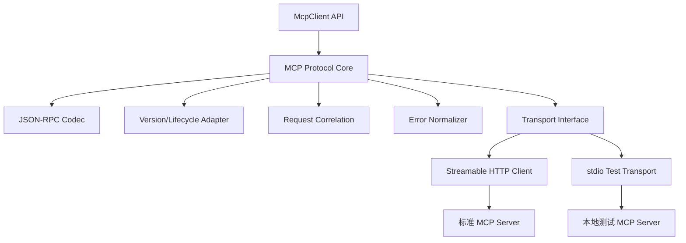
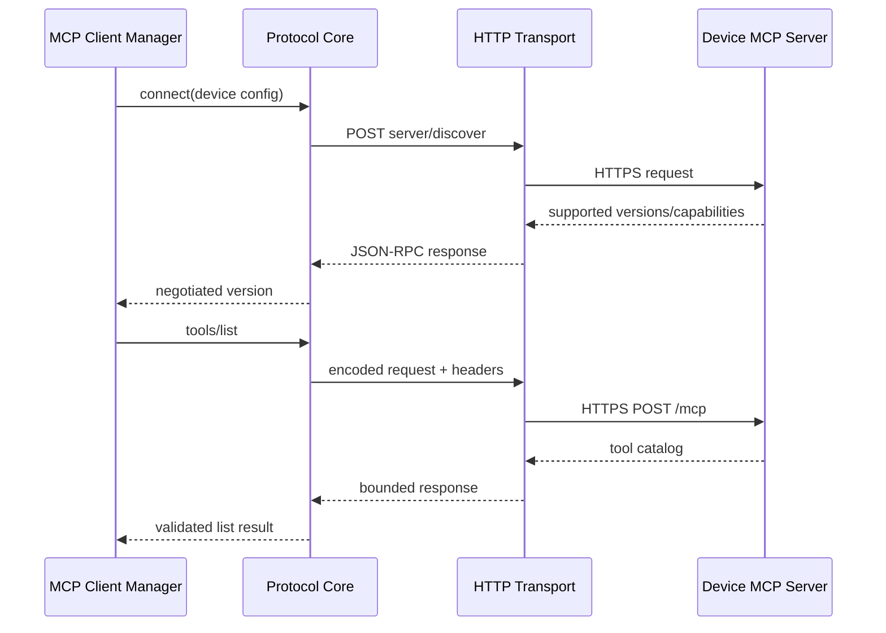
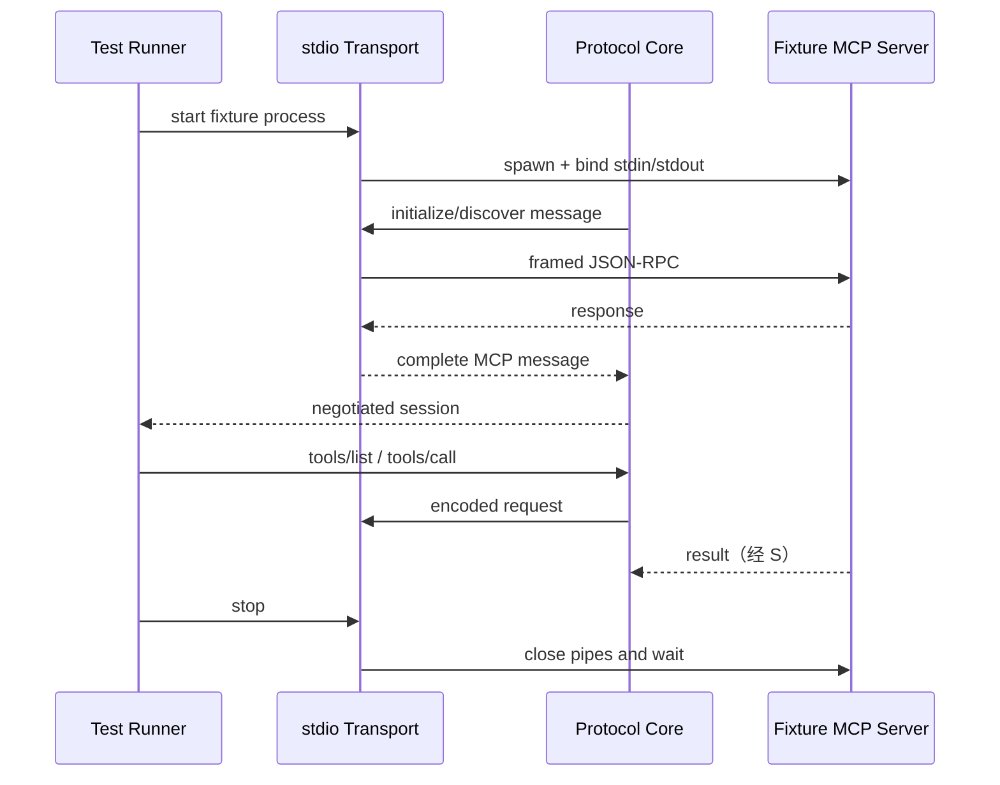
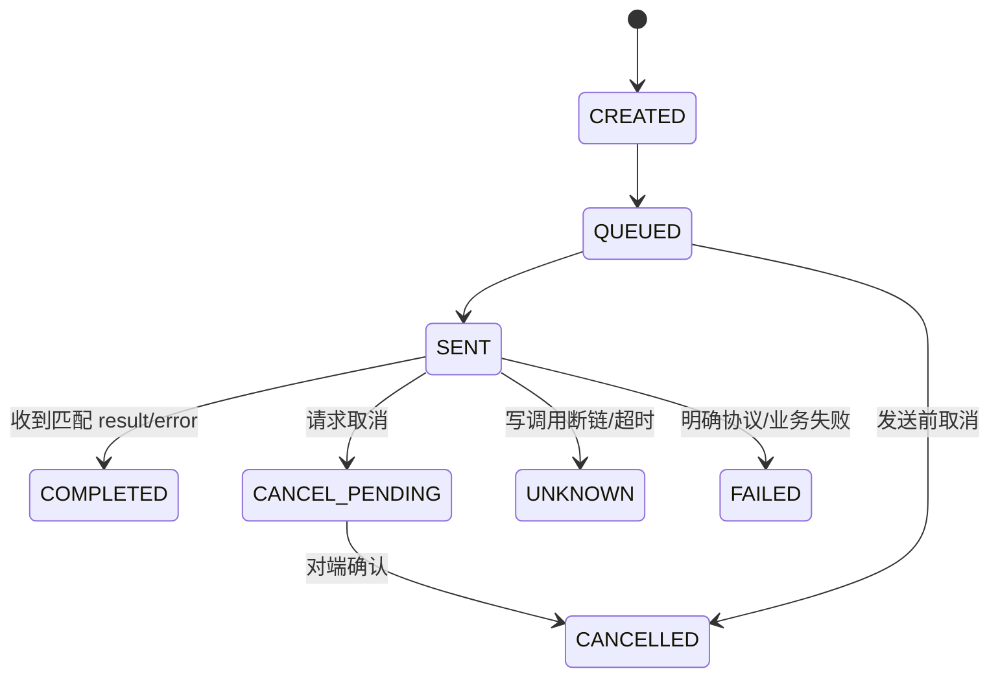

# MCP 协议与传输架构

## 1. 子功能目标

本模块在 C11 中实现有界的 MCP Client 协议核心。生产传输只采用标准 Streamable HTTP，stdio 仅供本地互操作和单元测试。业务 Provider、Capability Catalog 和 Agent Kernel 不处理协议版本差异。

## 2. 组件架构



`McpTransport` 只负责发送和接收完整 MCP 消息，不解析 Tool 业务字段；Protocol Core 不直接操作 socket、curl 或 TLS。

## 3. C 接口边界

```c
typedef struct McpTransport McpTransport;
typedef struct McpClient McpClient;

typedef struct {
    int (*start)(McpTransport*);
    int (*send)(McpTransport*, const char* json, size_t len, int64_t deadline_ms);
    int (*cancel)(McpTransport*, uint64_t request_id);
    void (*stop)(McpTransport*);
} McpTransportOps;
```

Transport 接收缓冲由 Transport 持有；完成消息通过回调移交 Protocol Core。所有回调必须说明线程上下文和内存所有权。

## 4. 协议版本策略

| 对端 | 首选版本 | 生命周期 |
|---|---|---|
| 新标准设备 | `2026-07-28` | `server/discover`，请求级元数据 |
| 兼容标准设备 | `2025-11-25` | `initialize` + initialized |

实现使用版本表和函数指针选择编码/生命周期，不在业务代码散落版本判断。对端返回未知版本时拒绝连接并记录支持列表。

## 5. 标准 HTTP 调用流程



HTTP Transport 复用现有 libcurl/OpenSSL 静态依赖。必须校验证书、主机名、Content-Type、响应长度、HTTP 状态和 Header/body 一致性；禁止从 Tool 参数接收 endpoint。

## 6. stdio 测试流程



stdio Transport 不进入生产设备配置，不对外监听，也不承载用户消息。它复用同一 Protocol Core，用于协议向量、生命周期、取消和错误归一测试。

## 7. 请求关联状态机



关联表固定容量，key 为内部 64 位 requestId，并在编码时转换为合法 JSON-RPC id。收到未知、重复或已完成 id 时丢弃并记录计数。

## 8. 消息限制

| 边界 | 行为 |
|---|---|
| 非 UTF-8/非法 JSON | 协议失败，必要时关闭连接 |
| JSON 深度/Token 超限 | 拒绝，不扩容 |
| 单消息超限 | 中止读取并标记对端异常 |
| tools/list 分页过多 | 达到页数/总字节上限后隔离设备 |
| 重复 JSON-RPC id | 拒绝或忽略，不覆盖关联项 |
| 未协商先调用 | 标准旧版本返回生命周期错误 |

## 9. 测试

- JSON-RPC request/result/error/notification 编解码向量。
- 两种标准协议版本生命周期互操作。
- HTTP 分片、chunked、空响应、错误 Content-Type 和超大响应。
- stdio 进程异常退出、半关闭、超时和畸形消息。
- fuzz JSON parser、HTTP 响应入口和版本协商入口。

## 10. 当前状态

首版已实现独立于 TCP 用户入口的 Streamable HTTP Client，支持 `2026-07-28` 发现流程、`2025-11-25` initialize/session 兼容流程、JSON 与 request-scoped SSE 响应、请求 ID/版本/header 校验、超时和响应上限。尚未实现 stdio、SSE 长连接、服务器主动消息、取消和分页。
