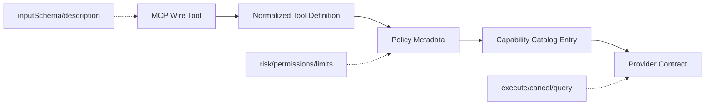
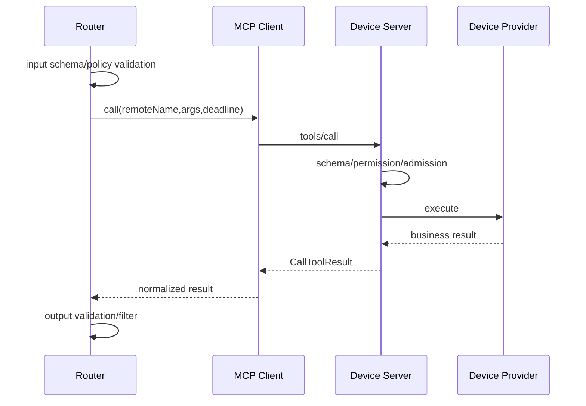
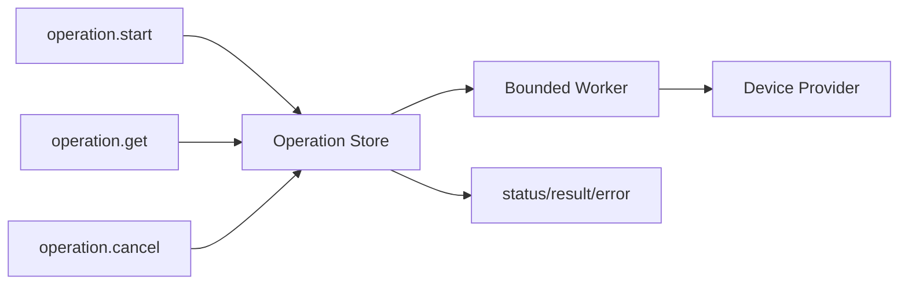
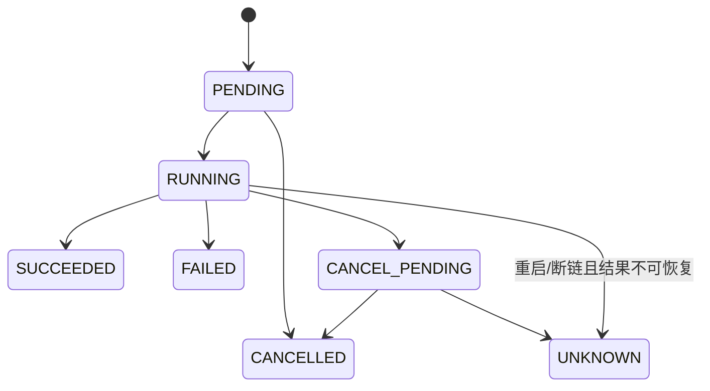

# Tool 契约与长操作架构

## 1. 子功能目标

本模块规定设备 Tool 如何定义输入、输出、风险、执行时限和幂等语义，并处理无法在一次短 `tools/call` 内完成的设备操作。非 Tool 类业务数据不属于本模块。

## 2. 契约分层



设备只提供 Wire Tool 定义。风险、权限、超时和是否允许模型调用由 LiteCrab 配置补充，不能信任设备自报 annotations。

## 3. Tool 定义

```text
ToolContract
  publicName
  remoteName
  inputSchema
  outputSchema（可选）
  riskClass
  timeoutMs
  maxInputBytes
  maxOutputBytes
  idempotencyPolicy
  cancellationPolicy
```

### 3.1 输入

首期接受根类型为 object 的 JSON Schema。无参数工具使用：

```json
{"type":"object","additionalProperties":false}
```

调用参数必须先由 LiteCrab 校验，设备端再次校验。两次校验防止模型错误和链路绕过；任何一侧失败都不得执行 Provider。

### 3.2 输出

优先返回 `structuredContent`，同时允许简短 text content。结果必须满足 outputSchema（如果存在），并在进入模型前进行过滤、截断和敏感字段处理。

## 4. 短调用流程



适合短调用的操作包括状态读取、参数读取和能够在固定 deadline 内确认结果的窄范围设置。

## 5. 长操作架构



固件升级、批量诊断、耗时修复等不能长期占用连接 worker。首期定义显式工具：

```text
operation.start -> operationId
operation.get   -> status/progress/result
operation.cancel -> accepted/finalStatus
```

未来若采用稳定 Tasks extension，只在协议层映射到同一 Operation Store，不改变业务 Provider。

## 6. Operation 状态机



状态只能单向进入终态。SUCCEEDED、FAILED、CANCELLED、UNKNOWN 不得回退到 RUNNING。

## 7. 幂等设计

| 类型 | 策略 |
|---|---|
| 只读 | 可在确认未执行时限次重试 |
| 天然幂等写 | 使用 operationId 去重，重复返回首次结果 |
| 非幂等写 | 默认不重试，断链进入 UNKNOWN |
| 长操作 | operationId 查询，不重复 start |

设备端幂等记录至少包含 operationId、toolName、参数 hash、身份、状态、结果摘要和过期时间。相同 operationId 配不同参数必须拒绝。

## 8. 存储与资源

Operation Store 使用固定 slot 或有界文件，不引入重量数据库。达到容量时拒绝新长操作，但允许查询/取消现有操作。终态按 TTL 清理；UNKNOWN 的审计保留时间应长于普通成功结果。

## 9. 错误处理

- 参数错误：`INVALID_ARGUMENT`，不创建 operation。
- 队列满：`RESOURCE_EXHAUSTED`。
- Provider 明确失败：`FAILED/BUSINESS_ERROR`。
- 请求已送达但结果不可确认：`UNKNOWN`。
- 结果过期：明确 `NOT_FOUND/EXPIRED`，不能假设失败。

## 10. 验收

- Schema 双层校验能阻止非法参数执行。
- outputSchema 不匹配时结果不进入模型。
- 相同 operationId 重复请求只产生一次副作用。
- 重启后可查询未完成/UNKNOWN 操作。
- 长操作不长期占用 MCP HTTP worker。
- Operation Store 满时行为有界且可恢复。

## 11. 当前状态

首版实现简单 object Schema 到 Runtime 参数契约的转换，支持 string/integer/boolean、required、整数范围和字符串 maxLength；设备 Server 提供四个无生产副作用的演示 Tool。outputSchema、复杂 JSON Schema、Tasks、operationId、持久化状态和 UNKNOWN 尚未实现。
