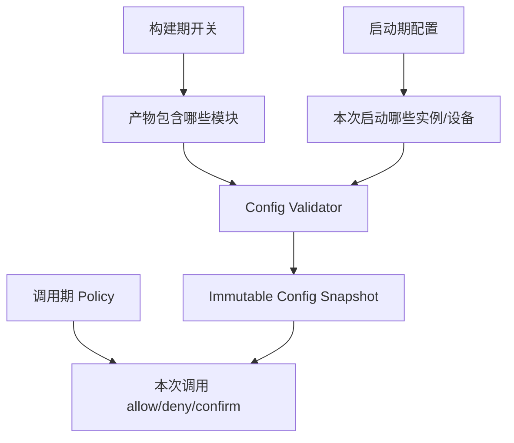
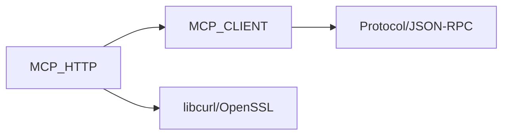
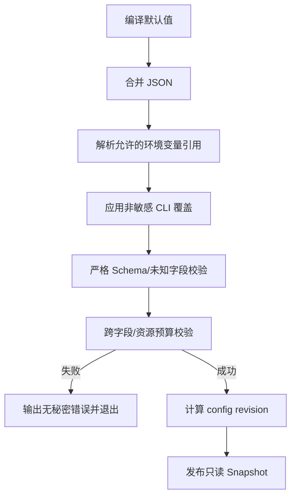
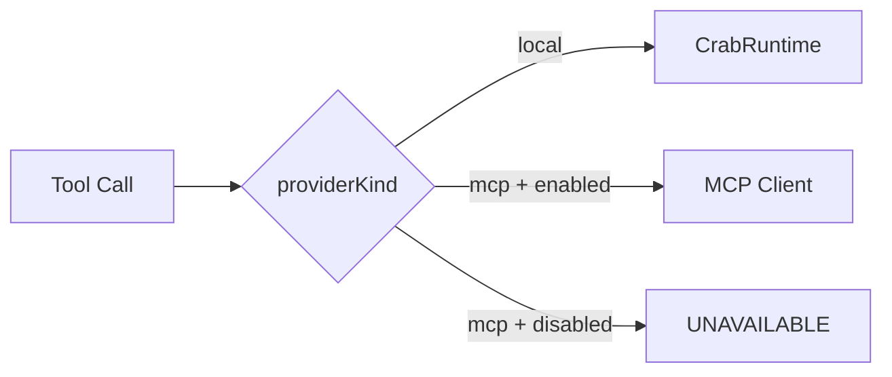

# MCP 配置、构建开关与校验架构

## 1. 子功能目标

配置模块决定 MCP 代码是否进入产物、进程是否启动 MCP、接入哪些设备以及每个 Tool 是否允许调用。配置加载后生成不可变快照，业务线程不直接读取环境变量。

## 2. 三层控制



构建期关闭表示代码和依赖不进入二进制；启动期关闭表示代码存在但不启动；调用期策略针对具体身份、设备和参数决策。

## 3. 构建期开关

```text
LITECRAB_WITH_MCP_CLIENT=ON|OFF
LITECRAB_WITH_MCP_HTTP=ON|OFF
```

依赖约束：



当前 HTTP 与 Client 是一个完整功能单元：两者必须同时开启或同时关闭；非法组合在 CMake 配置阶段报错。

## 4. 配置结构

```json
{
  "mcp": {
    "enabled": true,
    "required": false,
    "limits": {
      "max_devices": 8,
      "max_total_tools": 128,
      "max_inflight": 4,
      "max_message_bytes": 262144
    },
    "devices": [
      {
        "id": "sd5091-01",
        "alias": "power_room_1",
        "enabled": true,
        "transport": "streamable-http",
        "url": "https://192.168.8.10:8443/mcp",
        "tls_profile": "factory-ca",
        "required": false
      }
    ]
  }
}
```

## 5. 配置加载流程



未知字段默认报错，避免拼写错误被静默忽略。秘密只能通过环境变量名或受保护文件引用，不写入普通 JSON 和命令行。

## 6. 跨字段校验

必须拒绝：

- `mcp.enabled=true`，但构建不含 MCP Client。
- 配置 HTTP 设备，但构建关闭 MCP HTTP。
- 重复 deviceId/alias 或非法 publicName 命名空间。
- HTTPS 设备缺少 CA/证书策略，或配置允许静默降级明文。
- Tool/设备/连接/消息预算超过编译硬上限。
- 设备 URL 来自运行时 Prompt/Tool 参数。

## 7. 本地 Tool 行为



关闭 MCP 不影响 local Provider。远端 Provider 不允许静默切换成本地同名 Tool，除非配置定义了经过验证的显式 fallback。

## 8. 动态修改边界

首期监听地址、Transport 类型、凭据引用和总资源预算只在重启后生效。设备上线/离线和工具目录变化属于运行状态，不修改 Config Snapshot。证书轮换若需热更新，使用独立事务和新 TLS context。

## 9. 配置文件规划

```text
config/mcp/local-lan.example.json
config/mcp/sd5091-agent.example.json
config/mcp/device-policy.example.json
config/mcp/tls-profiles.example.json
```

## 10. 验收

- 所有合法开关组合可构建；非法依赖组合在 CMake 阶段失败。
- 默认配置不监听 MCP 网络端口。
- MCP 关闭时本地 Tool 回归通过。
- 未知字段、缺失秘密、重复设备和预算超限均启动失败。
- 启动日志只记录引用名、revision 和非敏感摘要。

## 11. 当前状态

首版已实现 `mcp.enabled/required/connect_timeout_ms/request_timeout_ms/limits.max_message_bytes/devices`，设备支持 `id/alias/enabled/required/transport/url/ca_file/client_cert_file/client_key_file/token_env`。配置示例见 `config/mcp/local-lan.example.json`。TLS Profile、Tool Policy、动态重载、未知字段全量拒绝和目录预算配置仍未实现。
