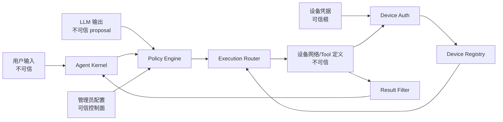
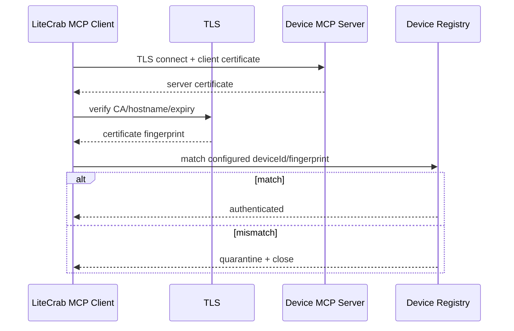
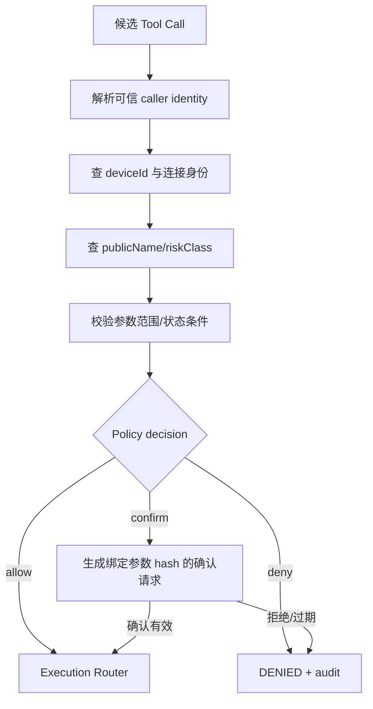

# MCP 设备接入安全架构

## 1. 子功能目标

安全模块确认“哪台设备、哪个用户、哪个 Tool、哪些参数”可以执行，并阻止网络、设备、模型和工具结果跨越各自信任边界。

## 2. 信任边界

设备完成认证只证明设备身份，不代表该设备所有 Tool 自动可信。模型提出调用也只是 proposal，必须经过 Policy。

## 3. 威胁模型

| 威胁 | 例子 | 控制 |
|---|---|---|
| 冒充设备 | 伪造 Device-Id | mTLS/每设备 Token，绑定 Registry |
| Tool 投毒 | 描述诱导模型泄密 | 描述清洗、管理员覆盖、长度限制 |
| 越权调用 | 普通用户写 PLC | identity + device + tool + args Policy |
| SSRF | 模型提供内网 URL | endpoint 只来自可信配置 |
| 重放 | 重复写参数 | operationId、时间窗、幂等记录 |
| DNS/路由劫持 | Client 被引到伪造设备 endpoint | TLS 主机名、证书链和地址 allowlist |
| 资源耗尽 | 巨型 Schema/结果、连接洪泛 | 全层容量与速率限制 |
| 秘密泄漏 | Token 进入 trace | 字段脱敏和最小记录 |

## 4. 设备认证流程

### 4.1 标准 HTTP 设备

若设备不使用 mTLS，可由 LiteCrab 在出站请求中携带每设备独立的短期 Bearer Token；Token 与配置中的 deviceId、endpoint 和 TLS Profile 绑定。MCP 消息内自报的设备标识不能覆盖已认证的连接身份。

## 5. 授权流程

确认记录绑定 user、device、Tool、参数 hash、Policy revision 和过期时间；不能用一次确认授权不同参数。

## 6. 风险分级

| 风险 | 示例 | 默认策略 |
|---|---|---|
| readonly | 状态/测量/参数读取 | allowlist 后可调用 |
| mutating | 音量、亮度、有界参数写入 | 权限、参数范围、operationId |
| destructive | 重启、升级、清除、复位 | 默认隐藏，显式确认和专用权限 |

Shell、任意 URL、任意路径文件和通用 PLC 写接口不得作为远端通用 Tool 暴露；应拆成窄能力。

## 7. 网络与输入安全

- HTTP Client 校验 TLS 证书链、主机名、Content-Type、协议版本和 Header/body 一致性。
- 不自动跟随跨主机重定向。
- DNS 解析结果仍需满足地址 allowlist。
- JSON 使用有界 parser，限制深度、token 数、字符串和总字节。
- 目录和结果均视为不可信，进入模型前过滤。

## 8. 秘密管理

配置只保存 `tokenEnv`、证书和私钥文件路径。日志记录凭据引用和证书指纹摘要，不记录 Authorization、私钥、设备密码或完整 Token。关闭时清零进程内敏感缓冲。

## 9. 安全失败原则

认证、证书、Policy、Schema 或审计初始化失败时，对应远端能力 fail closed。本地只读 Tool 是否继续运行由 `mcp.required` 决定，但不能为恢复可用性而关闭认证或扩大权限。

## 10. 验收

- 伪造 deviceId、错证书、过期证书和 Token 重放被拒绝。
- 主机名不匹配、跨主机重定向和私网 URL 注入被阻止。
- 设备 Tool 描述不能改变 Policy。
- destructive Tool 未确认不能执行。
- 参数变化使旧确认失效。
- 日志和 trace 通过秘密扫描。
- fuzz 网络帧、JSON、Schema，不崩溃且资源有界。

## 11. 当前状态

首版已将 MCP endpoint 与无认证 TCP 用户入口隔离；Client 禁止重定向、仅允许 loopback 明文 HTTP、支持 CA/mTLS 文件和环境变量 Token，并限制消息/名称/Schema；设备 Server 非 loopback 必须配置 Token，拒绝任意未显式允许的 Origin、重复敏感头和 Transfer-Encoding。设备端原生 TLS、细粒度 ACL/确认、证书身份映射和审计闭环尚未实现。
