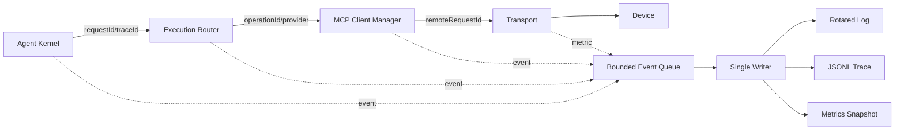
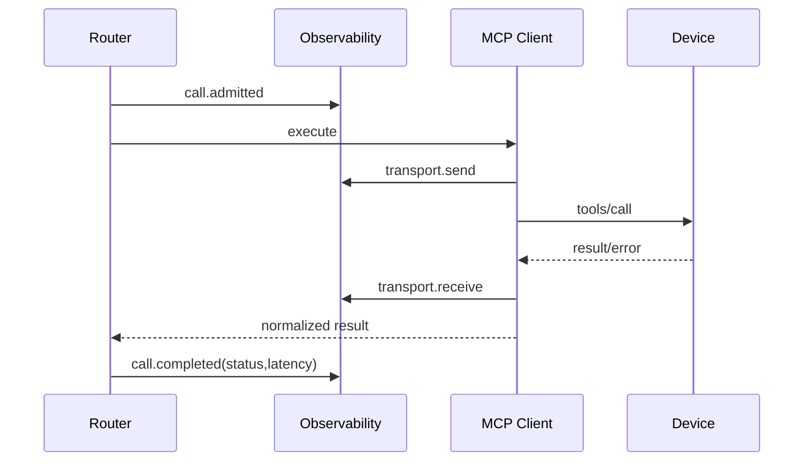
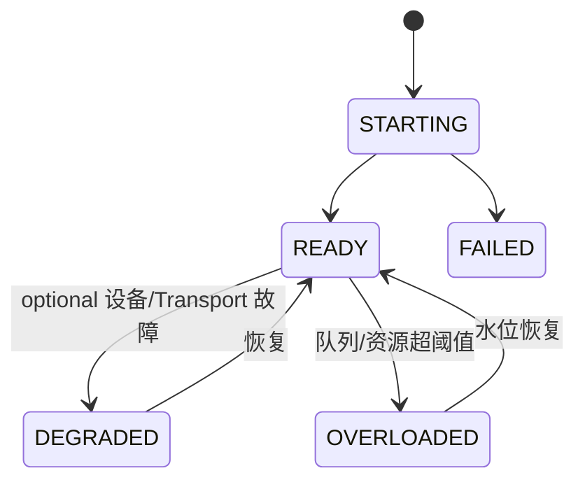
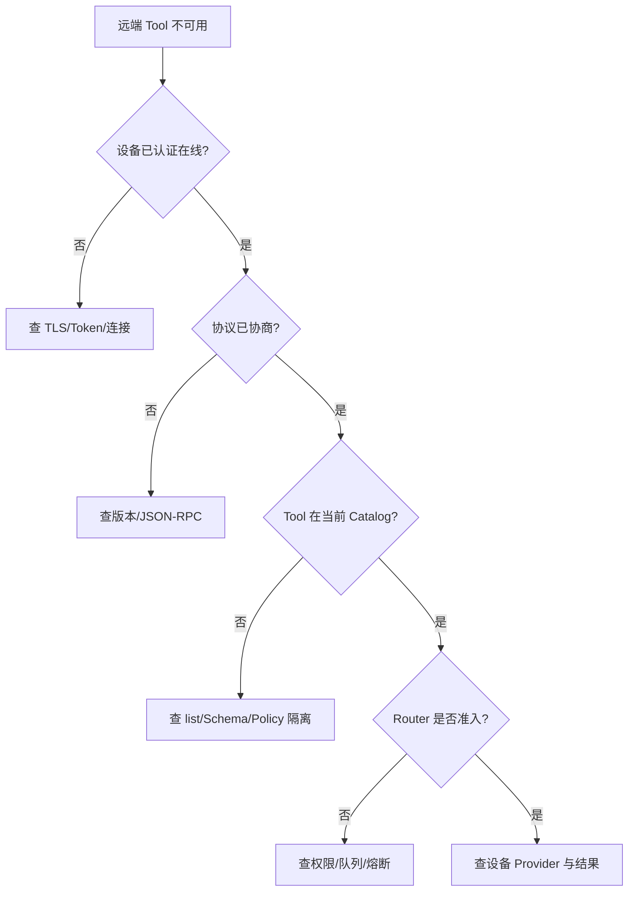

# MCP 可观测与运维架构

## 1. 子功能目标

本模块让一次远端 Tool 调用可以从 Agent requestId 追踪到设备、Transport、协议请求和最终状态，同时控制日志体积和敏感数据范围。

## 2. 观测数据流



业务线程只提交有界结构化事件，不直接执行磁盘 I/O。队列满时按优先级丢弃低价值 debug 事件，但保留安全拒绝和 UNKNOWN 终态计数。

## 3. 关联字段

```text
traceId
agentRequestId
operationId
catalogRevision
deviceId / deviceAlias
providerKind
publicName
remoteNameHash
protocolVersion
transportKind
remoteRequestId
terminalStatus
latencyMs
```

默认不记录完整 arguments、Tool description、Authorization 和完整 result。诊断模式仍需字段 allowlist、脱敏和字节上限。

## 4. 调用时间线



每个 accepted call 必须恰好有一个终态事件；进程异常重启后，通过 Operation Store 恢复的未决调用生成 `call.recovered_unknown`。

## 5. Metrics

| 类别 | 指标 |
|---|---|
| 连接 | configured/online/degraded/quarantined devices |
| 认证 | success/failure/replay/certificate errors |
| 目录 | revision、tool count、rebuild、isolated tools |
| 调用 | admitted、queued、success、error、timeout、unknown |
| 延迟 | queue/connect/send/provider/total P50/P95/P99 |
| 资源 | RSS、线程、FD、队列、水位、消息/结果字节 |
| 熔断 | open/half-open/close 与拒绝数 |

deviceId、原始 Tool 名不得成为无界 metrics label；只使用受控 alias 或聚合桶。

## 6. Health 模型



| 检查 | READY 条件 |
|---|---|
| liveness | 主循环、连接管理和日志 writer 有心跳 |
| readiness | Runtime、Policy、Catalog 可提供服务 |
| MCP readiness | MCP Client Manager 已初始化；required 设备满足策略 |
| device health | 单设备身份、协议、目录和熔断状态 |

optional 设备离线只导致 degraded，不使整个 Agent 不可用。

## 7. 结构化事件

- `mcp.device.connected/disconnected/quarantined`
- `mcp.protocol.negotiated/failed`
- `mcp.catalog.published/tool_isolated`
- `mcp.call.admitted/completed/unknown`
- `mcp.policy.denied/confirmation_required`
- `mcp.circuit.open/half_open/closed`
- `mcp.resource.exhausted`

## 8. 运维流程



## 9. 升级与回滚

MCP 模块随 `litecrab_server` 一起升级。升级前导出 config revision、设备身份绑定和未决 operation；升级后先验证只读工具，再恢复写工具。回滚不得删除 UNKNOWN 和幂等记录。

## 10. 验收

- 每次调用可按 traceId 串联 Agent、Router、Transport 和设备。
- accepted call 不缺失终态事件。
- optional 设备离线只进入 degraded。
- 日志轮转、队列满、磁盘满不形成 CPU 紧密重试。
- 指标 label 数量有界。
- 日志不包含秘密和未经允许的正文。

## 11. 当前状态

首版记录 MCP 启动时 ready device/tool 数量和非敏感错误摘要，Token 在启动时读取且不会写入配置。逐调用 trace/metric、设备 health、目录 revision、熔断状态和专用审计事件尚未实现。
