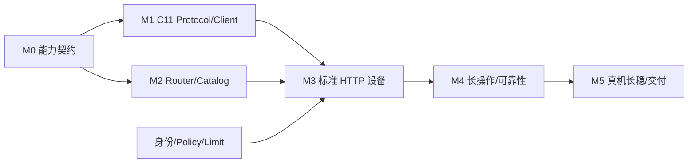
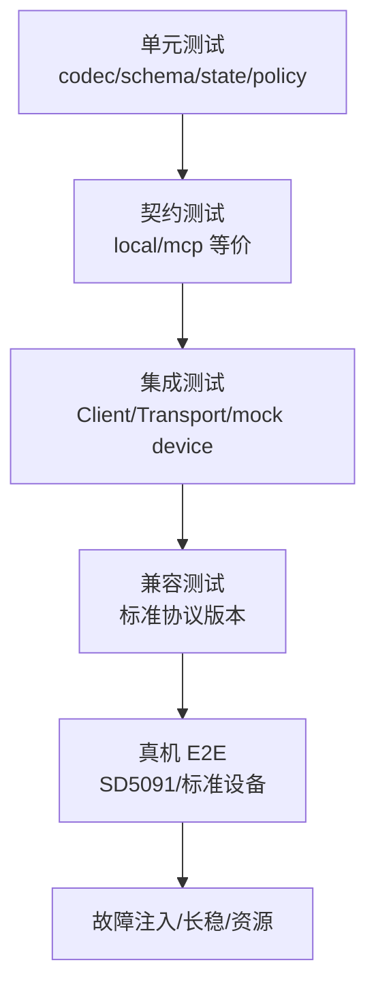
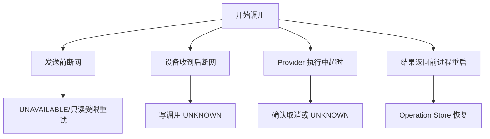

# MCP 分阶段交付与测试架构

## 1. 子功能目标

实施过程必须保持每个阶段可构建、可运行、可回滚。先建立本地/远端统一契约，再增加网络和真实设备；安全控制必须与首个网络版本同步交付。

## 2. 实施依赖图



M0～M2 可以完全在 WSL 使用 mock 完成。M3 首个联网版本只开放只读工具。

## 3. 里程碑

### M0：能力契约与本地适配

交付：CapabilityEntry、Catalog Snapshot、RoutedCall、NormalizedResult、Local Adapter。

验收：当前本地 Tool 契约回归；MCP 代码关闭；Kernel 通过 Tool Facade 调用本地工具。

### M1：C11 MCP Client MVP

交付：JSON-RPC Codec、Protocol Core、stdio Transport、request correlation、C mock MCP Server。

验收：完成版本协商、tools/list、tools/call、错误和取消；无网络监听。

### M2：Catalog 与 Execution Router

交付：本地/远端目录合并、Schema 校验、Provider 路由、deadline、错误归一和结果过滤。

验收：同一契约的 local/mock MCP 结果语义等价；远端失败不影响本地工具。

### M3：标准 Streamable HTTP 设备

交付：libcurl/OpenSSL Transport、静态设备配置、TLS、Device Registry、目录刷新和熔断。

验收：与标准 mock/参考 Server 互操作；证书、Host、响应大小和断网场景通过。

### M4：长操作与可靠性

交付：operationId、Operation Store、UNKNOWN、查询/取消、重启恢复和故障注入。

验收：写调用断链不重复执行；重启后能查询未决责任。

### M5：生产加固与交付

交付：资源预算、指标/健康、交叉编译脚本、systemd/supervisor 配置、部署/回滚手册。

验收：SD5091 真机资源、设备并发、磁盘满、网络风暴和至少 72 小时长稳通过。

## 4. 测试架构



## 5. 测试组件

```text
tests/mcp/test_jsonrpc.c
tests/mcp/test_protocol.c
tests/mcp/test_catalog.c
tests/mcp/test_router.c
tests/mcp/test_device_registry.c
tests/mcp/test_http_transport.c
tests/mcp/mock_mcp_server.c
```

mock MCP Server 使用 C11 测试产物，不要求目标设备安装 Python 或 Go。

## 6. 协议兼容矩阵

| 版本/Transport | 生命周期 | 必测内容 |
|---|---|---|
| 2026-07-28 HTTP | server/discover | header、无状态、list、call、cache |
| 2025-11-25 HTTP | initialize | session、list、call、重连 |
| stdio | 旧/现代测试 | stdout 污染、子进程退出、deadline |

## 7. 故障注入矩阵



还需覆盖证书过期、Token 错误、队列满、Schema 炸弹、结果洪泛、磁盘满、时钟回拨、重复 id 和设备重复连接。

## 8. SD5091 构建与运行验证

所有模块进入现有 CMake，继续使用 `arm-linux-gnueabihf` 静态交叉构建。验证 ELF32/ARM/EABI5、无动态 `NEEDED`，并在板上记录 RSS、VmSize、线程、FD、CPU、队列和日志增长。

建议门槛：MCP 空闲不产生紧密轮询；最大连接和最大在途调用下不 OOM；MCP 停止后所有线程可 join。

## 9. 文档门禁

每个里程碑完成时更新总体文档和对应子文档：状态、真实源文件、配置、命令、测试结果、未验证硬件。尚未实现的功能不得出现在部署指南“已支持”清单。

## 10. 当前状态

M0～M3 的首版最小链路已落地并自动化验证：现代/旧版协议、JSON/SSE、认证、边界、并发、超时、optional offline、恶意响应、真实 Agent 工具循环、配置拒绝、MCP 关闭构建和 SD5091 静态交叉编译。M4/M5、真机执行、故障断点语义、fuzz 和 72 小时长稳仍未完成；详细实测结果见 `12_implementation_and_runbook.md`。
