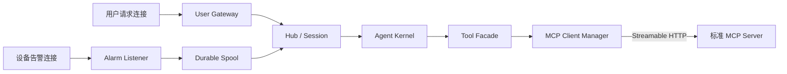
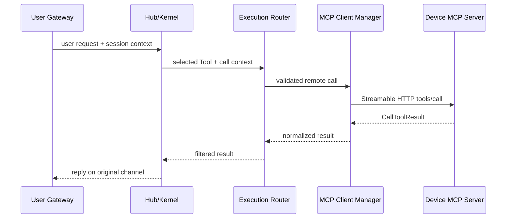
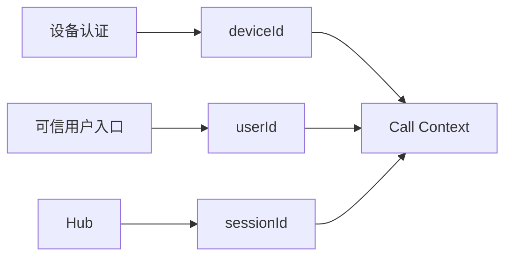
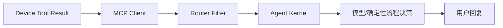

# 用户消息、告警与 MCP 边界架构

## 1. 子功能目标

本子功能定义通用 MCP 与现有用户会话、告警链路的边界。MCP 只处理能力发现和 Tool 调用；用户对话和告警继续使用各自的入口、队列与可靠性语义。

## 2. 入口分流架构



三类流量使用不同 endpoint 和协议栈，不需要在共享连接上猜测消息类型。现有 TCP 输入不能因为 payload 类似 JSON-RPC 就被当成 MCP。

## 3. 通道职责

| 数据 | Owner | 通道 | 可靠性 |
|---|---|---|---|
| 用户请求 | Gateway/Hub | 现有 TCP 或设备会话协议 | requestId + reply routing |
| Agent 回复 | 原用户 Channel | 用户协议 | session/channel 定向 |
| 告警 | Alarm | 专用 listener + durable spool | 先落盘、去重、ACK |
| MCP Tool | MCP Client Manager | 标准 Streamable HTTP | JSON-RPC + operationId |
| 高频遥测 | Telemetry Owner | MQTT/专用协议 | 批量/采样/时序 |

## 4. 独立 endpoint 调用流程



MCP Client 不读取或写入用户 Channel，也不接收告警。Router 只传递一次调用所需的身份、deadline 与 trace 上下文，结果必须回到发起请求的原 Channel。

## 5. 三种身份



- deviceId 代表物理/逻辑设备，由证书或设备凭据确定。
- userId 代表发起操作的人或系统，不能由设备随意自报。
- sessionId 代表对话上下文，由 Hub 管理。

三者不能互相替代。设备认证成功不等于获得某个用户的写权限。

## 6. Tool Result 到用户回复



设备结果不能绕过 Agent 直接进入用户输出。这样可以统一过滤敏感字段、解释业务失败并保持 Session 记录完整。

## 7. 用户消息中继何时需要

只有现场设备本身是用户终端、Agent 运行在其他主机时，才增加专用消息中继。中继定义独立 envelope：

```text
messageId
deviceId
channelId
userIdentityRef
sessionId
contentType
payloadRef/content
createdAt/deadline
```

它需要 ACK、去重、有界 outbox 和回复路由，但不属于 MCP Protocol Core。当前 MCP 实施不以该中继为前置条件。

## 8. 错误隔离

- MCP 设备离线：远端 Tool UNAVAILABLE，用户会话仍可继续。
- 用户 Channel 断开：取消/保存对应对话请求，不关闭设备 MCP 连接。
- 告警投递失败：由 spool 重试，不借用 Tool 重试策略。
- MCP 调用队列满：只拒绝远端 Tool 调用，不挤占用户入口和告警 spool。

## 9. 验收

- 用户、告警、MCP 分别使用独立 endpoint 和有界队列。
- MCP 慢调用不阻塞用户入口和告警落盘。
- Tool Result 必须经过 Router/Kernel 后才能成为用户回复。
- deviceId、userId、sessionId 无法互相伪造替代。
- 告警 spool 语义不因 MCP 接入发生回归。

## 10. 当前状态

当前 TCP 用户入口和 Alarm 链路继续保留。通用 MCP 实施不重写这两条链路，只在 Tool Facade、Execution Router 和调用上下文处建立明确接口。
