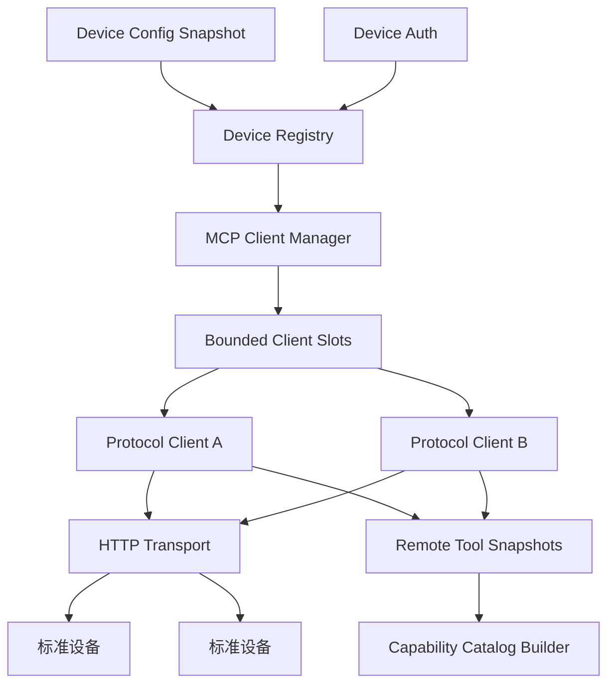
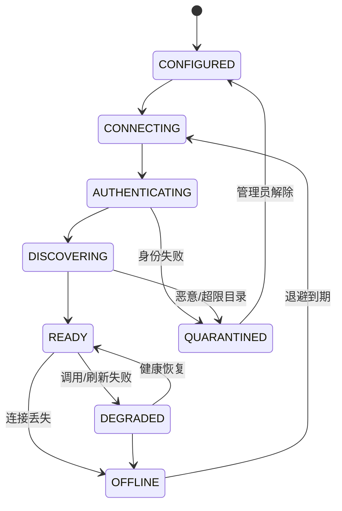
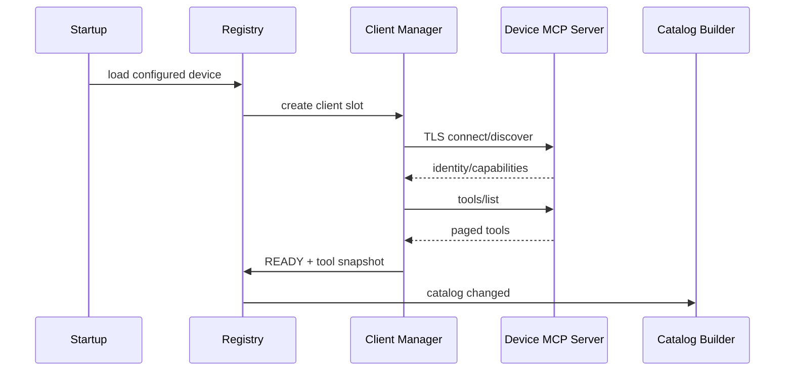
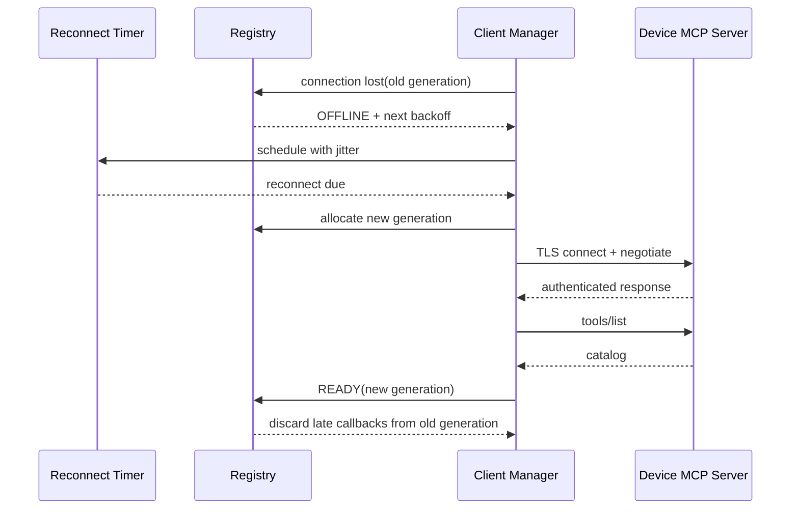
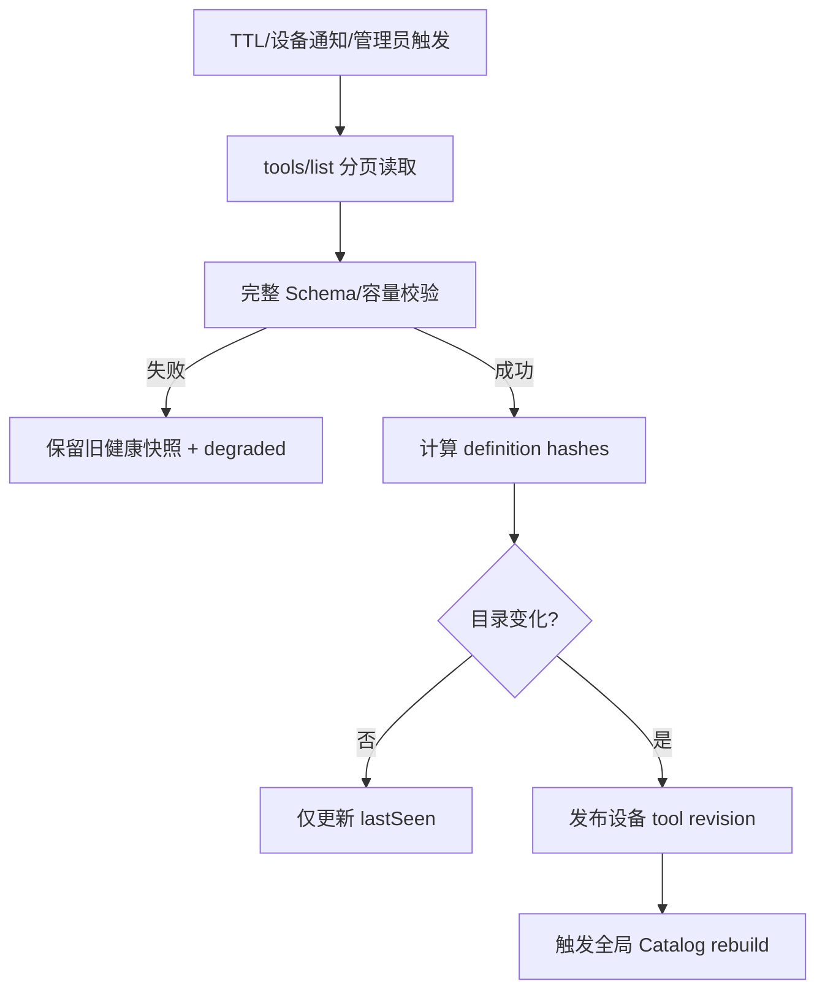
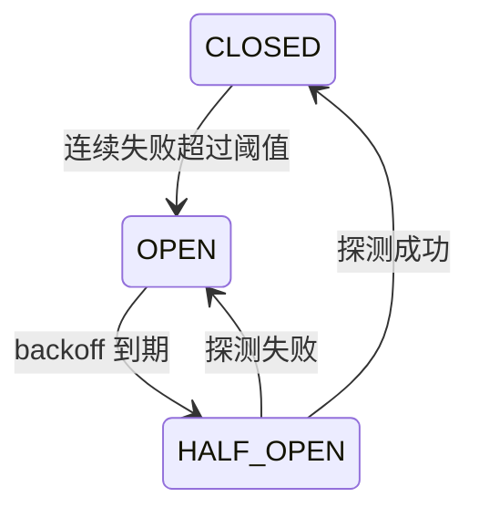

# Device Registry 与 MCP Client Manager 架构

## 1. 子功能目标

Device Registry 是设备身份、连接和工具目录状态的 Owner；MCP Client Manager 是所有 MCP Client 实例、请求关联和 Transport 的 Owner。两者位于 `litecrab_server` 进程内，但通过清晰接口解耦。

## 2. 组件架构



Registry 不执行 Tool；Client Manager 不决定 Tool 是否对模型可见；Catalog 不拥有网络连接。

## 3. DeviceRecord

```c
typedef struct {
    char device_id[64];
    char alias[64];
    uint8_t identity_fingerprint[32];
    McpTransportKind transport_kind;
    McpDeviceConnectionState connection_state;
    McpDeviceHealth health;
    uint64_t connection_generation;
    uint64_t catalog_revision;
    int64_t last_seen_ms;
    int client_slot;
} McpDeviceRecord;
```

deviceId 不随 IP、连接或展示名称变化。`connection_generation` 防止旧连接回调修改已被新连接接管的记录。

## 4. 设备生命周期



网络波动进入 OFFLINE，不等同于身份风险；认证失败和目录攻击进入 QUARANTINED，不自动恢复。

## 5. Client Manager C API

```c
int McpClientManagerInit(McpClientManager*, const McpConfig*);
int McpClientManagerStart(McpClientManager*);
int McpClientManagerCall(McpClientManager*, const McpRoutedCall*, McpResult*);
int McpClientManagerCancel(McpClientManager*, uint64_t request_id);
int McpDeviceRegistrySnapshot(McpClientManager*, McpDeviceSnapshot*);
void McpClientManagerStop(McpClientManager*);
void McpClientManagerDestroy(McpClientManager*);
```

调用结构带 requestId、traceId、deadline、catalogRevision 和 operationId。同步 API 可以在 Agent worker 上等待，但网络读循环和连接管理不得被阻塞；后续可增加 completion callback，不改变 Router 契约。

## 6. 静态 HTTP 设备接入



设备 URL 只能来自冻结配置。连接、发现和目录刷新分别有 deadline；失败按指数退避并加入随机抖动。

## 7. 重连与连接代际



同一 deviceId 只保留一个逻辑 Client slot。每次重新建连都递增 generation；旧 generation 的延迟响应不能完成新连接上的请求，也不能覆盖新目录。

## 8. 工具刷新流程



部分成功的分页结果不能覆盖旧目录。刷新失败不立即删除 Tool，但 Router 会根据设备健康返回 UNAVAILABLE。

## 9. 调用调度

Client Manager 维护固定 client slot、全局在途表和每设备队列。调用先验证 deviceId、generation、READY/DEGRADED 状态和熔断器，再分配 requestId。连接断开统一遍历该 generation 的在途项：未发送为 UNAVAILABLE，已发送写调用为 UNKNOWN。

## 10. 熔断与退避



半开只允许一个只读健康/目录请求。认证失败不走普通熔断，直接 QUARANTINED。

## 11. 持久化边界

持久化：设备身份绑定、静态配置 revision、operationId/UNKNOWN、必要审计。可重建：活动 socket、request map、临时目录 cache、熔断计时。持久文件采用有界 slot、校验和和原子替换。

## 12. 线程与内存所有权

- Registry 记录由 Registry mutex/单写线程保护。
- Transport callback 携带 generation，不直接返回裸 DeviceRecord 指针。
- Tool snapshot 深拷贝到有界 arena 后再发布。
- Stop 先停止新 connect/call，再取消请求、join worker，最后释放 Registry。

## 13. 验收

- 静态 HTTP 设备从 CONFIGURED 正确进入 READY。
- HTTP 重连后的旧响应和旧 callback 不会串入新 generation。
- 分页中途失败保留旧目录。
- 单设备熔断不影响其他设备或本地 Tool。
- request map、设备 slot 和目录 arena 达上限时快速拒绝。
- 停机后 socket、线程、请求和 arena 全部释放。

## 14. 当前状态

首版已实现固定上限的静态设备数组、启动期协议协商/发现、每设备互斥调用、optional/required 启动语义和安全 token 解析。它不是完整 Device Registry：运行中重连、状态机、generation、目录刷新、分页、连接池、熔断和旧目录保留尚未实现。
