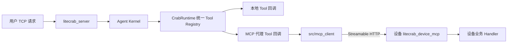
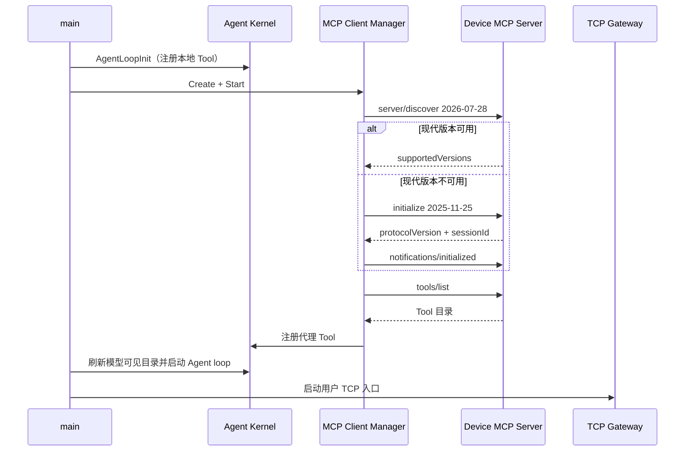
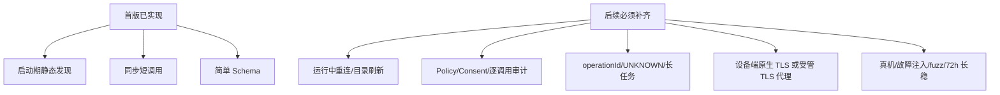

# MCP 首版实现、运行与验证手册

## 1. 已交付边界

本版实现的是通用 MCP 设备接入，不包含 xiaozhi Reverse WebSocket、ASR 或 Agent MCP Server。LiteCrab 是 MCP Host，MCP Client 作为 C11 静态模块链接进 `litecrab_server`；设备运行独立的 C11 MCP Server。Agent 不需要额外启动 `mcp-gateway` 进程。



模块是代码级隔离，不是额外进程：Agent 主程序只负责 `Create → Start → Stop → Destroy` 生命周期；协议、HTTP、设备状态和远端结果解析都在 `src/mcp_client` 内。MCP 编译关闭或运行配置关闭时，原有本地 Tool 路径不变。

## 2. 真实代码结构

```text
include/litecrab/mcp_client.h       Client Manager 公共生命周期/配置接口
src/mcp_client/mcp_internal.h       模块内部协议与 Transport 接口
src/mcp_client/protocol.c           JSON-RPC 请求编码和响应约束
src/mcp_client/http_transport.c     libcurl HTTP(S)、JSON/SSE、TLS、大小/超时
src/mcp_client/client_manager.c     设备协商、目录发现、Tool 代理和结果归一
others/mcp_server/CMakeLists.txt    设备端独立构建入口
others/mcp_server/src/server.c      C11 MCP HTTP Server 与演示 Tool
tests/mcp/                          协议栈、配置与真实 Agent E2E
config/mcp/                         可运行配置示例
```

`src/main.c` 的启动顺序如下：



当模型调用远端 Tool 时，Runtime 的参数校验仍先执行，再进入 MCP 代理；代理按 publicName 找到固定 `(device, remoteName)`，发送 `tools/call`，验证响应 ID，并把 `content/isError` 归一为现有 Tool Result。

## 3. WSL 编译 Agent

在仓库根目录执行：

```sh
cmake -S . -B build-mcp \
  -DLITECRAB_WITH_MCP_CLIENT=ON \
  -DLITECRAB_WITH_MCP_HTTP=ON \
  -DLITECRAB_ENABLE_STATIC_LINK=OFF
cmake --build build-mcp -j2
```

两个 MCP 开关必须同时为 ON 或同时为 OFF。关闭后构建的是只包含本地 Tool 的 Agent：

```sh
cmake -S . -B build-local \
  -DLITECRAB_WITH_MCP_CLIENT=OFF \
  -DLITECRAB_WITH_MCP_HTTP=OFF
cmake --build build-local -j2
```

## 4. 独立编译并运行设备 Server

设备 Server 不链接 Agent、LLM、Session 或 Alarm：

```sh
cmake -S others/mcp_server -B build-device-mcp
cmake --build build-device-mcp -j2
./build-device-mcp/litecrab_device_mcp \
  --listen 127.0.0.1 --port 18081
```

当前演示 Server 暴露 `device.get_status`、`device.echo`、`device.add` 和 `device.delay`。接真实设备时应保留协议/HTTP骨架，把这四个 Handler 替换为设备业务实现，并继续执行二次参数校验。

跨机器监听必须配置 Token，且应由反向代理或设备网关终止 TLS：

```sh
export LITECRAB_DEVICE_MCP_TOKEN='replace-with-a-random-secret'
./litecrab_device_mcp --listen 0.0.0.0 --port 18081 \
  --token-env LITECRAB_DEVICE_MCP_TOKEN
```

Agent 对非 loopback 明文 `http://` 会拒绝启动；局域网正式配置应使用 `https://`、CA 文件和 Token，或 CA + client certificate/key。

## 5. 没有云资源时如何运行

同一台 WSL/Linux 主机开两个终端即可验证完整 MCP 链路，不需要云服务器：

终端一：

```sh
./build-device-mcp/litecrab_device_mcp --listen 127.0.0.1 --port 18081
```

终端二：

```sh
./build-mcp/litecrab_server \
  --config config/mcp/wsl-all-in-one.example.json \
  --llm-config config/llm_config.json \
  --llm-provider siliconflow \
  --workspace . \
  --no-alarm
```

MCP 本身完全可以离线运行；Agent 是否能完成自然语言决策取决于 `--llm-provider` 指向的模型。没有外网时，应把 LLM 配置改为本机 OpenAI-compatible 服务。若只验证 MCP 协议和工具执行，可直接运行第 7 节测试，不需要真实 LLM。

## 6. 配置语义

```json
{
  "mcp": {
    "enabled": true,
    "required": false,
    "connect_timeout_ms": 3000,
    "request_timeout_ms": 10000,
    "limits": { "max_message_bytes": 262144 },
    "devices": [{
      "id": "device-01",
      "alias": "power_room_1",
      "enabled": true,
      "required": false,
      "transport": "streamable-http",
      "url": "https://192.168.8.10:18081/mcp",
      "ca_file": "/etc/litecrab/certs/factory-ca.pem",
      "client_cert_file": "",
      "client_key_file": "",
      "token_env": "LITECRAB_DEVICE_01_MCP_TOKEN"
    }]
  }
}
```

- `enabled=false`：不连接设备，本地 Tool 正常工作。
- `required=false`：某个 optional 设备启动时离线，Agent 仍启动，只是不注册该设备 Tool。
- 全局或设备 `required=true`：相应设备不可用时 Agent 拒绝进入服务状态。
- `token_env` 保存环境变量名，不保存秘密；Client 启动时读取一次。
- `alias` 参与生成模型可见名称，例如 `power_room_1__device_get_status`。
- 最多 8 台配置设备、每台 16 个 Tool、每个远端 Tool 8 个简单参数、单消息 1 KiB～1 MiB。

## 7. 自动化验证

干净 WSL 构建后执行：

```sh
ctest --test-dir build-mcp -R 'litecrab_mcp_(stack|agent_e2e|config)' \
  --output-on-failure
ctest --test-dir build-mcp --output-on-failure
```

测试覆盖：

- `2026-07-28 server/discover` 与 `2025-11-25 initialize/session`；
- JSON 与 request-scoped SSE 响应；
- `tools/list`、四种 `tools/call`、Unicode、范围、超时和 80 路并发；
- Token、Origin、Content-Type、HTTP 方法、body 上限和重复/危险 header；
- 错误 response ID、错误版本、恶意工具名、超限响应；
- optional 设备离线与 required 配置；
- 真实 `litecrab_server → LLM tool call → 设备 → Tool Result → 最终回答`；
- MCP 开关关闭构建和非法开关组合；
- ASan/UBSan 内存与未定义行为检查。

## 8. SD5091 构建

Agent 使用现有 sysroot：

```sh
cmake -S . -B build-5091-mcp \
  -DCMAKE_TOOLCHAIN_FILE=aarch32-toolchain.cmake \
  -DLITECRAB_ENABLE_STATIC_LINK=ON \
  -DLITECRAB_BUILD_TESTS=OFF
cmake --build build-5091-mcp -j2
```

设备端独立产物：

```sh
cmake -S others/mcp_server -B build-device-5091 \
  -DCMAKE_TOOLCHAIN_FILE="$PWD/aarch32-toolchain.cmake" \
  -DCMAKE_EXE_LINKER_FLAGS=-static
cmake --build build-device-5091 -j2
```

本次 WSL 已验证两个产物均为 `ELF 32-bit ARM EABI5 statically linked` 且无动态 `NEEDED`。glibc 静态链接会对 DNS/NSS 打印兼容警告；SD5091 配置建议使用数字 IP，最终上线仍必须在真机验证启动、网络、证书、RSS、FD 和长稳。

## 9. 已知限制与上线边界



当前设备在 Agent 启动后上线不会自动加入目录，目录变化也不会热更新；需要重启 Agent。Client 对每台设备串行调用，没有跨请求取消或熔断。复杂 object/array/union/$ref Schema 不支持。设备 Server 是参考实现，不具备原生 TLS、生产 ACL 和有副作用操作的幂等存储。因此本版适合协议联调、只读设备能力和受控局域网试运行，不应直接开放 PLC 写入、Shell、升级、重启等高风险 Tool。
