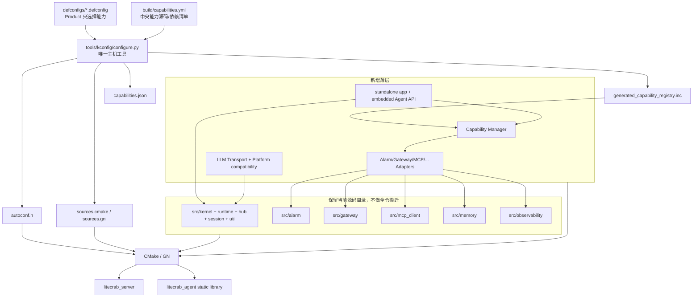
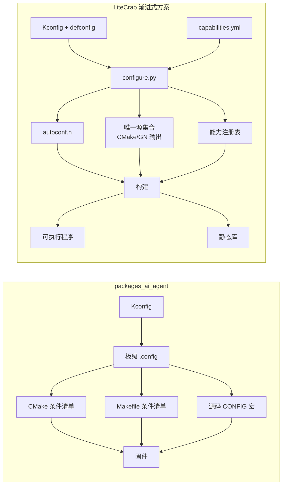

# LiteCrab 渐进式 Kconfig 最小改造方案

> 定位：在保持“能力原子化、Product 只做配置组合”目标不变的前提下，减少首期目录搬迁、文件新增和构建工具复杂度。  
> 推荐关系：《能力原子化 Kconfig 组合架构方案》是长期边界；本文是更适合当前仓库的首期落地方案。  
> 状态：设计方案，尚未修改产品源码。

## 1. 审查结论

完整能力包方案长期合理，但直接落地会同时引入：

- 全仓目录重组；
- Capability/Platform/Product 三类 Manifest；
- 多个 Python emitter；
- 自动生成 Kconfig；
- 自动注册表；
- 通用 executable/static-library 入口；
- Prompt 数据打包；
- CMake 与 GN 同步改造；
- 机器人分叉合并。

这些工作同时发生时，回归范围过大，而且很难判断问题来自业务重构、目录移动、生成器还是平台适配。

推荐采用：

```text
逻辑能力原子化
  + 保留现有物理目录
  + 少量稳定扩展点
  + 一个中央能力清单
  + 一个 configure.py
  + 生成 CMake/GN 源码列表和能力注册表
```

首期不追求“新增 Capability 也零修改中央文件”；只保证“新增 Product/场景时零 C 代码修改”。Capability 数量远少于 Product 数量，因此这个取舍能显著降低复杂度。

## 2. 三种方案对比

| 方案 | 改动量 | 能否统一机器人 | 新 Product 是否零代码 | 新 Capability 成本 | 风险 |
|---|---:|---:|---:|---:|---:|
| 只加 Kconfig/大量 `#ifdef` | 小 | 部分 | 可以 | 低 | 高：Core 形成宏分叉 |
| **渐进式最小方案（推荐）** | 中 | 可以 | 可以 | 修改清单 + 实现 Adapter | 中低 |
| 完整自发现 Capability Package | 大 | 可以 | 可以 | 新目录即可自动发现 | 中高：首期工具链复杂 |

只加宏不能解决机器人对 Kernel、LLM、Tool callback 的实质修改；完整 Package 又超出当前阶段需要。渐进式方案保留正确边界，但推迟非必要的物理治理。

## 3. 哪些改动无法省略

当前源码规模和耦合点：

| 文件 | 当前规模 | 必须解决的问题 |
|---|---:|---|
| `src/kernel/kernel.c` | 约 802 行 | Prompt 固定；机器人需要同步 API和 Tool callback |
| `src/kernel/llm.c` | 约 816 行 | 协议、OpenSSL transport 混在一起；Hi3516 使用 libllmclient |
| `src/runtime/builtin_tools.c` | 约 1162 行 | 所有工具在一个 object，无法按能力真正裁剪 |
| `src/config/config.c` | 约 544 行 | Gateway/MCP/Memory 配置耦合，但首期可兼容保留 |
| `src/main.c` | 约 203 行 | 手工管理 Agent、MCP、Alarm、Gateway 生命周期 |

首期必须完成四个扩展点：

1. `PromptProvider`：Product Prompt 不再修改 Kernel；
2. `LlmTransportOps`：POSIX/OpenSSL 和 Hi3516/libllmclient 可替换；
3. `ExternalToolBackend`：硬件回调经过 Runtime schema/权限/过滤；
4. `LiteCrabAgent API`：嵌入式同步调用不公开 `run_round()`。

此外，为了真实裁剪工具，必须把 `builtin_tools.c` 至少拆成 Workspace、Process、Skill、Memory 四个编译单元。这五项是合并两份代码的必要成本，不能由构建脚本替代。

## 4. 首期目标架构



关键点：能力已经逻辑独立，但首期仍可放在原目录。目录位置不决定架构边界，公共接口和构建清单才决定。

## 5. 首期文件结构

```text
LiteCrab/
├── Kconfig
├── defconfigs/
│   ├── diagnostic_sd5091.defconfig
│   ├── robot_hi3516.defconfig
│   └── <new_product>.defconfig
├── products/
│   └── <product>/
│       ├── product.yml
│       └── prompt.md
├── include/litecrab/
│   ├── capability.h              # 新增，小型生命周期接口
│   ├── prompt.h                  # 新增
│   ├── llm_transport.h           # 新增
│   ├── agent.h                   # 新增正式嵌入式 API
│   └── 现有头文件                # 首期不整体移动
├── src/
│   ├── app/
│   │   ├── standalone_app.c      # 从当前 main 提取通用启动
│   │   └── embedded_agent.c      # 主仓正式嵌入式 API
│   ├── capability/
│   │   ├── capability_manager.c
│   │   ├── cap_alarm.c           # 薄 Adapter，调用现有 AlarmApp
│   │   ├── cap_gateway.c         # 薄 Adapter，调用现有 Gateway
│   │   ├── cap_mcp.c             # 薄 Adapter，调用现有 MCP Manager
│   │   ├── cap_memory.c
│   │   ├── cap_observability.c
│   │   └── capability_registry.c # include 生成的 registry.inc
│   ├── platform/
│   │   ├── llm_transport_openssl.c
│   │   └── llm_transport_hi3516.c
│   ├── runtime/tools/             # 只对大文件做必要拆分
│   │   ├── workspace_tools.c
│   │   ├── process_tools.c
│   │   ├── skill_tools.c
│   │   ├── memory_tools.c
│   │   └── robot_tools.c
│   ├── alarm/                     # 保留
│   ├── gateway/                   # 保留
│   ├── mcp_client/                # 保留
│   ├── kernel/                    # 保留
│   ├── memory/                    # 保留
│   ├── hub/                       # 保留
│   ├── session/                   # 保留
│   └── observability/             # 保留
├── build/
│   ├── capabilities.yml           # 首期唯一中央 Manifest
│   ├── cmake/LiteCrabConfigure.cmake
│   └── gn/BUILD.gn
├── tools/kconfig/
│   ├── configure.py               # 首期只维护一个脚本
│   └── requirements.lock
└── tests/config_matrix/
```

与完整方案相比，首期不移动 Alarm/Gateway/MCP/Memory/Observability，不建立十几个 `capabilities/*` 包，也不拆分七个 emitter 脚本。

## 6. 中央能力清单

首期使用单个 `build/capabilities.yml`：

```yaml
schema: 1
capabilities:
  tcp_gateway:
    symbol: LITECRAB_CAP_TCP_GATEWAY
    adapter: litecrab_cap_gateway
    sources:
      - src/capability/cap_gateway.c
      - src/gateway/tcp_line.c
    requires_platform: [net_server, threads]

  alarm:
    symbol: LITECRAB_CAP_ALARM
    adapter: litecrab_cap_alarm
    sources:
      - src/capability/cap_alarm.c
      - src/alarm/alarm_service.c
      - src/alarm/alarm_notify.c
      - src/alarm/asp_client.c
      - src/alarm/polling/polling.c
      - src/alarm/subscription/subscription.c
    requires_platform: [filesystem, http_client, threads]
    libraries: [curl]

  mcp_client:
    symbol: LITECRAB_CAP_MCP_CLIENT
    adapter: litecrab_cap_mcp
    sources:
      - src/capability/cap_mcp.c
      - src/mcp_client/protocol.c
      - src/mcp_client/http_transport.c
      - src/mcp_client/client_manager.c
    requires_platform: [http_client]
    libraries: [curl]
```

Alarm 不依赖 Gateway，MCP 不依赖 diagnostic。清单表达的是技术依赖，不是 Product 归属。

新增 Product 不修改这个文件；只有真正新增 Capability 才增加一项。

## 7. 简化 Kconfig

首期可以手工维护稳定能力符号，不必先实现“扫描 Manifest 自动生成 Kconfig”：

```kconfig
config LITECRAB_PRODUCT_ID
    string

choice
config LITECRAB_ARTIFACT_EXECUTABLE
    bool "Executable"
config LITECRAB_ARTIFACT_STATIC_LIBRARY
    bool "Static library"
endchoice

config LITECRAB_CAP_TCP_GATEWAY
    bool "TCP Gateway"
    default n

config LITECRAB_CAP_ALARM
    bool "Alarm"
    default n

config LITECRAB_CAP_MCP_CLIENT
    bool "MCP Client"
    default n
```

仍然遵循：

- 无 `SCENE_*`；
- 无 `default y if PRODUCT_*`；
- Product defconfig 显式选择；
- Kconfig 负责用户可见依赖，`configure.py` 再做严格 DAG/Platform 校验。

## 8. 简化生成器

首期只实现一个 `configure.py`，内部几个 Python 函数即可：

```text
main
  load_manifest()
  load_kconfig_and_defconfig()
  validate_selection()
  topological_sort()
  emit_autoconf()
  emit_cmake_or_gn_sources()
  emit_registry_include()
  emit_capabilities_json()
```

输出：

```text
generated/.config
generated/include/litecrab/autoconf.h
generated/litecrab_sources.cmake
generated/litecrab_sources.gni
generated/generated_capability_registry.inc
generated/litecrab_capabilities.json
```

等能力数量和团队并行开发增加后，再把脚本拆分或把 Manifest 分散到每个 Capability 目录。首期不需要提前承担该复杂度。

## 9. 薄 Capability Adapter

不重写现有 Alarm/MCP/Gateway，只增加统一生命周期包装：

```c
typedef struct {
    const char *id;
    int (*init)(LiteCrabContext *ctx);
    int (*start)(LiteCrabContext *ctx);
    int (*quiesce)(LiteCrabContext *ctx);
    void (*stop)(LiteCrabContext *ctx);
    void (*destroy)(LiteCrabContext *ctx);
} LiteCrabCapabilityOps;
```

Alarm Adapter 示例：

```c
static int alarm_start(LiteCrabContext *ctx) {
    return AlarmAppStart(&ctx->alarm, &ctx->config.alarm);
}

static int alarm_quiesce(LiteCrabContext *ctx) {
    return AlarmAppQuiesce(&ctx->alarm);
}

static void alarm_stop(LiteCrabContext *ctx) {
    (void)AlarmAppStop(&ctx->alarm);
}

const LiteCrabCapabilityOps litecrab_cap_alarm = {
    .id = "alarm",
    .start = alarm_start,
    .quiesce = alarm_quiesce,
    .stop = alarm_stop,
};
```

Gateway 当前 `StartRequestServer()` 阻塞，可在 `cap_gateway.c` 内用一个受管理线程包装，stop 时调用 `RequestServerRequestStop()` 并 join。首期无需重写 Gateway Reactor。

## 10. 必要扩展点的最小实现

### 10.1 Prompt

不建立复杂 Prompt Package 系统。先把 `ContextBuildSystemPromptEx()` 的业务文本替换为：

```c
int LiteCrabPromptBuild(const LiteCrabPromptConfig *config,
                        const LiteCrabRequest *request,
                        char *out,
                        size_t out_size);
```

Product 通过 `product.yml/prompt.md` 提供文本；嵌入式构建可由 `configure.py` 生成一个 C 字符串。

### 10.2 LLM Transport

不立即彻底拆分 `llm.c`。只把其中 `http_post()`/连接收发抽为：

```c
typedef struct {
    int (*post)(void *ctx,
                const LiteCrabHttpRequest *request,
                LiteCrabHttpResponse *response);
    void (*cancel)(void *ctx);
} LlmTransportOps;
```

请求 JSON和响应/tool-call 解析暂时留在 `llm.c`；OpenSSL 和 Hi3516 实现分别放两个 transport 文件。

### 10.3 External Tool Backend

保留 `CrabRuntimeCallTool()` 主链，只允许 ToolSpec 的 execute backend 调用板级 callback。Kernel 不出现“设置回调后绕过 Runtime”的分支。

### 10.4 Agent API

新增正式 `LiteCrabAgentExecuteSync()`，内部复用当前 `IngressSubmit/DispatchResponse` 或统一 RequestContext，不公开静态 `run_round()`。现有 `agent_init/input/deinit` 作为薄兼容层。

## 11. Product 零代码组合

智能诊断：

```text
CONFIG_LITECRAB_PRODUCT_ID="diagnostic_sd5091"
CONFIG_LITECRAB_ARTIFACT_EXECUTABLE=y
CONFIG_LITECRAB_CAP_TCP_GATEWAY=y
CONFIG_LITECRAB_CAP_ALARM=y
CONFIG_LITECRAB_CAP_MCP_CLIENT=y
CONFIG_LITECRAB_CAP_SKILLS=y
CONFIG_LITECRAB_CAP_MEMORY=y
```

机器人：

```text
CONFIG_LITECRAB_PRODUCT_ID="robot_hi3516"
CONFIG_LITECRAB_ARTIFACT_STATIC_LIBRARY=y
CONFIG_LITECRAB_CAP_EMBEDDED_AGENT_API=y
CONFIG_LITECRAB_CAP_ROBOT_TOOLS=y
CONFIG_LITECRAB_CAP_TTS_OUTPUT=y
CONFIG_LITECRAB_CAP_MEMORY=y
```

新 Product：

```text
defconfigs/energy_inspection.defconfig
products/energy_inspection/product.yml
products/energy_inspection/prompt.md
```

只要使用现有 Capability，就不改 C 代码、Kconfig、Manifest、CMake 或 GN。

## 12. 分阶段实施

### 阶段 A：配置系统先跑通，不改行为

新增 `Kconfig`、两个 defconfig、中央 Manifest、单一 `configure.py`。只生成 diagnostic 当前全量组合，让新 CMake 输出与旧构建行为完全一致。

验收：新旧 `litecrab_server` 测试一致；不删除任何旧 option。

### 阶段 B：现有模块变成可选能力

给 MCP、Alarm、Gateway 增加薄 Adapter；生成 Registry；修改 `main.c` 使用 Capability Manager。先验证 diagnostic full，再验证逐项关闭。

验收：关闭能力后对应 object、符号、线程和依赖消失。

### 阶段 C：拆必要扩展点

实现 Prompt Provider、Transport Ops、External Tool Backend、Agent API；机械拆分 `builtin_tools.c`。

验收：默认 diagnostic 行为不变；Hi3516 transport 和 robot tools 可在主仓 host stub 编译。

### 阶段 D：合并机器人

把 `agent_core.c` 变为兼容层，引入 Hi3516 transport/Platform shim，GN 消费相同生成清单。设备目录先保留旧副本作为回滚。

验收：板上 ASR→Agent→Tool→TTS 通过，Tool 仍经过 Runtime。

### 阶段 E：证明新 Product 零代码

增加一个只含 defconfig/product.yml/prompt 的示例 Product，通过现有 Capability 构建。

验收：提交 diff 不包含 `.c/.h/CMakeLists.txt/BUILD.gn` 修改。

### 阶段 F：可选的目录治理

系统稳定后，再决定是否把 `src/alarm` 物理迁到 `capabilities/ingress_alarm`、拆分 Manifest 和 emitter。该阶段不改变 ABI、行为或配置符号，可以独立实施，也可以长期不做。

## 13. 首期修改文件范围

### 新增

```text
Kconfig
defconfigs/diagnostic_sd5091.defconfig
defconfigs/robot_hi3516.defconfig
build/capabilities.yml
tools/kconfig/configure.py
include/litecrab/capability.h
include/litecrab/prompt.h
include/litecrab/llm_transport.h
include/litecrab/agent.h
src/capability/capability_manager.c
src/capability/cap_*.c
src/app/standalone_app.c
src/app/embedded_agent.c
src/platform/llm_transport_*.c
```

### 修改

```text
CMakeLists.txt
src/main.c                    # 过渡转发或最终删除
src/kernel/kernel.c          # Prompt + Agent API 边界
src/kernel/llm.c             # transport 注入
src/runtime/runtime.c        # external backend
src/runtime/builtin_tools.c  # 拆分后删除或只保留兼容注册
src/config/config.c          # 编译能力与运行配置一致性校验
```

### 首期不移动

```text
src/alarm/**
src/gateway/**
src/mcp_client/**
src/memory/**
src/hub/**
src/session/**
src/observability/**
```

## 14. 测试重点

1. 新旧 diagnostic 全量构建行为等价；
2. Alarm/MCP/Gateway 每项 on/off 编译；
3. 未启用能力不在 link map/`nm`；
4. Alarm 不开启 Gateway 也能通过事件入口 smoke；
5. MCP 可在非 diagnostic Profile 注册工具；
6. Robot Tools 回调失败/非法参数不会绕过 Runtime；
7. POSIX 与 Hi3516 Transport contract；
8. 新 Product 只增加配置文件即可构建；
9. CMake/GN 选择的源文件集合一致；
10. 配置生成工具不进入嵌入式产物。

## 15. 最终建议

当前阶段不要一次实施完整文件树重构。推荐把验收目标限定为：

```text
一份 Core
+ 两种产物形态
+ 原子能力可开关
+ diagnostic/robot 同仓构建
+ 新 Product 只加配置
```

等这些目标稳定后，再决定是否演进到“每能力独立 Package、自发现 Manifest、多 emitter”的完整形态。这样保留长期扩展能力，同时显著降低首次改造的风险、工期和回归压力。

## 16. 与 packages_ai_agent Kconfig 方案对比

### 16.1 对比基线与结论

本节对比对象为 [`zhangchubing-zh/packages_ai_agent`](https://github.com/zhangchubing-zh/packages_ai_agent/) `dev` 分支提交 `4bcbd2a5e7f9724df77f7b17f1bb608321f8979c`（2026-09-15）。对比文件包括 `Kconfig`、`CMakeLists.txt`、`Makefile`、`Make.defs`、`include/agent_config.h`、`src/agent_main.c` 和工具注册代码。

结论不是“复制 packages_ai_agent”，而是：

- 复用它已经验证的 **Kconfig 决定固件能力、运行时配置决定连接参数** 的分层；
- 复用它在构建清单层移除未启用源文件的方式，确保 Flash/RAM/线程真正减少；
- 不复制 CMake 与 Makefile各自维护一份源清单的方式；
- 不把大量 `CONFIG_*` 判断继续堆入 `main`、Kernel 和 Runtime；
- LiteCrab 额外增加中央能力清单、生成清单、生命周期注册表和跨平台扩展点，以支持 POSIX 可执行程序与 Hi3516 静态库共用一份 Core。

### 16.2 架构对比

| 维度 | packages_ai_agent `dev` | LiteCrab 渐进式方案 | LiteCrab 选择原因 |
|---|---|---|---|
| Kconfig 宿主 | openvela/NuttX 配置树 | 仓库内 Kconfig，通过主机工具解析 | LiteCrab 同时服务 WSL、SD5091、Hi3516，不绑定单一 OS |
| 顶层入口 | `EXAMPLES_AI_AGENT_VELA` | Artifact + 原子 Capability | LiteCrab 要同时产生 executable 和 static library |
| 能力选择 | `AI_AGENT_FEISHU/MCP/NODE/...` | `LITECRAB_CAP_ALARM/MCP_CLIENT/...` | 两者都按能力开关，不按场景复制代码 |
| Product 表达 | 主要依赖板级 `.config` | 独立 defconfig + `product.yml` + Prompt | Product 可审计、可复现，新增场景不改源码 |
| 构建清单 | CMake 与 Makefile分别写条件源文件 | `capabilities.yml` 生成 CMake/GN 清单 | 避免两套清单漂移 |
| 源码条件编译 | 构建裁剪与 `#ifdef CONFIG_*` 并用 | 构建边界优先，宏限制在 Adapter/平台边界 | 避免 Core 形成场景宏分叉 |
| 生命周期 | `agent_main.c` 按宏手工启动/停止 | 生成 Registry + Capability Manager | 统一 init/start/quiesce/stop/destroy 和逆序回滚 |
| 工具注册 | 注册表内部按宏选择本地/MCP工具 | 每个 Tool Capability 自注册到统一 Runtime | Alarm、MCP、Robot 都能跨场景复用且不绕过治理 |
| 平台适配 | Vela/NuttX/mbedTLS 为固定平台 | `LlmTransportOps` + platform implementation | 同时适配 OpenSSL 与 Hi3516 `libllmclient` |
| 资源参数 | Kconfig 包含 stack、pool、buffer 等 | 第一阶段先做能力裁剪，第二阶段再纳入资源预算参数 | 先稳定功能组合，再量化板端资源 |
| 生成工具 | 依赖 NuttX Kconfig/CMake | Python 仅在开发机/CI运行 | 目标设备仍只运行编译后的二进制或静态库 |
| 组合验证 | 当前缺少完整配置矩阵 | 生成期校验 + pairwise/重点全组合 CI | 阻止“menuconfig 可选但无法构建”的配置进入产品 |

### 16.3 packages_ai_agent 值得直接借鉴的实现

#### 16.3.1 完整模块裁剪

其 CMake 使用：

```cmake
if(CONFIG_AI_AGENT_MCP)
  list(APPEND AGENT_SRCS
    src/tools/mcp_bridge.c
    src/tools/mcp_server.c
    src/tools/mcp_client.c)
endif()
```

LiteCrab 应保持同一语义：关闭 Capability 后不只是运行时不启动，而是对应源文件、第三方库、静态对象和线程入口都不进入最终产物。

#### 16.3.2 Kconfig 与运行时配置分层

packages_ai_agent 用 Kconfig 控制 MCP、Node、Camera、MQTT 等是否存在，用配置文件和 CLI 控制 endpoint、密钥和连接参数。LiteCrab 应采用相同边界：

```text
需要重新编译才能改变的能力/容量上限 → Kconfig
部署环境、地址、证书、密钥、超时       → config.json/环境变量
```

API Key、Token 等秘密不得进入 defconfig、`autoconf.h` 或 `capabilities.json`。

#### 16.3.3 布尔、choice 与数值参数分工

- `bool`：能力是否进入产物；
- `choice`：互斥 Artifact、Transport 或实现；
- `int/string`：编译期容量、程序名和固定路径；
- `depends on`：用户可见的直接依赖。

LiteCrab 首期先落地 bool/choice；只有经过 map、heap 和线程栈测试的数据才提升为 Kconfig 数值参数。

### 16.4 不应直接复制的问题

基线实现中已经观察到以下风险，LiteCrab 设计要在第一天规避：

1. `AGENT_TEST`、`AGENT_SKILL_SYNC`、`AGENT_MCP` 与实际定义的 `AI_AGENT_*` 名称不一致，导致部分子配置不可见；
2. CMake 和 Makefile分别维护源文件集合，已经出现路径和能力覆盖漂移；
3. WebSocket、Voice 等较大模块仍有始终编译或启动的情况，开关覆盖不完整；
4. `agent_main.c` 中分布大量能力宏，生命周期依赖靠人工顺序维护；
5. 某些 Kconfig 能力缺少底层网络、TLS、编解码等完整依赖表达；
6. 可见选项与真实源文件可能不同步，存在选中后构建失败的风险；
7. 缺少覆盖关键组合的持续构建矩阵。

这些问题说明 Kconfig 本身只负责表达选择，不能代替能力契约、统一源清单、依赖校验和组合测试。

### 16.5 两种方案的数据流差异



LiteCrab 多出的生成步骤不是目标设备运行依赖。Python/Kconfig 解析器只存在于开发机和 CI；SD5091 运行 `litecrab_server`，Hi3516 链接 `liblitecrab_agent.a`，两者都不需要 Python。

### 16.6 采用和拒绝清单

| 决策 | 内容 |
|---|---|
| 采用 | Kconfig 能力开关、defconfig 固化组合、构建期移除源文件、编译期资源上限、运行时配置承载地址与秘密 |
| 改进后采用 | 条件源文件由中央 Manifest 生成；生命周期由 Capability Manager 管理；宏只留在能力/平台边界 |
| 暂缓 | 全量资源参数 Kconfig 化、自动扫描每个能力 Manifest、完整目录搬迁 |
| 拒绝 | CMake/Makefile/GN 三份手工清单；场景宏进入 Core；关闭能力但仍编译完整实现；把密钥写入 Kconfig |

### 16.7 最终评价

packages_ai_agent 证明了 Kconfig 在嵌入式 Agent 中做静态裁剪是可行的，尤其适合单一 NuttX 产品树。LiteCrab 面临的约束更复杂：已有 POSIX 服务、SD5091 独立二进制、Hi3516 库集成以及后续多个场景。因此 LiteCrab 应采用其配置分层和裁剪原则，同时用中央能力契约解决跨构建系统一致性，用生命周期 Adapter 控制改造范围，用正式平台接口消除机器人分叉。

详细落地步骤见：[渐进式 Kconfig 实施计划](litecrab_kconfig_implementation/README.md)。

