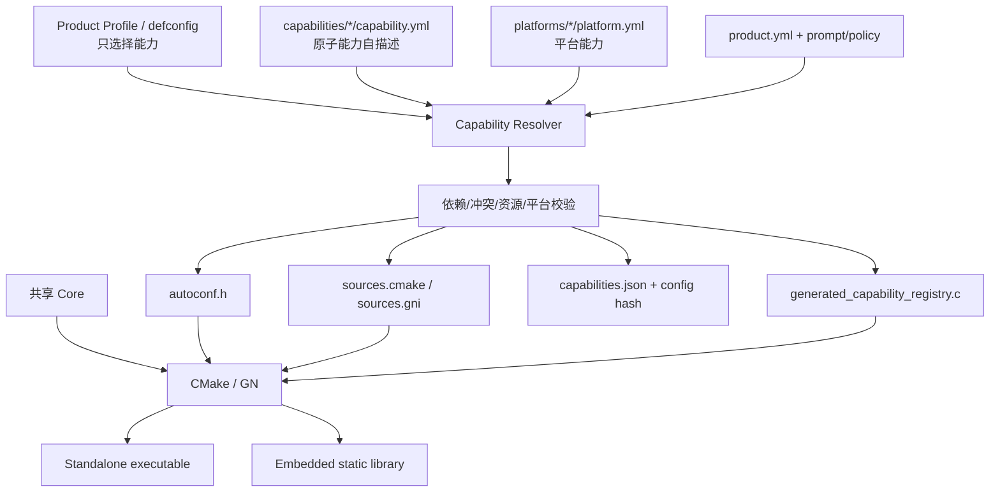
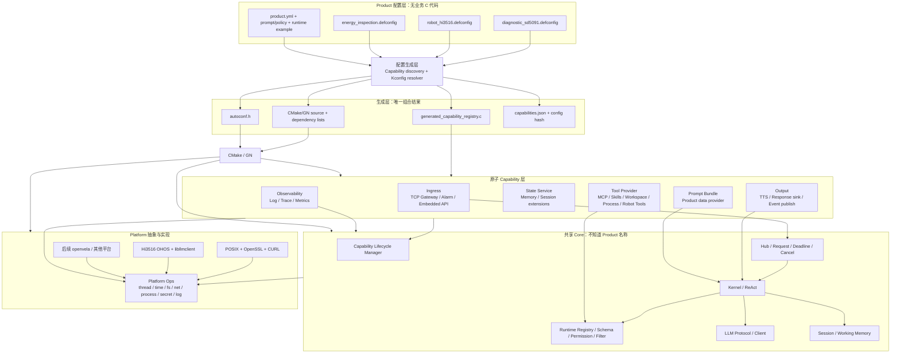
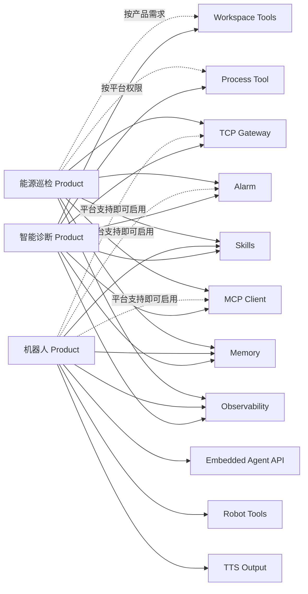
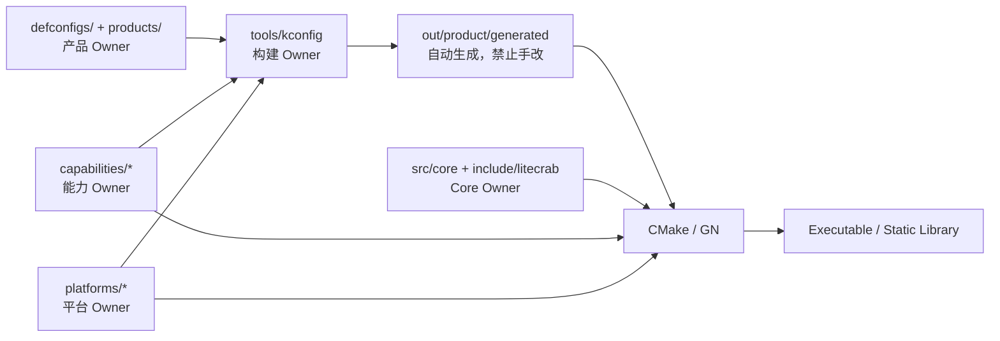
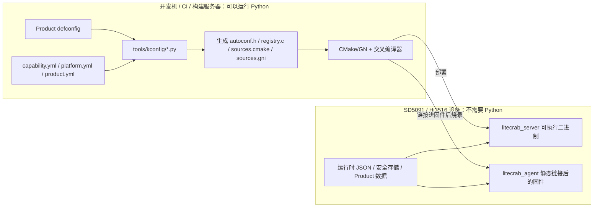
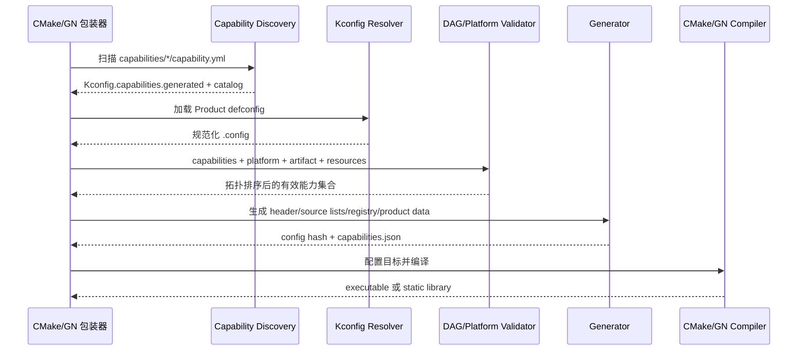
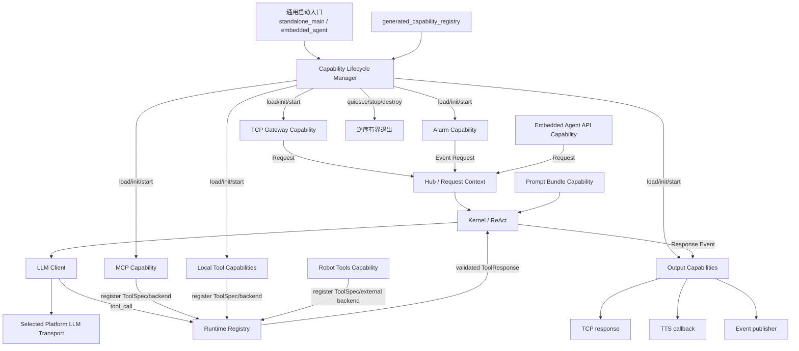
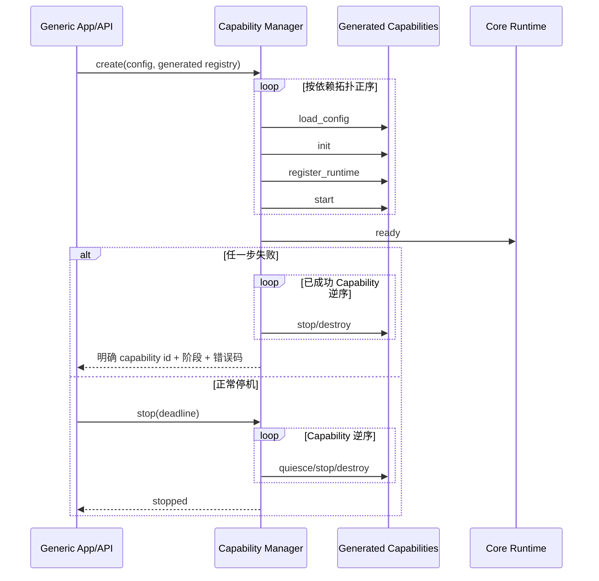

# LiteCrab 能力原子化 Kconfig 组合架构方案

> 本文是 `docs/kconfig` 下新的权威配置模型。原《LiteCrab 单仓多场景 Kconfig 架构设计方案》中关于代码分层、Core 扩展点、Platform Adapter、CMake/GN 和迁移分析仍然有效；其中固定 `SCENE_DIAGNOSTIC/SCENE_ROBOT`、按场景设置 Feature 默认值、由场景 C 文件手写完整 Feature 数组的设计由本文替代。  
> 状态：目标设计，尚未修改产品源码。
> 实施建议：本文描述长期目标边界；当前仓库首期应采用 [`LiteCrab渐进式Kconfig最小改造方案.md`](./LiteCrab渐进式Kconfig最小改造方案.md)，先逻辑原子化并保留现有目录，稳定后再决定是否完成物理 Package 重组。

## 1. 设计结论

LiteCrab 不再把“智能诊断”“机器人”“能源巡检”等场景实现为不同代码分支。所有可复用功能先拆成原子 Capability，场景只是一份 Product Profile：选择需要的 Capability、产物类型、平台、资源预算和 Prompt/Policy 数据。

```text
新场景 = 已有 Capability 的新组合 + 配置数据
新能力 = 新增一个 Capability Package，之后所有场景直接选择复用
```

当新场景所需能力已经存在时，只需增加：

```text
defconfigs/<product>.defconfig
products/<product>/product.yml
products/<product>/prompt.md（需要专属 Prompt 时）
tests/products/<product>_smoke.*
```

不修改 Core、Capability 源码、根 CMake、GN 源码列表或公共 API。

## 2. 核心概念重新定义

| 概念 | 职责 | 是否包含业务代码 |
|---|---|---:|
| Core | Agent 执行机制、Hub、Runtime Registry、Session、LLM Protocol、Lifecycle | 只包含通用机制 |
| Capability Package | 一个可独立选择、编译、注册、测试和计量的能力 | 是 |
| Platform Package | thread/fs/time/network/secret/process 等平台实现和 capability bits | 是 |
| Product Profile | 选择 Capability、Platform、产物类型和资源上限 | 否，纯配置 |
| Prompt/Policy Bundle | 身份、领域规则、工具使用策略等数据 | 否，作为资源生成或运行时加载 |
| Runtime Config | URL、端口、路径、设备地址和 secret 引用 | 否，部署配置 |

“Scenario”保留为产品语义名称，但不再对应必须编写的 `src/scenarios/<name>/*.c`。构建系统只认识 Product Profile 和 Capability。

## 3. 总体架构

### 3.1 配置、生成与构建总览



### 3.2 修改后的软件分层架构图

这张图强调 Product 只是配置，Capability 才是可复用实现。任意 Product 都可以在平台约束允许的情况下选择任意 Capability。



### 3.3 Product 与 Capability 组合关系图

实线表示常用默认组合，虚线表示只要平台能力满足即可选择，并不存在“某能力只能属于某场景”的限制。



### 3.4 修改后的文件结构图

标记说明：`[CORE]` 为所有产品共享机制，`[CAP]` 为可独立选择的原子能力，`[PRODUCT]` 为无业务 C 代码的产品配置，`[PLATFORM]` 为平台实现，`[GENERATED]` 为构建目录生成物。

```text
LiteCrab/
├── Kconfig                              # 只定义 Product 元数据、Artifact、资源等稳定入口
├── defconfigs/                          # [PRODUCT] 正式、可发布的能力组合
│   ├── diagnostic_sd5091.defconfig
│   ├── robot_hi3516.defconfig
│   ├── minimal_posix.defconfig
│   └── energy_inspection_sd5091.defconfig
│
├── products/                            # [PRODUCT] 场景数据，不放必需 C 代码
│   ├── diagnostic_sd5091/
│   │   ├── product.yml                  # Prompt、运行示例、smoke、发布元数据
│   │   ├── prompt.md
│   │   └── runtime.example.json
│   ├── robot_hi3516/
│   │   ├── product.yml
│   │   ├── prompt.md
│   │   └── runtime.example.json
│   └── energy_inspection_sd5091/
│       ├── product.yml
│       ├── prompt.md
│       └── runtime.example.json
│
├── include/litecrab/                    # 稳定公共 API
│   ├── agent.h                          # 通用 Create/Start/Execute/Stop/Destroy
│   ├── capability.h                     # Capability Descriptor/Lifecycle contract
│   ├── context.h                        # LiteCrabContext
│   ├── platform.h                       # Platform Ops 与 capability bits
│   ├── request.h                        # Request/Response/deadline/cancel
│   ├── runtime.h                        # Tool Registry/schema/backend/filter
│   └── generated_config.h               # 只 include build/out 中 autoconf.h
│
├── src/
│   ├── app/                             # 通用产物入口，不按场景复制
│   │   ├── standalone_main.c            # executable 的统一入口
│   │   └── embedded_agent.c             # static library 的统一嵌入式实现
│   │
│   └── core/                            # [CORE] 禁止依赖 Product 和具体 Capability
│       ├── agent/
│       │   └── agent.c
│       ├── lifecycle/
│       │   └── capability_manager.c
│       ├── hub/
│       │   └── hub.c
│       ├── kernel/
│       │   └── kernel.c
│       ├── llm/
│       │   ├── llm_client.c
│       │   ├── llm_protocol.c
│       │   └── tool_adapter.c
│       ├── runtime/
│       │   ├── runtime.c
│       │   └── external_backend.c
│       ├── session/
│       │   ├── session.c
│       │   └── working_memory.c
│       └── util/
│           └── json.c
│
├── capabilities/                        # [CAP] 每个目录可独立发现、选择和测试
│   ├── ingress_tcp_gateway/
│   │   ├── capability.yml
│   │   ├── include/litecrab/cap/tcp_gateway.h
│   │   ├── src/tcp_gateway.c
│   │   ├── config_schema.json
│   │   └── tests/
│   ├── ingress_alarm/
│   │   ├── capability.yml
│   │   ├── include/litecrab/cap/alarm.h
│   │   ├── src/
│   │   │   ├── alarm_service.c
│   │   │   ├── alarm_spool.c
│   │   │   ├── alarm_notify.c
│   │   │   ├── polling.c
│   │   │   └── subscription.c
│   │   ├── config_schema.json
│   │   └── tests/
│   ├── provider_mcp_client/
│   │   ├── capability.yml
│   │   ├── include/litecrab/cap/mcp_client.h
│   │   ├── src/
│   │   │   ├── client_manager.c
│   │   │   ├── protocol.c
│   │   │   └── http_transport.c
│   │   ├── config_schema.json
│   │   └── tests/
│   ├── skills_runtime/
│   ├── memory/
│   ├── workspace_tools/
│   ├── process_tool/
│   ├── observability/
│   ├── embedded_agent_api/
│   ├── robot_tools/
│   ├── tts_output/
│   └── prompt_bundle/
│       └── ...                          # 每个目录结构与上述 Capability 模板一致
│
├── platforms/                           # [PLATFORM] 只实现系统能力，不含业务 Prompt/Tool
│   ├── posix_openssl/
│   │   ├── platform.yml
│   │   ├── include/
│   │   └── src/
│   │       ├── platform.c
│   │       ├── thread.c
│   │       ├── filesystem.c
│   │       ├── process.c
│   │       ├── secret_env.c
│   │       └── llm_transport_openssl.c
│   ├── hi3516_ohos/
│   │   ├── platform.yml
│   │   ├── include/
│   │   └── src/
│   │       ├── platform.c
│   │       ├── board_callbacks.c
│   │       ├── secret_store.c
│   │       └── llm_transport_llmclient.c
│   └── openvela_nuttx/                  # 后续平台按同一 contract 扩展
│
├── build/
│   ├── schemas/
│   │   ├── capability.schema.json
│   │   ├── platform.schema.json
│   │   └── product.schema.json
│   ├── cmake/
│   │   └── LiteCrabConfigure.cmake
│   └── gn/
│       ├── BUILD.gn
│       └── litecrab.gni
│
├── tools/kconfig/
│   ├── configure.py                     # 发现、Kconfig 解析、DAG 校验和生成总入口
│   ├── discover_capabilities.py
│   ├── validate_graph.py
│   ├── emit_autoconf.py
│   ├── emit_cmake.py
│   ├── emit_gn.py
│   ├── emit_registry.py
│   └── requirements.lock
│
├── tests/
│   ├── core/
│   ├── contracts/                       # Capability/Platform 通用合约
│   ├── capabilities/                    # 单能力测试入口
│   ├── combinations/                    # dependency/conflict/pairwise
│   ├── products/                        # 数据驱动 Product smoke/E2E
│   ├── config_matrix/
│   └── security/
│
└── out/                                 # 不提交仓库，每个 Product 独立目录
    └── <product>/generated/              # [GENERATED]
        ├── .config
        ├── Kconfig.capabilities.generated
        ├── include/litecrab/autoconf.h
        ├── litecrab_config.cmake
        ├── litecrab_config.gni
        ├── litecrab_sources.cmake
        ├── litecrab_sources.gni
        ├── generated_capability_registry.c
        ├── generated_product_data.c
        ├── litecrab_capabilities.json
        └── configure.stamp
```

### 3.5 文件结构所有权图



### 3.6 当前文件到目标结构的迁移映射

| 当前文件或目录 | 目标位置 | 迁移原则 |
|---|---|---|
| `src/main.c` | `src/app/standalone_main.c` | 变成通用入口，不直接启动 Alarm/MCP/Gateway |
| 机器人 `agent_core.c` | `src/app/embedded_agent.c` + 兼容层 | 不再公开或直接调用 `run_round()` |
| `src/kernel/kernel.c` | `src/core/kernel/kernel.c` | 移除具体 Prompt、Tool callback 和场景判断 |
| `src/kernel/llm.c` | `src/core/llm/*` + `platforms/*/llm_transport_*` | 协议与网络实现分离 |
| `src/runtime/runtime.c` | `src/core/runtime/runtime.c` | 保留通用 Registry/schema/permission/filter |
| `src/runtime/builtin_tools.c` | `capabilities/workspace_tools`、`process_tool`、`skills_runtime`、`memory` | 按权限、依赖和资源成本原子拆分 |
| `src/alarm/*` | `capabilities/ingress_alarm/` | 不依赖 TCP Gateway 或 diagnostic Product |
| `src/gateway/*` | `capabilities/ingress_tcp_gateway/` | 只负责网络 ingress |
| `src/mcp_client/*` | `capabilities/provider_mcp_client/` | 任意 Product 可选择 |
| `src/memory/*` | `capabilities/memory/` | 通过存储 Platform capability 工作 |
| `src/observability/*` | `capabilities/observability/` | 独立启停和资源预算 |
| `src/config/config.c` | Core config loader + 各 Capability config parser | Core 不 include 可选 Capability 配置结构 |
| 机器人 `robot_tools` | `capabilities/robot_tools/` | 依赖 external backend，不依赖 robot 场景名 |
| 机器人 TTS callback | `capabilities/tts_output/` | 作为通用 Output Capability |
| 机器人 `platform_3516.h` | `platforms/hi3516_ohos/` | 收敛为 Platform Ops/ABI |
| 根 CMake/机器人 `BUILD.gn` 手写 sources | 生成的 `litecrab_sources.cmake/gni` | Capability Manifest 是唯一源码事实 |

### 3.7 `tools/kconfig` 的运行位置与部署边界

`tools/kconfig/*.py` 全部是**构建主机工具**，只在开发机、WSL、CI 或 OpenHarmony 编译服务器上执行。它们不会交叉编译进程序，不复制到 SD5091/Hi3516，也不是嵌入式运行时依赖。



各脚本职责：

| 文件 | 构建主机上的作用 | 输入 | 输出/副作用 | 是否进入设备 |
|---|---|---|---|---:|
| `configure.py` | 总入口，组织“发现→生成 Kconfig→解析 defconfig→校验→输出” | Profile、源码根、输出目录 | 调用其他模块并生成完整配置目录 | 否 |
| `discover_capabilities.py` | 扫描所有原子能力和平台元数据，检查重复 id/路径 | `capabilities/*/capability.yml`、`platforms/*/platform.yml` | 内存 catalog、临时生成的 Kconfig capability 菜单 | 否 |
| `validate_graph.py` | 校验 requires/conflicts、循环依赖、平台能力和资源上限，并拓扑排序 | catalog、规范化 `.config` | 有序启用能力集合；非法组合时让构建失败 | 否 |
| `emit_autoconf.py` | 把 Kconfig 值转换为 C 编译宏 | `.config` | `include/litecrab/autoconf.h` | 脚本否；生成的宏参与编译 |
| `emit_cmake.py` | 生成 CMake 可消费的源码、依赖和配置变量 | 有序能力集合、Manifest | `litecrab_config.cmake`、`litecrab_sources.cmake` | 否 |
| `emit_gn.py` | 生成 OpenHarmony GN 可消费的源码、依赖和配置变量 | 有序能力集合、Manifest | `litecrab_config.gni`、`litecrab_sources.gni` | 否 |
| `emit_registry.py` | 生成运行时唯一的 Capability Descriptor 注册数组和 Product 数据 | 有序能力集合、Product metadata | `generated_capability_registry.c`、`generated_product_data.c` | Python 脚本否；生成的 C 会编进产物 |
| `requirements.lock` | 固定 Kconfig parser/YAML 等主机 Python 依赖版本和 hash，保证可重复构建 | Python 包版本 | 主机依赖锁定 | 否 |

生成文件的去向分为三类：

```text
仅构建系统读取：
  litecrab_config.cmake
  litecrab_sources.cmake
  litecrab_config.gni
  litecrab_sources.gni

参与 C 编译，最终变成机器码/只读数据：
  autoconf.h
  generated_capability_registry.c
  generated_product_data.c

仅用于审计和发布验证：
  .config
  litecrab_capabilities.json
  configure.stamp
```

最终设备侧只有两种结果：

- Standalone 场景：部署 `litecrab_server` 可执行二进制；
- Embedded 场景：`litecrab_agent` 静态库在产品构建时已经链接进固件，设备运行固件，不运行 `.a` 文件或 Python。

如果构建主机不能安装 Python，可选择以下方案之一，但设备侧仍然不需要 Python：

1. 在统一 CI/发布服务器预生成配置，再把“生成目录 + 源码 revision + config hash”交给交叉编译环境；
2. 将 generator 打包成构建主机可执行工具，例如 zipapp/受控 Python runtime；
3. 后续把生成器改写成主机原生工具，但必须保持完全相同的输入输出协议。

不建议把生成文件长期提交到源码仓，因为多个 Product 容易互相覆盖并产生过期配置。推荐每个 Product 使用独立 `out/<product>/generated`，在正式构建前自动生成。

## 4. 原子 Capability 定义

一个 Capability 必须满足：

1. 有唯一稳定 id；
2. 源码、头文件和外部依赖自包含；
3. 只依赖 Core API、其他 Capability id 或 Platform capability；
4. 拥有配置 parser、生命周期和必要的 Tool/Ingress/Output 注册；
5. 可单独编译和运行 contract test；
6. 声明 Flash/BSS/heap/thread/FD 成本；
7. 关闭时不编译、不链接、不注册、不出现在能力清单；
8. 不判断产品或场景名称。

禁止：

```c
#if CONFIG_PRODUCT_ROBOT
#if CONFIG_SCENE_DIAGNOSTIC
if (strcmp(product_id, "robot") == 0)
```

允许：

```c
#if CONFIG_CAP_TTS_OUTPUT
if (platform_has(LITECRAB_PLATFORM_CAP_AUDIO_OUTPUT))
```

## 5. 原子能力目录

建议首批拆分为：

```text
capabilities/
├── ingress_tcp_gateway/
├── ingress_alarm/
├── provider_mcp_client/
├── skills_runtime/
├── memory/
├── workspace_tools/
├── process_tool/
├── observability/
├── embedded_agent_api/
├── robot_tools/
├── tts_output/
└── prompt_bundle/
```

能力关系：

| Capability id | 作用 | 依赖 | 不应依赖 |
|---|---|---|---|
| `ingress_tcp_gateway` | 接收 TCP 请求并投递 Core Hub | `platform.net_server` | diagnostic、Alarm |
| `ingress_alarm` | polling/subscription、spool、投递告警事件 | Core Hub、filesystem、HTTP client | TCP Gateway、diagnostic |
| `provider_mcp_client` | 注册远端 MCP tools | HTTP client、Runtime Registry | diagnostic、Gateway |
| `skills_runtime` | Skill 发现、读取、执行状态 | filesystem、Runtime Registry | 某个产品名 |
| `memory` | 长期记忆和 memory tool | filesystem 或其他存储 capability | robot/diagnostic |
| `workspace_tools` | read/write/edit/search 等工具 | filesystem | standalone 场景名 |
| `process_tool` | 受限进程执行 | platform.process | diagnostic |
| `embedded_agent_api` | 为宿主提供 Create/Execute/Stop API | Core Agent API | robot |
| `robot_tools` | move/speak/stop 等 ToolSpec/backend | external tool backend | SCENE_ROBOT |
| `tts_output` | 最终文本输出 callback | output callback API | robot |
| `observability` | log/trace/metrics | platform.log/time | 产品名 |
| `prompt_bundle` | 加载或内嵌 Prompt/Policy 数据 | Prompt Provider API | 固定业务源码 |

关键修正：Alarm 不依赖 TCP Gateway；两者是不同 ingress。MCP 不属于智能诊断专用能力；任何 Product 都可以选择。Robot Tools 和 TTS 也不绑定 Robot 场景名。

## 6. Capability Package 结构

```text
capabilities/ingress_alarm/
├── capability.yml
├── Kconfig.fragment           # 可选；也可完全由 yml 生成
├── include/litecrab/cap/alarm.h
├── src/alarm_service.c
├── src/alarm_spool.c
├── src/alarm_notify.c
├── src/polling.c
├── src/subscription.c
├── config_schema.json
└── tests/
    ├── test_alarm_contract.c
    └── test_alarm_e2e.py
```

`capability.yml` 是组件事实的唯一来源：

```yaml
schema: 1
id: ingress_alarm
symbol: LITECRAB_CAP_ALARM
kind: ingress
descriptor: litecrab_capability_alarm
sources:
  - capabilities/ingress_alarm/src/alarm_service.c
  - capabilities/ingress_alarm/src/alarm_spool.c
  - capabilities/ingress_alarm/src/alarm_notify.c
  - capabilities/ingress_alarm/src/polling.c
  - capabilities/ingress_alarm/src/subscription.c
public_headers:
  - capabilities/ingress_alarm/include/litecrab/cap/alarm.h
requires:
  core: [hub, runtime]
  capabilities: []
  platform: [filesystem, http_client, monotonic_clock]
conflicts: []
external_dependencies: [curl]
runtime_config_section: alarm
tests:
  - test_alarm_contract
  - test_alarm_e2e
resources:
  threads: 2
  file_descriptors: 4
```

新增 Capability 时只增加自己的 package；发现器自动纳入 Kconfig、CMake、GN 和 CI，不修改中央源文件列表。

## 7. Capability 生命周期

所有能力使用统一 Descriptor：

```c
typedef enum {
    LITECRAB_CAP_KIND_INGRESS,
    LITECRAB_CAP_KIND_TOOL_PROVIDER,
    LITECRAB_CAP_KIND_OUTPUT,
    LITECRAB_CAP_KIND_SERVICE,
    LITECRAB_CAP_KIND_API
} LiteCrabCapabilityKind;

typedef struct LiteCrabCapabilityDescriptor {
    const char *id;
    LiteCrabCapabilityKind kind;
    unsigned abi_version;
    int  (*load_config)(LiteCrabConfigBuilder *builder);
    int  (*init)(LiteCrabContext *ctx);
    int  (*register_runtime)(LiteCrabContext *ctx);
    int  (*start)(LiteCrabContext *ctx);
    int  (*quiesce)(LiteCrabContext *ctx);
    void (*stop)(LiteCrabContext *ctx);
    void (*destroy)(LiteCrabContext *ctx);
} LiteCrabCapabilityDescriptor;
```

Lifecycle Manager 只遍历生成注册表：

```text
load_config → init → register_runtime → start
失败：对已成功项逆序 stop/destroy
停机：quiesce → stop → destroy
```

Core 不手工调用 Alarm、MCP、Gateway 或 Robot Tools。

## 8. Kconfig 模型

### 8.1 不再定义场景 choice

删除：

```kconfig
choice
config LITECRAB_SCENE_DIAGNOSTIC
config LITECRAB_SCENE_ROBOT
config LITECRAB_SCENE_CUSTOM
endchoice
```

替换为纯元数据和产物类型：

```kconfig
config LITECRAB_PRODUCT_ID
    string "Product profile identifier"
    default "custom"

choice
    prompt "Artifact type"
config LITECRAB_ARTIFACT_EXECUTABLE
    bool "Standalone executable"
config LITECRAB_ARTIFACT_STATIC_LIBRARY
    bool "Embedded static library"
endchoice
```

`PRODUCT_ID` 不参与 Core 条件编译，只用于版本、日志、发布清单和选择 Product 数据。

### 8.2 每个能力是独立 bool

```kconfig
config LITECRAB_CAP_TCP_GATEWAY
    bool "TCP Gateway ingress"
    default n
    depends on LITECRAB_PLATFORM_HAS_NET_SERVER

config LITECRAB_CAP_ALARM
    bool "Alarm ingress and durable spool"
    default n
    depends on LITECRAB_PLATFORM_HAS_FILESYSTEM
    depends on LITECRAB_PLATFORM_HAS_HTTP_CLIENT

config LITECRAB_CAP_MCP_CLIENT
    bool "MCP tool provider"
    default n
    depends on LITECRAB_PLATFORM_HAS_HTTP_CLIENT

config LITECRAB_CAP_ROBOT_TOOLS
    bool "Robot tool provider"
    default n
    depends on LITECRAB_PLATFORM_HAS_EXTERNAL_TOOL_BACKEND
```

所有可选能力默认 `n`；正式 defconfig 显式写出 `y/n`。任何 symbol 都不使用 `default y if PRODUCT/SCENE_*`。

### 8.3 资源预算不依赖场景名

```kconfig
config LITECRAB_MAX_TOOL_ITERATIONS
    int "Maximum tool iterations"
    range 1 40
    default 8

config LITECRAB_SESSION_CAPACITY
    int "Maximum active sessions"
    range 1 256
    default 8
```

不同产品在 defconfig 中覆盖，而不是在根 Kconfig 判断场景。

## 9. Product Profile 示例

### 9.1 智能诊断

```text
CONFIG_LITECRAB_PRODUCT_ID="diagnostic_sd5091"
CONFIG_LITECRAB_ARTIFACT_EXECUTABLE=y
CONFIG_LITECRAB_PLATFORM_POSIX_OPENSSL=y

CONFIG_LITECRAB_CAP_TCP_GATEWAY=y
CONFIG_LITECRAB_CAP_ALARM=y
CONFIG_LITECRAB_CAP_MCP_CLIENT=y
CONFIG_LITECRAB_CAP_SKILLS=y
CONFIG_LITECRAB_CAP_MEMORY=y
CONFIG_LITECRAB_CAP_WORKSPACE_TOOLS=y
CONFIG_LITECRAB_CAP_PROCESS_TOOL=y
CONFIG_LITECRAB_CAP_OBSERVABILITY=y
CONFIG_LITECRAB_CAP_PROMPT_BUNDLE=y

CONFIG_LITECRAB_CAP_EMBEDDED_AGENT_API=n
CONFIG_LITECRAB_CAP_ROBOT_TOOLS=n
CONFIG_LITECRAB_CAP_TTS_OUTPUT=n

CONFIG_LITECRAB_MAX_TOOL_ITERATIONS=16
CONFIG_LITECRAB_SESSION_CAPACITY=128
```

### 9.2 机器人

```text
CONFIG_LITECRAB_PRODUCT_ID="robot_hi3516"
CONFIG_LITECRAB_ARTIFACT_STATIC_LIBRARY=y
CONFIG_LITECRAB_PLATFORM_HI3516_OHOS=y

CONFIG_LITECRAB_CAP_EMBEDDED_AGENT_API=y
CONFIG_LITECRAB_CAP_ROBOT_TOOLS=y
CONFIG_LITECRAB_CAP_TTS_OUTPUT=y
CONFIG_LITECRAB_CAP_SKILLS=y
CONFIG_LITECRAB_CAP_MEMORY=y
CONFIG_LITECRAB_CAP_OBSERVABILITY=y
CONFIG_LITECRAB_CAP_PROMPT_BUNDLE=y

CONFIG_LITECRAB_CAP_TCP_GATEWAY=n
CONFIG_LITECRAB_CAP_ALARM=n
CONFIG_LITECRAB_CAP_MCP_CLIENT=n
CONFIG_LITECRAB_CAP_WORKSPACE_TOOLS=n
CONFIG_LITECRAB_CAP_PROCESS_TOOL=n

CONFIG_LITECRAB_MAX_TOOL_ITERATIONS=5
CONFIG_LITECRAB_SESSION_CAPACITY=1
```

### 9.3 新场景：能源巡检

这个例子证明新场景可只通过配置重组已有能力：

```text
CONFIG_LITECRAB_PRODUCT_ID="energy_inspection_sd5091"
CONFIG_LITECRAB_ARTIFACT_EXECUTABLE=y
CONFIG_LITECRAB_PLATFORM_POSIX_OPENSSL=y

CONFIG_LITECRAB_CAP_TCP_GATEWAY=y
CONFIG_LITECRAB_CAP_ALARM=y
CONFIG_LITECRAB_CAP_MCP_CLIENT=y
CONFIG_LITECRAB_CAP_SKILLS=y
CONFIG_LITECRAB_CAP_MEMORY=y
CONFIG_LITECRAB_CAP_OBSERVABILITY=y
CONFIG_LITECRAB_CAP_WORKSPACE_TOOLS=n
CONFIG_LITECRAB_CAP_PROCESS_TOOL=n
CONFIG_LITECRAB_CAP_ROBOT_TOOLS=n

CONFIG_LITECRAB_MAX_TOOL_ITERATIONS=10
CONFIG_LITECRAB_SESSION_CAPACITY=32
```

配套 `products/energy_inspection_sd5091/product.yml`：

```yaml
schema: 1
id: energy_inspection_sd5091
prompt: products/energy_inspection_sd5091/prompt.md
runtime_config_example: products/energy_inspection_sd5091/runtime.example.json
smoke_test: energy_inspection_smoke
```

没有新增或修改任何 `.c` 文件。

## 10. 两阶段配置生成

为了让新增 Capability 也不修改根 Kconfig，配置器分两阶段：



### 阶段 A：发现能力

扫描：

```text
capabilities/*/capability.yml
platforms/*/platform.yml
```

生成临时 `Kconfig.capabilities.generated`，其中包含 bool、prompt、depends/conflicts。按 id 排序，确保结果稳定。

### 阶段 B：解析 Profile

Kconfig parser 加载生成片段和 defconfig，得到规范化 `.config`，然后解析 Capability DAG 并输出：

```text
generated/.config
generated/include/litecrab/autoconf.h
generated/litecrab_config.cmake
generated/litecrab_config.gni
generated/litecrab_sources.cmake
generated/litecrab_sources.gni
generated/generated_capability_registry.c
generated/generated_product_data.c
generated/litecrab_capabilities.json
generated/configure.stamp
```

任何依赖缺失、冲突、平台能力不足、重复 id、循环或资源超限都在编译前失败。

## 11. 自动生成能力注册表

不要在 Product/Scenario C 文件中维护 Feature 数组。配置器生成：

```c
extern const LiteCrabCapabilityDescriptor litecrab_cap_tcp_gateway;
extern const LiteCrabCapabilityDescriptor litecrab_cap_alarm;
extern const LiteCrabCapabilityDescriptor litecrab_cap_mcp_client;

const LiteCrabCapabilityDescriptor *const
litecrab_enabled_capabilities[] = {
    &litecrab_cap_observability,
    &litecrab_cap_memory,
    &litecrab_cap_skills,
    &litecrab_cap_mcp_client,
    &litecrab_cap_alarm,
    &litecrab_cap_tcp_gateway,
};

const size_t litecrab_enabled_capability_count =
    sizeof(litecrab_enabled_capabilities) /
    sizeof(litecrab_enabled_capabilities[0]);
```

顺序由依赖拓扑和显式 lifecycle priority 生成，而不是依赖文件名或人工数组顺序。

### 11.1 修改后的运行时架构图

所有入口先进入统一 Hub/Agent API；所有工具提供方进入 Runtime Registry；输出能力订阅结构化响应事件。Lifecycle Manager 只使用生成注册表，不识别 Product 名称。



### 11.2 Capability 生命周期时序图



## 12. 通用入口替代场景入口

### 12.1 Executable

所有独立服务共用：

```text
src/app/standalone_main.c
```

它只负责加载 Product 数据和运行生成的 Capability Registry。TCP Gateway、Alarm 等自行作为 Capability 启动；不再为每个新产品复制 `main.c`。

### 12.2 Static Library

所有嵌入式产品共用：

```text
src/app/embedded_agent.c
include/litecrab/agent.h
```

宿主创建 Agent 并注入 Platform/board callbacks；Robot Tools、TTS、MCP 等都由 Profile 选择。

### 12.3 Prompt

Prompt 通过 `prompt_bundle` 能力加载 `product.yml` 指定的数据。构建器可以把 `prompt.md` 转成生成 C 数组，也可以在有文件系统的平台按版本化路径加载。Core 永远追加安全、Tool schema 和完成语义，Product Prompt 不能覆盖。

## 13. CMake 与 GN 自动构建

CMake：

```sh
cmake -S . -B build/energy-inspection \
  -DLITECRAB_PROFILE=energy_inspection_sd5091
cmake --build build/energy-inspection -j2
```

得到通用 executable target，可按 Product ID 设置输出名，推荐仍统一为 `litecrab_server` 并由发布清单区分。

GN/Hi3516：

```text
python3 build/litecrab/build_product.py \
  --profile robot_hi3516 \
  --product <ohos-product> \
  --build
```

两者消费同一 `.config`、Capability Manifest 和生成 Registry；不得维护独立源码表。

## 14. 编译期与运行时边界

| 内容 | Product defconfig | Product/Runtime 数据 |
|---|---:|---:|
| 是否编译 Alarm/MCP/Gateway/TTS | 是 | 否 |
| 产物是 executable/static library | 是 | 否 |
| Platform/Transport 实现 | 是 | 否 |
| buffer、线程栈、registry 上限 | 是 | 只能收紧 |
| Prompt/业务策略 | 选择 bundle | 是 |
| URL、端口、路径、设备地址 | 否 | 是 |
| API key、密码、私钥 | 禁止 | 安全存储/环境注入 |
| 已编译能力是否临时关闭 | 编译上限 | 可以关闭 |

运行时不得打开未编译能力；返回 `FEATURE_NOT_COMPILED:<id>`。

## 15. 新场景零代码接入步骤

在所有能力已存在的前提下：

1. 创建 `defconfigs/<product>.defconfig`，显式选择 Capability、Platform、Artifact 和资源预算；
2. 创建 `products/<product>/product.yml` 和可选 `prompt.md`；
3. 创建场景 smoke 输入/期望数据；如果通用数据驱动 smoke runner 足够，只增加 YAML/JSON 用例；
4. 执行统一构建命令；
5. 检查 capability JSON、link map、资源报告和 E2E；
6. 提交 Profile 和发布元数据。

不需要：

- 修改 Core；
- 增加 `SCENE_<NAME>` 宏；
- 修改根 CMake/BUILD.gn；
- 手工增加源文件；
- 复制 `main.c` 或 Agent API；
- 修改其他 Product Profile。

## 16. 新能力接入步骤

如果新场景需要仓库中不存在的能力，例如 CAN 总线采集：

1. 新建 `capabilities/ingress_can/`；
2. 实现 Capability Descriptor 和 contract tests；
3. 在 `capability.yml` 声明源文件、依赖、平台 capability、资源成本；
4. Platform 缺少 CAN 时新增一次通用 Platform Ops；
5. generator 自动发现并生成 `LITECRAB_CAP_CAN_INGRESS`；
6. 任何 Product 此后只需在 defconfig 设置 `CONFIG_LITECRAB_CAP_CAN_INGRESS=y`。

新增能力需要写代码一次；后续场景复用不再适配。

## 17. 测试策略

### 17.1 Capability 级

- 独立编译；
- 生命周期正常/逐点失败/逆序回滚；
- config parser；
- platform capability 缺失；
- Tool/schema/权限或 ingress/output contract；
- 资源成本基线。

### 17.2 组合级

- required/conflict/cycle；
- 关键 Capability pairwise 组合；
- 多 ingress 同时启用；
- 多 tool provider 名称冲突；
- 关闭能力后源码、符号、线程和 runtime config 都消失。

### 17.3 Product 级

- 每份正式 defconfig 自动发现并至少执行 configure/build/smoke；
- executable/static library 产物契约；
- CMake/GN component parity；
- capability JSON 与 link map 一致；
- 资源阈值、secret scan 和发布清单。

CI 不再手写固定的 diagnostic/robot 三行矩阵，而是扫描 `products/*/product.yml` 和正式 defconfig 自动生成矩阵。

## 18. 迁移顺序

1. 抽 Prompt、LLM transport、Agent API、External Tool Backend；
2. 建立 Capability Descriptor/Lifecycle Manager；
3. 将 Gateway、Alarm、MCP、Skills、Memory、Workspace、Process、Robot Tools、TTS 逐个封装为 Capability；
4. 拆除 Alarm→Gateway、MCP→diagnostic、Robot Tools→robot 等场景耦合；
5. 建立 capability.yml 发现器和两阶段 Kconfig 生成；
6. 生成 capability registry 和 CMake/GN source list；
7. 用 Product Profile 重建 diagnostic 与 robot，做行为等价验证；
8. 增加一个只含配置的示例 Product，证明零代码新增场景；
9. 删除 `SCENE_*` 宏、手写 Feature 数组和旧源码副本。

## 19. 验收标准

- 根 Kconfig 和 Core 不包含任何具体产品/场景名称；
- 每个原子能力有独立 package、descriptor、manifest、config parser 和测试；
- Alarm、MCP、TCP Gateway、Robot Tools、TTS 可以被任意 Product 选择；
- Alarm 不依赖 TCP Gateway，MCP 不依赖 diagnostic，Robot Tools 不依赖 robot 场景宏；
- Product 只包含 defconfig 和数据，不包含必需 C 代码；
- 生成 Registry 是启用能力集合的唯一运行时来源；
- CMake/GN 由同一 Capability Manifest 自动得到源码和依赖；
- 新增一个组合型 Product 时，Core、Capability、构建脚本零修改；
- 未启用 Capability 不编译、不链接、不注册、不出现在 capability JSON；
- 所有正式 Product 自动进入 CI；
- revision、product id、config hash、platform ABI 能唯一定位产物。

## 20. 适用边界

“新场景零代码”成立的前提是场景只是已有能力的组合和数据差异。如果新需求引入新的协议、硬件、Tool 语义、业务状态机或安全边界，它本质上是新 Capability，需要实现一次代码。该 Capability 完成后，后续所有场景都可以仅通过 Kconfig 复用。

