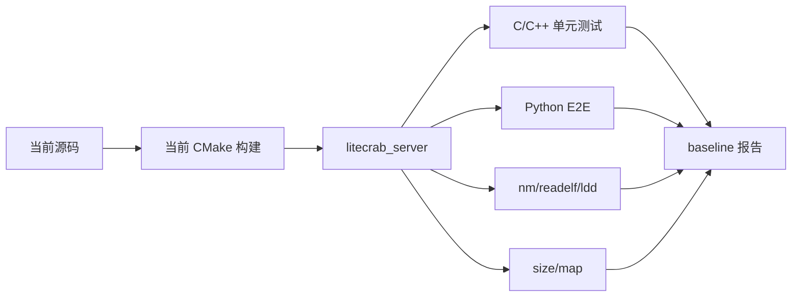
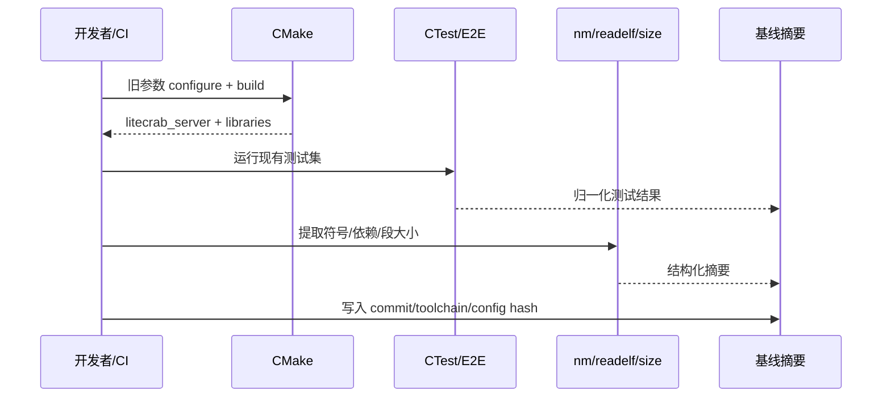

# 阶段 0：实施基线与兼容护栏

## 1. 阶段目标

本阶段不改变功能，只冻结改造前的构建、API、行为和资源基线，使后续每一步都能回答“是否破坏现有智能诊断版本”。

完成后应得到四类可机器比较的证据：测试结果、公开符号、二进制依赖、运行行为。

## 2. 基线架构



此处的 baseline 是比较依据，不进入目标设备。

## 3. 功能和边界

需要冻结：

- `litecrab_server` 正常启动、停止、TCP 请求与响应；
- Alarm polling/subscription、MCP、Memory、Session、Skills 的现有行为；
- 当前公开头文件与 `litecrab` 静态库导出符号；
- 静态/动态链接依赖和构建参数；
- 默认配置下的线程数量、端口、持久化目录和日志关键事件；
- Hi3516 机器人当前 `agent_core` 对外 API、调用时序和依赖库。

本阶段不承诺冻结内部私有函数；后续允许重构内部实现，但公开契约变化必须有兼容层。

## 4. 文件修改计划

| 文件 | 类型 | 修改内容 |
|---|---|---|
| `docs/kconfig/litecrab_kconfig_implementation/baseline/README.md` | 新增 | 记录采样 commit、工具链和命令 |
| `tests/config_matrix/baseline.ps1` 或 `.sh` | 新增 | 统一执行 configure/build/test/symbol/size 采集 |
| `tests/config_matrix/expected/diagnostic_full.*` | 新增 | 保存结构化预期，不保存包含密钥的日志 |
| `tests/test_public_api.c` | 新增 | 只包含公开头文件并链接公共 API |
| `CMakeLists.txt` | 小改 | 注册 public API contract test；不改生产源清单 |
| Hi3516 `agent/` 下的基线说明 | 新增 | 记录原 API 和旧构建命令，不改业务实现 |

如仓库不希望提交二进制快照，可提交 JSON/文本摘要和生成方式，产物 hash 由 CI artifact 保存。

## 5. 修改内容

### 5.1 基线元数据

建议结构：

```json
{
  "schema": 1,
  "source_revision": "<git-sha>",
  "toolchain": "gcc-x.y",
  "profile": "legacy_diagnostic_full",
  "tests": {"passed": 14, "failed": 0},
  "artifacts": {
    "litecrab_server": {
      "sha256": "<sha256>",
      "text": 0,
      "data": 0,
      "bss": 0
    }
  }
}
```

数值必须由脚本填入；设计文档不预填伪造的基准。

### 5.2 API 契约测试

示例：

```c
#include "kernel.h"
#include "runtime.h"

int main(void) {
    CrabRuntime runtime;
    (void)runtime;
    return 0;
}
```

后续新增 `include/litecrab/agent.h` 后，该测试迁移到新 API；旧 API 在声明的兼容期内继续有编译测试。

### 5.3 行为归一化

日志包含时间戳、端口和临时路径，不能直接逐字节比较。基线脚本应：

- 删除时间戳和随机 request ID；
- 把临时目录替换为占位符；
- 比较状态码、事件顺序和响应结构；
- 明确哪些 LLM 内容不可确定，只验证协议与状态机。

## 6. 执行流程



## 7. 测试方法

### 7.1 本机构建

```sh
cmake -S . -B build-baseline -DLITECRAB_BUILD_TESTS=ON
cmake --build build-baseline -j2
ctest --test-dir build-baseline --output-on-failure
```

### 7.2 产物检查

```sh
file build-baseline/litecrab_server
nm -g --defined-only build-baseline/liblitecrab.a
readelf -d build-baseline/litecrab_server
size build-baseline/litecrab_server
```

### 7.3 行为测试

- TCP 文本和 JSON 请求各一条；
- Alarm polling 与 subscription 各一次；
- MCP 开启、禁用和配置错误各一次；
- 正常退出、活动请求中退出各一次；
- Session 重启恢复和 Memory 上限测试。

### 7.4 Hi3516 基线

记录但不改变当前 `BUILD.gn`：

- 静态库/目标名；
- `agent_init/input/deinit` 或实际入口的头文件签名；
- ASR→Agent→TTS 调用时序；
- 板级回调和 `libllmclient` 的链接方式；
- 一次真机功能日志和产物 size。

## 8. 验收标准

- 当前主机构建与测试全部通过；
- 基线记录包含 commit、工具链、CMake 参数和配置摘要；
- 日志中无 Token、API Key 和完整业务数据；
- 能在干净目录重新生成同结构报告；
- Hi3516 基线接口和构建入口已记录；
- 本阶段生产行为和产物内容没有主动变化。

## 9. 回滚

本阶段只增加测试和报告。若新增 contract test 暴露现有构建不稳定，应先记录为已知缺陷，不得通过修改生产逻辑“顺手修复”并混入基线提交。
