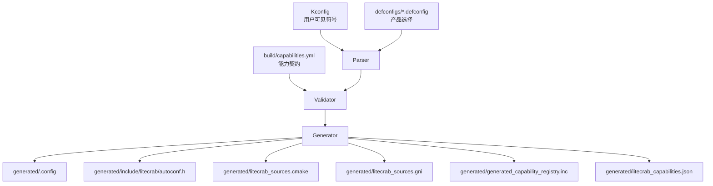
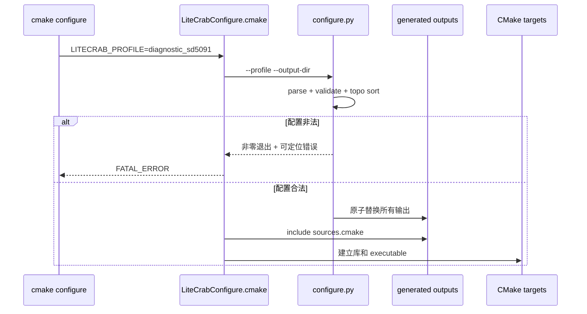

# 阶段 1：Kconfig、中央 Manifest 与生成器

## 1. 阶段目标

在不改变默认智能诊断行为的前提下，建立唯一配置输入链：

```text
Kconfig + Product defconfig + capabilities.yml
                    ↓ configure.py
.config + autoconf.h + sources.cmake/gni + registry.inc + capabilities.json
```

首期只有一个 `configure.py`。它是主机侧构建工具，不会链接进 SD5091 二进制或 Hi3516 静态库。

## 2. 子方案架构



权威关系：Kconfig 定义可选项，defconfig 定义 Product 选择，Manifest 定义实现文件和技术依赖；任何输出都不可被手工编辑。

## 3. 功能设计

`configure.py` 必须实现：

1. 解析 Kconfig 和指定 defconfig；
2. 拒绝未定义 symbol、重复能力 ID、重复源码归属；
3. 校验 Capability requires/conflicts/platform/artifact；
4. 校验 Manifest 中源文件真实存在；
5. 进行稳定拓扑排序；
6. 生成相同选择对应的确定性输出；
7. 输出不含秘密的能力摘要和配置 hash；
8. 提供 `--check`，只校验不生成；
9. 生成失败使用非零退出码，不能静默回退为全量构建。

## 4. 文件修改计划

| 文件 | 类型 | 修改内容 |
|---|---|---|
| `Kconfig` | 新增 | Artifact、Platform、原子 Capability 符号 |
| `defconfigs/diagnostic_sd5091.defconfig` | 新增 | 与现有诊断版本等价的全量组合 |
| `defconfigs/robot_hi3516.defconfig` | 新增 | 先声明目标组合，阶段 4 才正式交付 |
| `products/diagnostic_sd5091/product.yml` | 新增 | 产品 ID、Platform、Prompt、期望产物 |
| `products/diagnostic_sd5091/prompt.md` | 新增/迁移 | 诊断 Prompt 数据 |
| `build/capabilities.yml` | 新增 | 唯一能力实现清单 |
| `tools/kconfig/configure.py` | 新增 | 解析、校验与生成总入口 |
| `tools/kconfig/requirements.lock` | 新增 | 固定主机依赖版本 |
| `build/cmake/LiteCrabConfigure.cmake` | 新增 | CMake 调用生成器并 include 输出 |
| `CMakeLists.txt` | 修改 | 默认走 diagnostic profile；保留旧 options 兼容映射一个周期 |
| `.gitignore` | 修改 | 忽略生成目录，不忽略 defconfig/Manifest |
| `tests/config_matrix/test_configure.py` | 新增 | 生成器与错误组合测试 |

## 5. 配置与清单示例

### 5.1 Kconfig

```kconfig
mainmenu "LiteCrab Configuration"

choice LITECRAB_ARTIFACT
    prompt "Artifact type"
config LITECRAB_ARTIFACT_EXECUTABLE
    bool "Standalone executable"
config LITECRAB_ARTIFACT_STATIC_LIBRARY
    bool "Embedded static library"
endchoice

config LITECRAB_CAP_TCP_GATEWAY
    bool "TCP Gateway"
    default n

config LITECRAB_CAP_ALARM
    bool "Alarm ingress"
    default n

config LITECRAB_CAP_MCP_CLIENT
    bool "MCP client"
    default n
```

不得添加 `PRODUCT_DIAGNOSTIC` 自动选择一组能力；组合只写在 defconfig 中。

### 5.2 diagnostic defconfig

```text
CONFIG_LITECRAB_PRODUCT_ID="diagnostic_sd5091"
CONFIG_LITECRAB_PLATFORM_POSIX=y
CONFIG_LITECRAB_ARTIFACT_EXECUTABLE=y
CONFIG_LITECRAB_CAP_TCP_GATEWAY=y
CONFIG_LITECRAB_CAP_ALARM=y
CONFIG_LITECRAB_CAP_MCP_CLIENT=y
CONFIG_LITECRAB_CAP_MEMORY=y
CONFIG_LITECRAB_CAP_SKILLS=y
```

### 5.3 Manifest

```yaml
schema: 1
capabilities:
  alarm:
    symbol: LITECRAB_CAP_ALARM
    adapter: litecrab_cap_alarm
    sources:
      - src/capability/cap_alarm.c
      - src/alarm/alarm_app.c
      - src/alarm/alarm_service.c
      - src/alarm/alarm_notify.c
      - src/alarm/asp_client.c
      - src/alarm/polling/polling.c
      - src/alarm/subscription/subscription.c
    requires_platform: [threads, filesystem, http_client]
    libraries: [curl]
```

Manifest 字段必须使用仓库相对路径。路径规范化后禁止越出仓库根目录。

## 6. 生成物示例

### 6.1 `autoconf.h`

```c
#ifndef LITECRAB_AUTOCONF_H
#define LITECRAB_AUTOCONF_H
#define CONFIG_LITECRAB_CAP_ALARM 1
#define CONFIG_LITECRAB_CAP_TCP_GATEWAY 1
#define CONFIG_LITECRAB_PRODUCT_ID "diagnostic_sd5091"
#endif
```

### 6.2 CMake 源清单

```cmake
set(LITECRAB_GENERATED_SOURCES
  "${CMAKE_CURRENT_SOURCE_DIR}/src/capability/cap_alarm.c"
  "${CMAKE_CURRENT_SOURCE_DIR}/src/alarm/alarm_service.c")
set(LITECRAB_GENERATED_LIBRARIES CURL::libcurl)
```

### 6.3 能力报告

```json
{
  "schema": 1,
  "product": "diagnostic_sd5091",
  "artifact": "executable",
  "capabilities": ["alarm", "memory", "mcp_client", "tcp_gateway"],
  "config_hash": "<sha256>"
}
```

## 7. CMake 接入流程



生成器写到临时文件，全部成功后再原子替换，避免中途失败留下半套配置。

## 8. 兼容策略

现有 `LITECRAB_WITH_MCP_CLIENT` 和 `LITECRAB_WITH_MCP_HTTP` 可保留一个发布周期：

- 未指定 profile 时默认 `diagnostic_sd5091`；
- 若用户显式给旧 option，则包装层转换成临时 config fragment；
- 若旧 option 与 defconfig 冲突，立即报错；
- 下一周期删除旧 option，并在 release note 提供迁移表。

业务源码在本阶段仍可使用旧宏；本阶段目标是先跑通配置链，不同时改生命周期。

## 9. 测试方法

### 9.1 生成器单元测试

- 合法 defconfig 输出稳定；
- 未定义 symbol 失败；
- 源文件不存在失败；
- requires 缺失失败；
- conflicts 同时启用失败；
- 环依赖给出完整路径；
- 同一输入连续生成两次 hash 相同；
- YAML 路径穿越、重复 key 和非法类型失败。

### 9.2 默认等价测试

```sh
cmake -S . -B build-kconfig -DLITECRAB_PROFILE=diagnostic_sd5091
cmake --build build-kconfig -j2
ctest --test-dir build-kconfig --output-on-failure
```

与阶段 0 比较：目标列表、能力列表、现有 CTest、关键公开符号和运行行为必须一致。二进制字节无需完全相同，因为生成头和链接顺序可能变化。

### 9.3 负向测试

```text
alarm=y + platform 无 filesystem       → configure 失败
mcp_http=y + mcp_client=n              → configure 失败
executable=y + static_library=y         → Kconfig choice 失败
Manifest 引用 missing.c                → configure 失败
```

## 10. 阶段验收

- 默认 Profile 可运行全部现有测试；
- 输出完全由输入生成且可复现；
- CMake 不再手工枚举新增能力的条件源文件；
- GN 清单已生成但允许到阶段 4 才被 Hi3516 消费；
- 生成器和 Python 依赖未进入 install tree；
- 配置错误在 configure 阶段失败，不推迟到链接或运行阶段。

## 11. 回滚

保留旧 CMake 源列表一个阶段，通过单一兼容开关切回；不得让新旧列表同时参与同一个 target。阶段验收通过后再进入阶段 2，之后删除旧清单必须单独提交。
