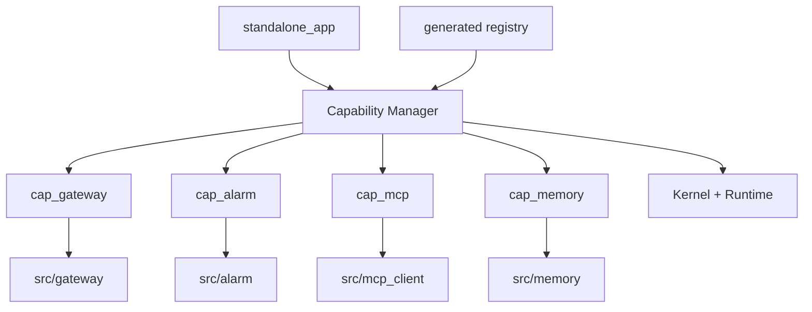
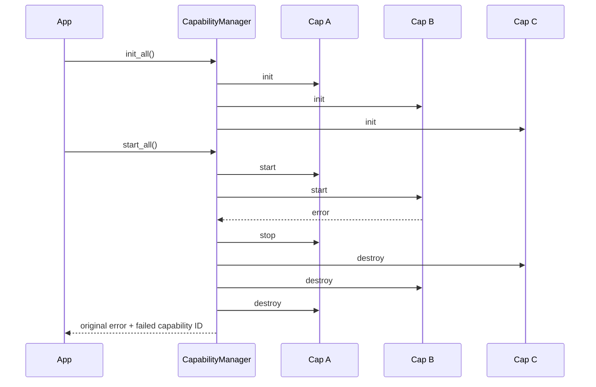

# 阶段 2：Capability Manager 与现有能力适配

## 1. 阶段目标

把 `main.c` 手工管理的 Alarm、MCP、TCP Gateway 等生命周期迁移到统一 Capability Manager，同时保留现有模块内部实现和物理目录。

本阶段解决“配置选中了什么”和“程序实际启动了什么”不一致的问题。

## 2. 子方案架构



Adapter 只处理生命周期、依赖注入和错误转换，不复制模块业务代码。

## 3. 生命周期契约

```c
typedef struct LiteCrabContext LiteCrabContext;

typedef struct {
    const char *id;
    int (*init)(LiteCrabContext *ctx);
    int (*start)(LiteCrabContext *ctx);
    int (*quiesce)(LiteCrabContext *ctx);
    void (*stop)(LiteCrabContext *ctx);
    void (*destroy)(LiteCrabContext *ctx);
} LiteCrabCapabilityOps;
```

语义：

- `init`：只构造状态和注册 Tool，不启动后台线程；
- `start`：依赖已启动，可以对外提供服务；
- `quiesce`：停止接收新工作，允许在截止时间内排空；
- `stop`：请求后台任务停止并 join；
- `destroy`：释放本能力所有资源；
- 任一步失败，Manager 只对已成功阶段执行逆序回滚；
- 每个函数需说明幂等性，`stop/destroy` 必须允许部分初始化状态。

## 4. 文件修改计划

| 文件 | 类型 | 修改内容 |
|---|---|---|
| `include/litecrab/capability.h` | 新增 | 生命周期接口、状态和错误码 |
| `src/capability/capability_manager.c` | 新增 | 拓扑顺序启动、逆序停止、失败回滚 |
| `src/capability/capability_registry.c` | 新增 | 包含生成的 registry |
| `src/capability/cap_gateway.c` | 新增 | 包装 TCP server 与工作线程 |
| `src/capability/cap_alarm.c` | 新增 | 包装 `AlarmApp*` API |
| `src/capability/cap_mcp.c` | 新增 | 包装 MCP Manager 和 Tool 注册 |
| `src/capability/cap_memory.c` | 新增 | 包装 Memory 生命周期 |
| `src/app/standalone_app.c` | 新增 | 配置加载、Context、Manager、主循环 |
| `src/main.c` | 修改 | 缩为参数解析和 `LiteCrabStandaloneRun()` 调用 |
| `src/gateway/tcp_line.c` | 小改 | 若缺少，补充 request-stop/join 可调用边界 |
| `src/alarm/alarm_app.c` | 小改 | 只补幂等/上下文接口，不重写状态机 |
| `src/mcp_client/client_manager.c` | 小改 | 显式 init/start/stop 边界 |
| `build/capabilities.yml` | 修改 | 填写 Adapter 和生命周期依赖 |
| `tests/test_capability_manager.c` | 新增 | 顺序、回滚、幂等和超时测试 |

## 5. 生成注册表示例

```c
extern const LiteCrabCapabilityOps litecrab_cap_memory;
extern const LiteCrabCapabilityOps litecrab_cap_mcp;
extern const LiteCrabCapabilityOps litecrab_cap_gateway;
extern const LiteCrabCapabilityOps litecrab_cap_alarm;

static const LiteCrabCapabilityOps *const kCapabilities[] = {
    &litecrab_cap_memory,
    &litecrab_cap_mcp,
    &litecrab_cap_gateway,
    &litecrab_cap_alarm,
};
```

数组顺序来自依赖拓扑和稳定 ID 排序。`main.c` 不出现 `#ifdef ALARM`。

## 6. Adapter 修改示例

### 6.1 Alarm

```c
static int alarm_start(LiteCrabContext *ctx) {
    return AlarmAppStart(&ctx->alarm, &ctx->config.alarm);
}

static int alarm_quiesce(LiteCrabContext *ctx) {
    return AlarmAppQuiesce(&ctx->alarm);
}

static void alarm_stop(LiteCrabContext *ctx) {
    (void)AlarmAppStop(&ctx->alarm);
}

const LiteCrabCapabilityOps litecrab_cap_alarm = {
    .id = "alarm",
    .start = alarm_start,
    .quiesce = alarm_quiesce,
    .stop = alarm_stop,
};
```

Alarm 是 ingress 能力，不依赖 TCP Gateway；两者可以独立开关。

### 6.2 Gateway

当前 server 入口若阻塞，由 Adapter 创建受管线程：

```c
static int gateway_start(LiteCrabContext *ctx) {
    return LiteCrabThreadStart(&ctx->gateway_thread,
                               gateway_thread_main, ctx);
}

static void gateway_stop(LiteCrabContext *ctx) {
    RequestServerRequestStop(&ctx->request_server);
    LiteCrabThreadJoin(&ctx->gateway_thread);
}
```

不得使用 detach 线程；否则 Manager 无法保证静态库卸载或进程退出时资源已经释放。

## 7. 启停与失败流程



真正实现时只回滚已完成的动作；图中 destroy 顺序由内部状态表决定。

正常退出：


## 8. 运行配置一致性

配置文件可能含被裁剪能力的字段。建议规则：

- 能力未编译但配置为 `enabled: false`：允许，记录 debug；
- 能力未编译但配置为 `enabled: true`：启动失败并明确提示重新构建；
- 能力已编译但运行配置关闭：允许不启动，仅当该能力声明支持 runtime-disable；
- 核心必需能力不可 runtime-disable。

这样不会出现配置显示开启、产物实际没有能力却静默继续的情况。

## 9. 测试方法

### 9.1 Manager 单元测试

- 正常 init/start 与逆序 stop/destroy；
- 第 N 个 init/start 失败的精确回滚；
- 重复 stop/destroy 不崩溃；
- quiesce deadline 到期后进入有界强制停止；
- 重复能力 ID、空函数和依赖顺序错误被拒绝。

### 9.2 能力组合构建

| 组合 | 预期 |
|---|---|
| Gateway only | TCP 请求可进入 Core，无 Alarm/MCP 符号 |
| Alarm only | Alarm 可产生 ingress，无监听端口 |
| MCP only | MCP Tool 可注册，无 Alarm/Gateway 线程 |
| Alarm + MCP | 告警可触发使用 MCP Tool 的 Agent |
| 全关闭的最小 Core | 无上述模块依赖，基础同步 API测试通过 |
| diagnostic full | 阶段 0 行为回归通过 |

### 9.3 裁剪证明

对每个关闭能力执行：

```sh
nm -C <artifact> | grep -E 'AlarmApp|McpClient|StartRequestServer'
readelf -d <artifact>
```

预期对应符号和仅由该能力使用的动态依赖消失。仅检查“没有启动线程”不算编译裁剪完成。

### 9.4 故障注入

- 端口占用导致 Gateway start 失败；
- Alarm 配置非法；
- MCP endpoint 不可达；
- 第三方库初始化失败；
- 活动请求期间收到退出信号。

验证无泄漏线程、fd、队列和半注册 Tool。

## 10. 阶段验收

- `main.c` 不再手工列举能力；
- Alarm、MCP、Gateway 可独立构建和启停；
- 关闭能力后源文件、符号、依赖和线程均消失；
- 生命周期失败能完整逆序回滚；
- diagnostic full 的现有 E2E 全部通过；
- 未移动现有业务目录，Adapter 没有复制业务状态机。

## 11. 回滚

在一个发布周期内保留 `LegacyStandaloneRun()` 作为编译时回滚入口，但正式 CI 只测试新 Manager。不得让同一进程同时启动新旧两套生命周期。验收稳定后删除旧入口。
