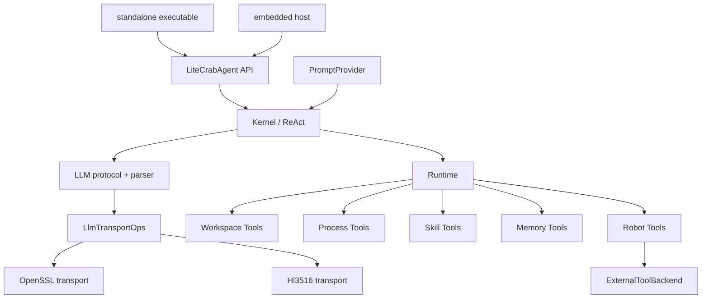
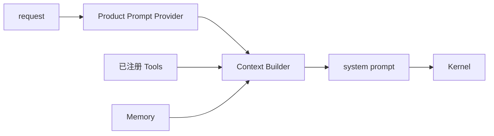
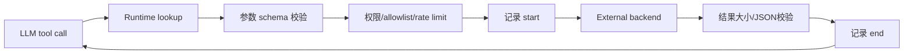

# 阶段 3：公共扩展点与工具原子化

## 1. 阶段目标

以最小改动抽取四个跨 Product 必需接口：Prompt、LLM Transport、External Tool Backend、Embedded Agent API；同时机械拆分 `builtin_tools.c`，使工具能力能被链接器真实裁剪。

完成后 Kernel、LLM 协议层和 Runtime 不知道“智能诊断”或“机器人”名称。

## 2. 目标架构



依赖方向只能从 Core 指向接口，从平台/能力实现接口；平台代码不得反向包含 Kernel 私有头文件。

## 3. 修改范围

| 文件 | 类型 | 修改内容 |
|---|---|---|
| `include/litecrab/prompt.h` | 新增 | Prompt Provider 契约 |
| `include/litecrab/llm_transport.h` | 新增 | HTTP/LLM Transport 契约、取消语义 |
| `include/litecrab/external_tool.h` | 新增 | 板级 Tool backend 契约 |
| `include/litecrab/agent.h` | 新增 | 稳定 Embedded Agent API |
| `src/kernel/kernel.c` | 修改 | 调用 PromptProvider 和公开 Agent 执行入口 |
| `src/kernel/llm.c` | 修改 | 只抽离连接/收发，保留 JSON/流解析 |
| `src/platform/llm_transport_openssl.c` | 新增 | 当前 POSIX/OpenSSL 行为迁移 |
| `src/app/embedded_agent.c` | 新增 | Agent handle、同步请求、取消、销毁 |
| `src/runtime/runtime.c` | 修改 | External backend 仍经过 ToolSpec 执行链 |
| `src/runtime/builtin_tools.c` | 删除/兼容壳 | 机械拆到多个编译单元后移除 |
| `src/runtime/tools/*.c` | 新增 | Workspace/Process/Skill/Memory/Robot 工具 |
| `build/capabilities.yml` | 修改 | 每组工具的 source、requires、libraries |
| `tests/test_prompt_provider.c` | 新增 | Prompt 边界测试 |
| `tests/test_llm_transport_contract.c` | 新增 | Transport 合同测试 |
| `tests/test_embedded_agent.c` | 新增 | 公开 API 生命周期和并发测试 |
| `tests/test_external_tool_backend.c` | 新增 | schema/权限/超时/审计不被绕过 |

## 4. Prompt Provider 子方案

### 4.1 功能

- Product Prompt 从 Kernel 代码移出；
- 支持编译期内嵌文本和宿主回调两种来源；
- 统一追加工具、Memory、时间等动态上下文；
- 保证输出长度和截断策略可测试。

### 4.2 接口示例

```c
typedef struct {
    void *ctx;
    int (*build)(void *ctx,
                 const LiteCrabPromptRequest *request,
                 char *output,
                 size_t output_size);
} LiteCrabPromptProvider;
```

`configure.py` 可把 `products/<id>/prompt.md` 转义为生成 C 文件。生成文件只包含公开 Prompt 文本，不包含密钥。

### 4.3 流程



Prompt Provider 失败应终止本次请求，不回退到另一个 Product 的硬编码文本。

## 5. LLM Transport 子方案

### 5.1 边界

`llm.c` 保留：请求 JSON、stream/non-stream 协议、tool call 解析、错误语义。Transport 负责：连接、TLS/宿主 client、HTTP 收发、取消和超时。

```c
typedef struct {
    void *ctx;
    int (*post)(void *ctx,
                const LiteCrabHttpRequest *request,
                LiteCrabHttpResponseSink *sink,
                const LiteCrabDeadline *deadline);
    void (*cancel)(void *ctx);
    void (*destroy)(void *ctx);
} LlmTransportOps;
```

Sink 允许流式响应，避免 Hi3516 transport 必须拼接无限响应缓冲。

### 5.2 错误映射

| Transport 错误 | Core 错误 |
|---|---|
| DNS/connect/TLS | `LITECRAB_ERR_UNAVAILABLE` |
| deadline | `LITECRAB_ERR_TIMEOUT` |
| explicit cancel | `LITECRAB_ERR_CANCELLED` |
| HTTP 401/403 | `LITECRAB_ERR_AUTH` |
| malformed response | 由协议层返回 `LITECRAB_ERR_PROTOCOL` |

平台实现不得自行重试非幂等请求；重试策略由 Core 统一决定。

## 6. External Tool Backend 子方案

板级 Tool 先注册为正常 `ToolSpec`：

```c
typedef struct {
    void *ctx;
    int (*invoke)(void *ctx, const char *tool_id,
                  const char *arguments_json,
                  char *result_json, size_t result_size,
                  const LiteCrabDeadline *deadline);
    void (*cancel)(void *ctx, uint64_t invocation_id);
} LiteCrabExternalToolBackend;
```

调用流程：



严禁 Kernel 检测 callback 后直接调用，因为那会绕过所有 Runtime 治理。

## 7. Embedded Agent API 子方案

```c
typedef struct LiteCrabAgent LiteCrabAgent;

int LiteCrabAgentCreate(const LiteCrabAgentConfig *config,
                        LiteCrabAgent **out_agent);
int LiteCrabAgentExecuteSync(LiteCrabAgent *agent,
                             const LiteCrabRequest *request,
                             LiteCrabResponse *response);
int LiteCrabAgentCancel(LiteCrabAgent *agent, uint64_t request_id);
void LiteCrabAgentDestroy(LiteCrabAgent *agent);
```

契约：

- 调用者拥有 request 输入，API 返回前不得异步引用；
- response 的释放方式在头文件中明确；
- 同一 handle 是否允许并发必须固定，首期建议串行并返回 `BUSY`；
- `Destroy` 先 quiesce/cancel/join，再释放；
- 不公开 `run_round()`、Kernel 私有结构或全局单例。

旧 `agent_init/input/deinit` 在 Hi3516 目录中作为薄兼容包装，阶段 4 验收后决定保留周期。

## 8. `builtin_tools.c` 拆分方案

首期按链接裁剪边界拆，不做功能重写：

```text
src/runtime/tools/
├── builtin_common.c       # 仅共享的参数/结果助手
├── workspace_tools.c      # list/read/write/search 等
├── process_tools.c        # shell/process，仅支持该平台时编译
├── skill_tools.c          # Skill 发现和调用
├── memory_tools.c         # Memory 查询/写入
└── robot_tools.c          # 板级运动/设备工具注册
```

拆分步骤：

1. 先逐函数移动，不改变函数体；
2. 私有共享 helper 移入 `builtin_common.c` 或复制前先消除隐式依赖；
3. 每组暴露一个 `LiteCrabRegister*Tools()`；
4. Capability Adapter 调用注册函数；
5. 对比旧/新 Tool 名称、描述、schema 和结果；
6. 最后删除总注册函数或只保留兼容转发。

禁止把所有分组函数仍链接进一个 `builtin_tools.o`，否则关闭能力无法降低产物。

## 9. 测试方法

### 9.1 Prompt

- 产品 Prompt 精确选择；
- 缺失 Prompt 在 configure 阶段失败；
- 特殊字符、UTF-8 和最大长度；
- Robot Product 不包含诊断专属文本。

### 9.2 Transport contract

同一组测试向 OpenSSL fake server 和 Hi3516 mock transport 运行：成功、分块、HTTP 错误、超时、取消、畸形数据、过大响应。协议层预期结果必须一致。

### 9.3 Tool 原子化

- 比较拆分前后 Tool catalog 的结构化快照；
- 关闭 Process Tools 后 `fork/exec/system` 等符号和相关帮助文本消失；
- 关闭 Memory Tools 后不注册对应 schema；
- External backend 收到非法参数前必须已被 Runtime 拒绝；
- backend 超时/取消产生审计结束事件。

### 9.4 Agent API

- create/execute/destroy 正常路径；
- 构造中途失败无泄漏；
- 并发调用返回约定结果；
- execute 中 destroy/cancel 的竞态测试；
- 1000 次创建销毁和多轮请求；
- AddressSanitizer/ThreadSanitizer 可用平台下运行。

## 10. 阶段验收

- Kernel 不含 Product 名称和场景宏；
- `llm.c` 不直接依赖 OpenSSL socket 实现；
- 所有板级 Tool 都经过 Runtime；
- 公开 Agent API 不暴露内部 `run_round()`；
- 工具分组可单独从 link map 消失；
- diagnostic full 行为与阶段 0 一致；
- host stub 下能编译 Hi3516 transport 和 Robot Tools 接口。

## 11. 回滚

每个扩展点单独提交：Prompt → Transport → Agent API → Tool 拆分。不得在一个提交中同时移动 1000 行 Tool、改协议解析和接入机器人。旧接口通过薄包装保留，不能复制一份旧 Core。
