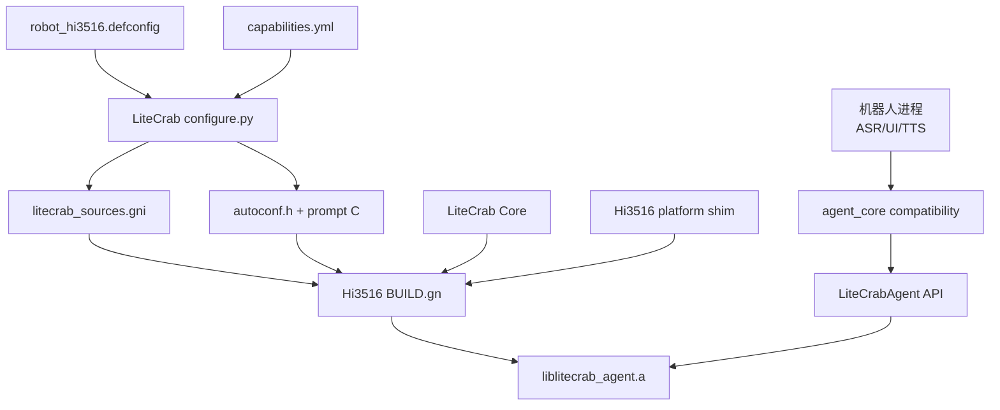
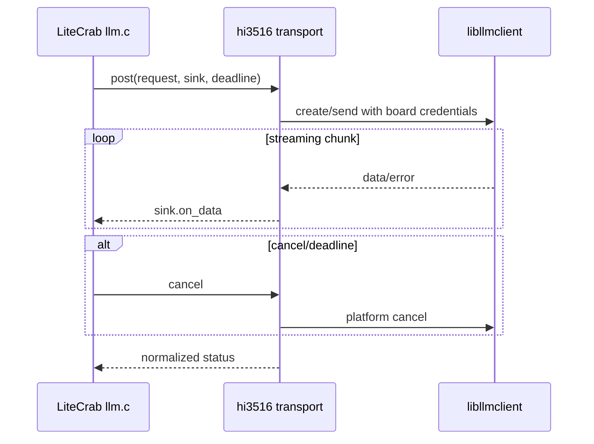
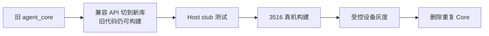

# 阶段 4：Hi3516 机器人合仓

## 1. 阶段目标

让 `Z:\code\3516\device\soc\hisilicon\common\platform\agent\` 不再保存修改后的 LiteCrab Core，只保留板级集成和兼容包装；GN 根据 `robot_hi3516.defconfig` 消费主仓生成清单，链接 `liblitecrab_agent.a` 或等价 GN static library。

阶段 4 完成前，旧机器人实现保留为可回滚基线。

## 2. 集成架构



主仓拥有 Core 和能力实现；3516 工程拥有设备驱动、`libllmclient` 包装、音频/运动回调及上层生命周期。

## 3. Product 配置

```text
CONFIG_LITECRAB_PRODUCT_ID="robot_hi3516"
CONFIG_LITECRAB_PLATFORM_HI3516=y
CONFIG_LITECRAB_ARTIFACT_STATIC_LIBRARY=y
CONFIG_LITECRAB_CAP_EMBEDDED_AGENT_API=y
CONFIG_LITECRAB_CAP_ROBOT_TOOLS=y
CONFIG_LITECRAB_CAP_TTS_OUTPUT=y
CONFIG_LITECRAB_CAP_MEMORY=y
# CONFIG_LITECRAB_CAP_ALARM is not set
# CONFIG_LITECRAB_CAP_TCP_GATEWAY is not set
# CONFIG_LITECRAB_CAP_MCP_CLIENT is not set
```

这只代表当前机器人组合；以后机器人也可以启用 Alarm 或 MCP，无需把能力重新实现成 Robot 版本。

## 4. 文件修改计划

### 4.1 LiteCrab 主仓

| 文件 | 类型 | 修改内容 |
|---|---|---|
| `defconfigs/robot_hi3516.defconfig` | 完成 | 固化机器人能力组合 |
| `products/robot_hi3516/product.yml` | 新增 | Platform、Artifact、Prompt 元数据 |
| `products/robot_hi3516/prompt.md` | 新增/迁移 | 机器人 Prompt |
| `src/platform/llm_transport_hi3516.c` | 新增 | 调用注入的 libllmclient ops，不直接包含私有宿主状态 |
| `src/runtime/tools/robot_tools.c` | 完成 | ToolSpec + External backend 转发 |
| `build/gn/BUILD.gn` | 新增 | 可复用 GN target 包装 |
| `tests/platform/hi3516/*` | 新增 | host stub 和 contract tests |

### 4.2 Hi3516 工程

| 文件 | 类型 | 修改内容 |
|---|---|---|
| `agent/BUILD.gn` | 修改 | 导入生成 `.gni`，编译/链接主仓选择源 |
| `agent/agent_core.c` | 修改 | 缩为旧 API → `LiteCrabAgent*` 兼容包装 |
| `agent/platform/litecrab_hi3516_llm.c` | 新增 | `libllmclient` 适配和错误映射 |
| `agent/platform/litecrab_hi3516_tools.c` | 新增 | 运动、设备控制、TTS backend |
| `agent/platform/litecrab_hi3516_os.c` | 新增 | 时钟、锁、线程/取消等必要 shim |
| 原删除/改写的 Core 文件 | 退役 | 真机验收后移除，不再维护第二份 |

## 5. GN 接入示例

```gn
import("//third_party/litecrab/generated/litecrab_sources.gni")

static_library("litecrab_agent") {
  sources = litecrab_sources
  sources += [
    "platform/litecrab_hi3516_llm.c",
    "platform/litecrab_hi3516_tools.c",
    "platform/litecrab_hi3516_os.c",
  ]
  include_dirs = [
    "//third_party/litecrab/include",
    "//third_party/litecrab/generated/include",
  ]
  deps = litecrab_gn_deps
}
```

建议使用固定目录映射、submodule 或构建系统依赖声明引入 LiteCrab；禁止在每次构建前手工复制一份源文件。若平台不允许外部路径，应由同步脚本按 commit 导入并校验 hash，仍不得人工删功能。

## 6. LLM Transport 适配



平台层负责把 `libllmclient` 回调线程切换到 LiteCrab 允许的同步/队列模型，并明确回调结束后缓冲区所有权。不可在平台层重新实现 tool-call 解析。

## 7. Robot Tool 适配

```c
static int robot_move_execute(const char *arguments,
                              char *result, size_t result_size,
                              void *user_data) {
    LiteCrabExternalToolBackend *backend = user_data;
    return backend->invoke(backend->ctx, "robot.move", arguments,
                           result, result_size, NULL);
}
```

真实实现还必须传 invocation ID、deadline 和 cancel。机器人宿主注册 backend，主仓注册 ToolSpec；这样 Tool 名称/schema/权限归主仓，硬件调用归板级。

## 8. 兼容迁移流程



切换顺序：

1. 旧接口保持不变，内部改调新 API；
2. host stub 验证无硬件也能跑完整链；
3. GN 同时提供 legacy/new 两个 target，但一个产物只能选一个；
4. 真机和长稳验证新 target；
5. 确认回滚包可用后删除重复 Core；
6. 最后再推动上层直接使用新公开 API。

## 9. 测试方法

### 9.1 Host stub

- mock `libllmclient` 返回普通回答和 tool call；
- mock Robot backend 验证 schema、调用参数和结果；
- TTS backend 验证文本传递和取消；
- ASR 输入多轮对话；
- LLM 超时、取消、空响应和回调乱序。

### 9.2 GN 构建检查

- 生成 `.gni` 与 CMake 对同一 defconfig 得到相同源集合；
- `robot_hi3516` 不包含 `alarm`、`gateway`、MCP 源和依赖；
- 产物只导出声明的 public API；
- 无 OpenSSL/libcurl 意外依赖；
- 重复符号和 private header 泄漏检查。

### 9.3 真机功能

至少验证：

1. 初始化/反初始化 100 次；
2. ASR 文本→普通回答→TTS；
3. ASR 文本→Robot Tool→结果→TTS；
4. 非法工具参数被 Runtime 拒绝；
5. LLM 网络断开和恢复；
6. 请求中停止 Agent；
7. 连续多轮会话和 Memory；
8. 8/24/72 小时分级 soak；
9. 线程、fd、heap 水位和 CPU 峰值；
10. 旧版与新版可回滚启动。

## 10. 修改后使用方式

主仓生成：

```sh
python3 tools/kconfig/configure.py \
  --profile robot_hi3516 \
  --output-dir out/robot_hi3516/generated
```

3516 构建系统随后导入生成目录并执行正常 GN/Ninja 构建。设备运行时只加载最终固件/二进制，不运行 Python，也不读取 Kconfig。

## 11. 阶段验收

- 3516 agent 目录不再保存修改版 Kernel/Runtime/LLM 协议实现；
- 主仓同一 commit 可构建 diagnostic 与 robot；
- GN/CMake 源集合由同一 Manifest 产生；
- Robot Tool 不绕过 Runtime；
- 不需要 Alarm/MCP/Gateway 的当前机器人产物不含其符号和依赖；
- 真机完整链路、异常和长稳测试通过；
- 旧产物和回滚步骤已经验证。

## 12. 回滚

保留一个经过测试的 legacy GN target 和旧产物，回滚只切 target/版本，不恢复手工复制源码。发生 ABI 或真机阻塞时可回到旧 target，但主仓接口修复必须继续前进，不能重新形成永久分叉。
