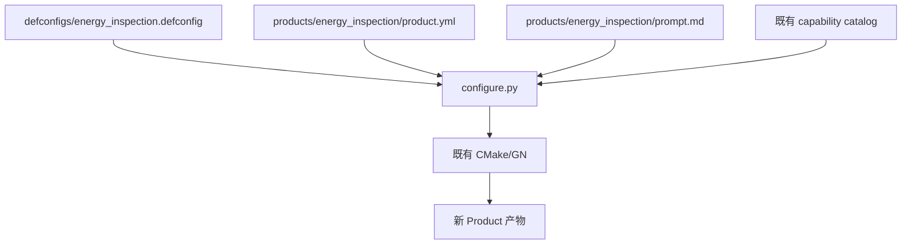
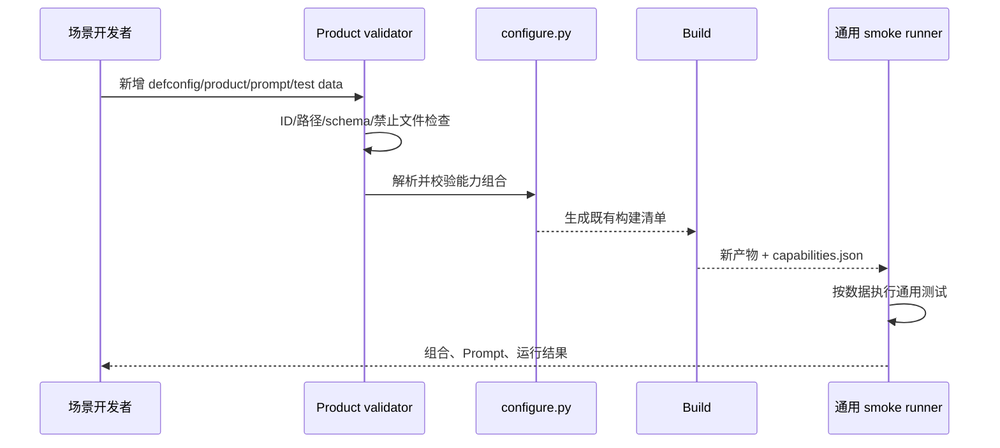
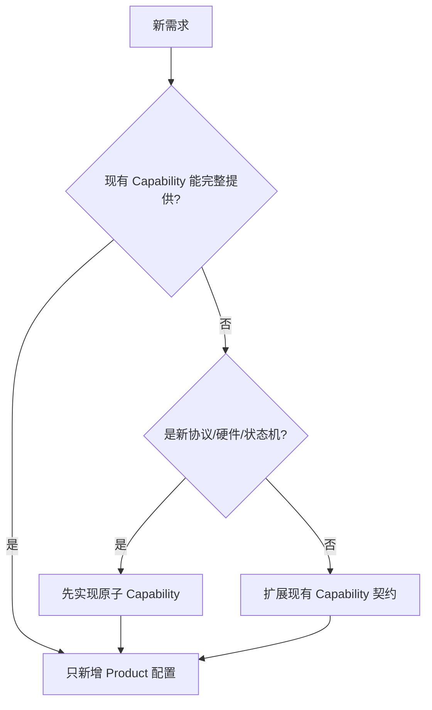

# 阶段 5：新 Product 零代码接入验证

## 1. 阶段目标

新增一个只组合现有 Capability 的示例 Product，用事实证明新场景不需要修改 C/H、Kconfig、Manifest、CMake 或 GN。

“零代码”只针对已有能力组合。如果新场景需要新协议、硬件驱动或业务状态机，应先新增一次原子 Capability，后续 Product 再零代码复用。

## 2. Product 模型



Product 是配置和数据，不拥有能力源码。

## 3. 允许修改的文件

```text
defconfigs/energy_inspection.defconfig
products/energy_inspection/product.yml
products/energy_inspection/prompt.md
tests/products/energy_inspection_smoke.yml
```

其中 smoke 数据是否纳入“Product 必需文件”由项目确定，但不能包含新的测试执行代码。

禁止修改：

```text
src/**/*.c
include/**/*.h
Kconfig
build/capabilities.yml
CMakeLists.txt
**/BUILD.gn
tools/kconfig/configure.py
```

如果必须修改上述文件，说明需求不是单纯的新 Product，或已有能力契约不完整，应退回架构评审。

## 4. 文件内容示例

### 4.1 defconfig

```text
CONFIG_LITECRAB_PRODUCT_ID="energy_inspection"
CONFIG_LITECRAB_PLATFORM_POSIX=y
CONFIG_LITECRAB_ARTIFACT_EXECUTABLE=y
CONFIG_LITECRAB_CAP_TCP_GATEWAY=y
CONFIG_LITECRAB_CAP_MCP_CLIENT=y
CONFIG_LITECRAB_CAP_MEMORY=y
CONFIG_LITECRAB_CAP_SKILLS=y
# CONFIG_LITECRAB_CAP_ALARM is not set
# CONFIG_LITECRAB_CAP_ROBOT_TOOLS is not set
```

### 4.2 `product.yml`

```yaml
schema: 1
id: energy_inspection
display_name: Energy Inspection Agent
defconfig: defconfigs/energy_inspection.defconfig
prompt: products/energy_inspection/prompt.md
artifact_name: litecrab_energy_inspection
runtime_config_schema: config/runtime.schema.json
```

Product 文件可设置产物显示名、Prompt 和配置 schema 引用，但不能重新声明 Capability 的源码或依赖。

### 4.3 Prompt

```markdown
你是能源设备巡检助手。优先使用已注册工具获取事实；无法确认时明确说明未知，禁止编造设备状态。
```

Prompt 只定义角色和业务约束，不写 endpoint、密码、Token 和部署地址。

### 4.4 数据驱动 smoke

```yaml
schema: 1
product: energy_inspection
cases:
  - name: tool_catalog
    expect_capabilities: [tcp_gateway, mcp_client, memory, skills]
    reject_capabilities: [alarm, robot_tools]
  - name: prompt_identity
    input: "你是谁"
    expect_contains: "巡检"
```

测试执行器来自通用 `tests/products/run_product_smoke.py`，每个 Product 不写新的脚本。

## 5. 接入流程



## 6. 通用校验器

建议为 Product 提交增加 diff guard：

```text
输入：base revision、head revision、product ID
允许：defconfigs/<id>.defconfig
      products/<id>/**
      tests/products/<id>_smoke.yml
拒绝：其他文件变化
```

这个 guard 用于证明零代码接入，不替代普通 PR 检查。若一个 PR 同时包含新能力与新 Product，应拆成两个提交：先交付并测试 Capability，再交付 Product 组合。

## 7. 构建和使用示例

```sh
cmake -S . -B build/energy_inspection \
  -DLITECRAB_PROFILE=energy_inspection \
  -DLITECRAB_BUILD_TESTS=ON
cmake --build build/energy_inspection -j2
ctest --test-dir build/energy_inspection --output-on-failure
```

正式产物使用方式与智能诊断相同：将二进制和独立的运行时配置部署到设备。Kconfig/defconfig 不需要复制到设备。

## 8. 测试方法

### 8.1 静态验证

- Product ID 与目录、defconfig 中 ID 一致；
- 引用的 Prompt 和 schema 存在；
- 所有 symbol 已定义；
- 能力依赖和冲突合法；
- diff guard 确认没有代码/构建系统修改；
- 生成 `capabilities.json` 与 defconfig 选择一致。

### 8.2 构建验证

- 干净目录首次构建；
- 连续构建不重复生成无变化文件；
- 关闭 Alarm/Robot 后无对应 object、符号和依赖；
- 产物名、版本和配置 hash 可查询；
- 安装树不包含 Python、Kconfig 或生成器依赖。

### 8.3 运行验证

- TCP Gateway 可接受请求；
- MCP Tool 可注册和调用；
- Memory/Skills 按所选配置工作；
- Alarm 不启动轮询/订阅线程；
- Robot Tool 不出现在 Tool catalog；
- Prompt 与 Product 一致；
- 缺失必需运行配置时提供明确错误。

## 9. 阶段验收

- 新 Product 只增加允许的配置和数据文件；
- 未修改业务源码和构建脚本；
- 通用命令完成配置、构建、测试；
- 选择的能力全部存在，未选择的能力确实被裁剪；
- 产品 Prompt、能力清单、运行配置边界清晰；
- 文档能由不了解 Kernel 内部实现的场景开发者独立操作。

## 10. 新能力与新场景判定



不得用 Product-specific `#ifdef` 规避新增 Capability 的设计流程。

## 11. 回滚

删除该 Product 的配置和数据文件即可，不影响其他 Product。已经发布的产物按产品版本回滚，不需要回滚 Core。
