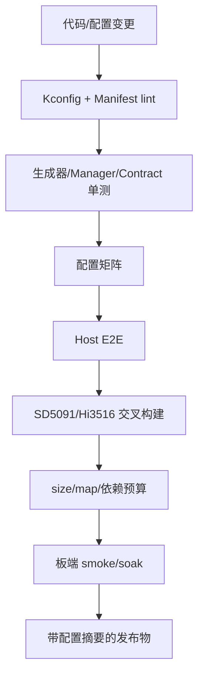
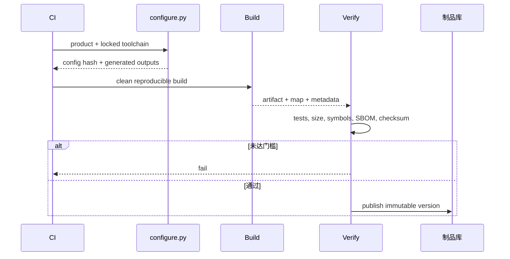

# 阶段 6：配置矩阵、发布与可选目录治理

## 1. 阶段目标

把前五阶段形成的配置系统纳入持续验证和发布，使“可配置”变成长期可维护的产品线能力；在稳定后再决定是否执行物理目录整理。

本阶段不会穷举所有 bool 的笛卡尔积，而是组合静态校验、单能力测试、关键交互、pairwise 和正式 Product 全量测试。

## 2. 验证架构



任何层失败都阻止正式发布；板端测试可按 nightly/release 分级，但正式发布必须有目标板证据。

## 3. 文件修改计划

| 文件 | 类型 | 修改内容 |
|---|---|---|
| `tests/config_matrix/matrix.yml` | 新增 | 正式 Product、单能力、交互和负向组合 |
| `tests/config_matrix/run_matrix.py` | 新增 | 通用生成/构建/测试/检查 runner |
| `tests/config_matrix/check_symbols.py` | 新增 | 符号、依赖和 Tool catalog 裁剪检查 |
| `tests/config_matrix/check_product_diff.py` | 新增 | 零代码 Product guard |
| `tests/config_matrix/budgets.yml` | 新增 | 每平台产物大小、BSS、线程等阈值 |
| CI 配置 | 修改 | PR、nightly、release 三档矩阵 |
| `cmake/package` 或发布脚本 | 修改 | 带上能力摘要、SBOM、config hash |
| `docs/kconfig/.../IMPLEMENTATION_STATUS.md` | 新增 | 按真实证据记录完成度和未完成项 |

## 4. 配置矩阵设计

### 4.1 PR 必跑

| 类型 | 组合 |
|---|---|
| 默认回归 | `diagnostic_sd5091` full |
| 最小 Core | executable + core only |
| 单能力 | Alarm、MCP、Gateway、Memory、Skills 分别开启 |
| 关键交互 | Alarm+Memory、Alarm+MCP、Gateway+MCP |
| Embedded | robot profile host stub |
| 负向 | 缺依赖、冲突、错误 Platform、缺源文件 |

### 4.2 Nightly

- 所有正式 Product；
- bool 选项 pairwise 组合；
- ASan/UBSan/TSan 可用组合；
- 静态链接和动态链接；
- 生成器不同 Python 受支持版本；
- 重复构建确定性；
- 长稳压力和故障注入。

### 4.3 Release

- SD5091 正式工具链交叉构建与真机 smoke/soak；
- Hi3516 正式 GN/Ninja 构建与机器人完整链；
- map/heap/线程/fd 预算；
- 升级和回滚；
- 配置摘要、SBOM、许可证、产物 hash。

## 5. Matrix 示例

```yaml
schema: 1
jobs:
  - id: diagnostic_full
    profile: diagnostic_sd5091
    tests: [unit, e2e, symbol, size]
  - id: alarm_without_gateway
    base: minimal_posix
    enable: [alarm, memory]
    reject_symbols: [StartRequestServer, McpClientStart]
  - id: robot_host_stub
    profile: robot_hi3516
    toolchain: host_stub
    tests: [transport_contract, external_tools, embedded_api]
  - id: invalid_mcp_transport
    base: minimal_posix
    enable: [mcp_http]
    expect_configure_failure: true
```

测试 runner 只能使用 Kconfig fragment 覆盖，不得直接拼接 CMake 源文件。

## 6. 资源预算

每个正式 Product 建立基线：

```yaml
diagnostic_sd5091:
  artifact_max_bytes: <measured-value>
  text_growth_percent: 3
  bss_growth_percent: 3
  max_threads_idle: <measured-value>
  max_open_fds_idle: <measured-value>
robot_hi3516:
  artifact_max_bytes: <measured-value>
  heap_peak_bytes: <measured-value>
```

占位符必须在阶段 0/4 实测后填写。预算超限可以经审核更新，但 CI 必须显示是哪个 Capability 引起变化。

### 6.1 能力差分报告

对每个 Capability 保存：

```text
delta text/data/bss
新增动态/静态库
新增线程及栈
新增 fd/连接池
运行时 heap 峰值
```

这些数据既用于产品选型，也用于决定哪些 `int` 参数值得进入 Kconfig。

## 7. 发布物设计

### 7.1 SD5091

```text
release/diagnostic_sd5091/
├── bin/litecrab_server
├── metadata/capabilities.json
├── metadata/build-info.json
├── metadata/sbom.spdx.json
└── metadata/checksums.txt
```

运行时 `config.json`、密钥和 Skills 仍由设备部署系统独立提供，不应因 Kconfig 改造被打包进公开产物。

### 7.2 Hi3516

```text
release/robot_hi3516/
├── lib/liblitecrab_agent.a
├── include/litecrab/*.h
├── metadata/capabilities.json
├── metadata/build-info.json
└── metadata/checksums.txt
```

如果最终由整机固件消费静态库，发布元数据应随固件归档，便于追溯主仓 commit 和 defconfig hash。

## 8. 发布流程



## 9. 可选目录治理

只有以下条件全部满足后才考虑把 `src/alarm` 等迁到 `capabilities/*`：

- 配置符号和 Capability ABI 已稳定至少一个发布周期；
- CMake/GN 都只消费生成清单；
- 不再有外部工程直接包含私有路径；
- 目录移动能独立完成，不夹带行为修改；
- `git mv` 后全矩阵仍通过。

目标结构可为：

```text
capabilities/
├── alarm/
├── mcp_client/
├── tcp_gateway/
├── memory/
└── robot_tools/
```

这一步不是 Kconfig 生效的前提，也不应该为了“结构漂亮”制造一次大规模回归。

## 10. 测试方法

### 10.1 配置契约

- Kconfig 所有内部 symbol 都已定义；
- Manifest 源文件和 Adapter 存在；
- 依赖图无环；
- 所有正式 defconfig 可解析；
- Kconfig 与 Manifest symbol 一一对应；
- 生成 CMake/GN 的规范化源集合一致。

### 10.2 产物契约

- 未选能力无 object/符号/Tool/依赖；
- `capabilities.json` 与产物内查询结果一致；
- install tree 无生成工具；
- release metadata 可追溯 commit、profile、toolchain 和 config hash；
- 两次 clean build 的生成文本和归一化产物一致。

### 10.3 板端门槛

- SD5091 智能诊断完整 E2E 和 72 小时 soak；
- Hi3516 ASR→Agent→Tool→TTS 和 72 小时 soak；
- 网络中断、磁盘满、配置错误、线程/连接耗尽和有界退出；
- 升级到新版本和回滚到上一正式版本。

## 11. 最终验收清单

- [ ] 一个 Manifest 驱动 CMake/GN；
- [ ] 正式 Product 有锁定 defconfig；
- [ ] 新 Product 零代码 guard 生效；
- [ ] 单能力和关键交互矩阵持续运行；
- [ ] 每个关闭能力有裁剪证据；
- [ ] SD5091 与 Hi3516 正式工具链构建通过；
- [ ] 两个平台真机验收通过；
- [ ] 资源预算有实测值；
- [ ] 发布物包含能力和构建摘要，不包含秘密；
- [ ] 回滚包和操作步骤经过演练。

## 12. 回滚和长期维护

正式发布以 `(source revision, product ID, config hash, toolchain ID)` 为唯一构建身份。回滚必须回滚完整身份组合，不能只替换二进制而保留不兼容的运行配置。

新增 Capability 时更新 Kconfig、Manifest、Adapter/实现、单能力测试和资源差分；新增 Product 时只更新配置和数据。CI 对这两类变更采用不同检查规则，防止场景代码重新渗入 Core。
