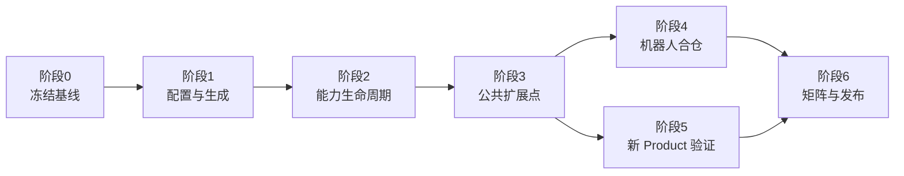

# LiteCrab 渐进式 Kconfig 实施计划

> 上位方案：[LiteCrab 渐进式 Kconfig 最小改造方案](../LiteCrab渐进式Kconfig最小改造方案.md)  
> 文档状态：已开始实施；真实完成度和未完成门禁见 [IMPLEMENTATION_STATUS.md](IMPLEMENTATION_STATUS.md)。
> 实施原则：每一步可独立合入、可回滚、默认产品行为不变；不得跳过阶段门槛直接删除旧路径。

## 1. 实施目标

用一份 LiteCrab Core 同时支持：

- SD5091 智能诊断可执行程序；
- Hi3516 机器人静态库；
- Alarm、MCP、TCP Gateway、Memory、Skills、Robot Tools 等原子能力按配置编译；
- 新 Product 仅增加 defconfig、产品元数据和 Prompt；
- 未选择能力不进入 object、link map、线程和运行配置；
- Python 生成工具只在开发机或 CI 中运行，不进入目标设备。

## 2. 阶段导航

| 阶段 | 文档 | 主要产物 | 合入门槛 |
|---|---|---|---|
| 0 | [实施基线与兼容护栏](00_baseline_and_guardrails.md) | 基线报告、符号/API/行为快照 | 当前测试通过，基线可复现 |
| 1 | [Kconfig、Manifest 与生成器](01_configuration_and_generator.md) | `.config`、`autoconf.h`、CMake/GN清单、能力报告 | 默认构建与旧构建等价 |
| 2 | [Capability Manager 与现有能力适配](02_capability_lifecycle.md) | 统一生命周期、Alarm/MCP/Gateway Adapter | 逐项开关能真实裁剪和回滚 |
| 3 | [公共扩展点与工具原子化](03_extension_points_and_tools.md) | Prompt、Transport、Tool Backend、Agent API | Core 不出现 Product 分支 |
| 4 | [Hi3516 机器人合仓](04_hi3516_robot_integration.md) | GN接入、静态库、板级 shim | ASR→Agent→Tool→TTS 真机通过 |
| 5 | [新 Product 零代码接入](05_zero_code_product.md) | 第三个示例 Product、模板与检查器 | Diff 不含业务 C/构建脚本修改 |
| 6 | [配置矩阵、发布与可选治理](06_matrix_release_and_cleanup.md) | CI 矩阵、size 基线、发布元数据 | 两平台可复现、可回滚 |

## 3. 总实施依赖图



阶段 1 和 2 不要求连接 Hi3516 工程；阶段 4 之前不得删除机器人目录的旧实现。阶段 5 必须使用已有能力，不允许为了证明“零代码”而偷偷增加场景判断。

## 4. 修改范围总览

```text
LiteCrab_0829/
├── Kconfig                                      # 阶段1新增
├── defconfigs/                                  # 阶段1/5新增
├── products/                                    # 阶段1/5新增
├── build/capabilities.yml                       # 阶段1新增
├── tools/kconfig/configure.py                   # 阶段1新增，主机工具
├── include/litecrab/                            # 阶段2/3新增公共契约
├── src/capability/                              # 阶段2新增薄适配层
├── src/app/                                     # 阶段2/3抽取入口
├── src/platform/                                # 阶段3/4平台实现
├── src/runtime/tools/                           # 阶段3机械拆分
├── tests/config_matrix/                         # 阶段1起持续扩充
└── CMakeLists.txt                               # 按阶段渐进接入生成清单

Hi3516 agent/
├── BUILD.gn                                     # 阶段4消费生成源清单
├── agent_core.c                                 # 阶段4变为兼容包装
└── platform/litecrab_hi3516_*.c                 # 阶段4板级适配
```

## 5. 每阶段共同交付格式

每个阶段的提交或 PR 必须包含：

1. 本阶段新增/修改/删除文件表；
2. 配置输入和生成输出样例；
3. 单元测试、组合构建、现有回归测试结果；
4. `nm`、link map 或目标清单证明关闭能力后已被裁剪；
5. 已知限制和回滚步骤；
6. 文档中的“完成状态”从设计更新为真实结果。

## 6. 全局禁止项

- 禁止新增 `SCENE_ROBOT`、`SCENE_DIAGNOSTIC` 等场景宏；
- 禁止在 Kernel 中直接启动 Alarm、Gateway、MCP；
- 禁止让板级 Tool callback 绕过 Runtime 的 schema、权限、超时和审计；
- 禁止手工同时维护 CMake 与 GN 的完整能力源清单；
- 禁止把 API Key、Token、证书私钥写入 Kconfig 或生成物；
- 禁止在没有 map/heap 证据时声明资源裁剪完成；
- 禁止在阶段 4 真机验收前删除旧机器人代码。

## 7. 完成定义

全部实施完成必须同时满足：

```text
同一 commit + 明确 Product defconfig
              ↓
        可复现生成配置
              ↓
    CMake 生成 SD5091 executable
    GN 生成 Hi3516 static library
              ↓
能力集合、版本、配置摘要可从产物查询
```

新增一个只使用已有能力的 Product 时，允许新增的文件仅限 `defconfigs/<product>.defconfig` 与 `products/<product>/*`；如果修改了 `.c/.h/CMakeLists.txt/BUILD.gn/Kconfig/capabilities.yml`，检查器必须判定其不是“零代码 Product 接入”。
