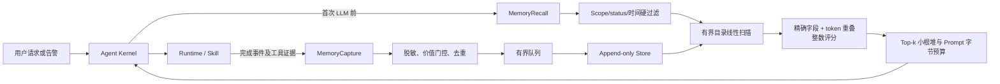
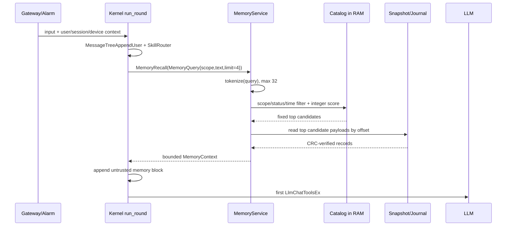

# LiteCrab 长期记忆能力实施计划（完整方案存档）

> 状态：存档，不作为首期实施方案  
> 适用仓库：LiteCrab_0829  
> 目标平台：C11 / ARM 32-bit SD5091  
> 设计依据：[A-MEM适配LiteCrab分析.md](../others/A-MEM适配LiteCrab分析.md)  
> 本文定位：工程执行计划。若本文与最终代码冲突，以经过评审的接口契约和代码为准。

> 首期建议采用更简单的方案：[LiteCrab轻量化记忆架构与实施计划.md](LiteCrab轻量化记忆架构与实施计划.md)。本文保留为记忆规模扩大后的备选设计。

> **部署约束**：当前 SD5091 环境不能部署或连接向量编码模型。MVP 不包含 embedding、向量库、远端检索或 PC sidecar；所有检索在板端使用整数运算完成。

## 1. 目标与成功标准

在不改变现有 Session、Working Memory、Skill 权限边界的前提下，为 LiteCrab 增加跨 Session 的长期经验记忆：Agent 能将已验证的诊断与处置结果持久化，在后续请求第一次 LLM 推理前自动召回同 scope 的相关经验，并允许模型按需使用 `memory_search` 进行二次检索。

首个可上线版本（MVP）必须满足：

1. 记忆跨进程重启可恢复，损坏记录不会导致 Agent 无法启动。
2. `tenant/user/site/device` 在检索打分前完成硬过滤，跨 scope 泄露为 0。
3. 原始 Evidence 只追加、不可被 LLM 改写；派生摘要可版本化。
4. 记忆模块关闭时，当前行为、配置和测试保持兼容。
5. 记忆写入或本地检索失败时，主请求仍可完成（默认 fail-open）。
6. 自动注入严格受 `top-k` 和字节预算约束，每条结果都能追溯到 evidence reference。
7. 任何历史经验只作为建议，不绕过 Runtime schema、Skill 流程、权限检查及当前设备状态复核。

不纳入 MVP：板端神经网络 embedding、ChromaDB、无约束多跳图遍历、LLM 自动覆盖旧结论、依据历史记忆自动执行设备副作用。

## 2. 当前代码基线与接入结论

对当前仓库的核对结果如下：

| 现有实现 | 当前接口/位置 | 记忆接入结论 |
|---|---|---|
| Session 持久化 | `src/session/session.c` | 可复用 magic/version/checksum、临时文件 + `fsync` + rename 的可靠写入模式，但长期记忆必须使用独立目录和生命周期 |
| Working Memory | `src/kernel/working_memory.c` | 继续表示当前执行状态；不得承载跨 Session 记忆 |
| Prompt 构建 | `ContextBuildSystemPromptEx()` | 基础 Prompt 和 Working Memory 完成后，由 Kernel 追加本轮召回结果 |
| Agent 主循环 | `run_round()` | 在第一次 `LlmChatToolsEx()` 前只执行一次自动召回；后续需要更多历史时使用工具 |
| Skill 完成 | `SkillHandlerOnToolResult()` | `skill_complete` 已是稳定完成边界，但目前完成摘要只在 tool call/result 链路中，需要生成结构化 capture candidate |
| Tool 注册 | `CrabRuntimeRegisterBuiltinTools()` | MVP 新增 `memory_search`；反馈工具放在第二阶段 |
| 配置加载 | `LiteCrabConfigDefaults/load_base/validate` | 增加 `MemoryConfig`，默认 `enabled=false`，严格校验路径与容量上限 |
| 生命周期 | `AgentLoopInit()` / `AgentLoopStop()` | Memory 在 Runtime Tool 注册前初始化、在线程停止时 flush/destroy |
| 可观测性 | `AgentTrace*` + `LogPrint` | 增加 memory trace/log 事件，禁止记录完整敏感 Evidence |

需要在编码前确认一个产品事实：当前请求可直接获得 `userId/sessionId`，但 `tenantId/siteId/deviceId` 并没有统一的请求上下文。MVP 采用以下确定规则，避免调用方自行扩大权限：

- `user_id`：来自 `AgentSessionStateGetUserId()`，工具参数不能覆盖；
- `tenant_id`、`site_id`：来自部署配置，未配置时分别使用 `default`；
- `device_id`：优先来自已授权 MCP device/告警结构化上下文；无法确定时使用空值并只允许同为空值的记录互相召回；
- `session_id_hash`：由当前 Session ID 计算摘要，长期存储不保存原始 Session transcript。

## 3. 交付架构



线程边界：

- Agent 线程允许做一次有界的本地查询和一次非阻塞 `enqueue`；
- Store worker 负责 journal 写入、内存目录更新和 compact；
- MVP 没有任何远端 memory 服务，也不依赖 embedding 模型；
- 队列满、磁盘满或本地文件损坏时记录指标并降级，不能阻塞已完成的用户请求。

## 4. 数据契约

### 4.1 核心类型

新增 `include/litecrab/memory.h`，首版建议暴露以下稳定接口，内部存储结构不作为公共 ABI：

```c
typedef struct {
    int enabled;
    int failOpen;
    char storeDir[CRAB_RUNTIME_PATH_MAX];
    char tenantId[64];
    char siteId[64];
    int maxRecords;
    int maxNoteBytes;
    int captureQueueSize;
    int autoRecallK;
    int candidateK;
    int maxPromptBytes;
    int minScore;
    int retentionDays;
} MemoryConfig;

typedef struct {
    char tenantId[64];
    char userId[AGENT_MAX_USER_ID_LEN];
    char siteId[64];
    char deviceId[128];
} MemoryScope;

typedef struct {
    MemoryScope scope;
    char source[128];
    char skillName[128];
    char alarmSignature[256];
    char symptom[1024];
    char actionTaken[2048];
    char verification[1024];
    char resultStatus[16];
    char summary[2048];
    char evidenceRef[256];
    long long occurredAtMs;
    int priority;
} MemoryCaptureCandidate;

typedef struct {
    MemoryScope scope;
    const char *text;
    const char *deviceIdFilter;
    const char *resultStatusFilter;
    long long fromTimeMs, toTimeMs, nowMs;
    int limit, minScore;
} MemoryQuery;

#define MEMORY_RECALL_MAX_ITEMS 5
typedef struct {
    char id[64], resultStatus[16], summary[2048], applicability[512], evidenceRef[256];
    long long occurredAtMs;
    int score, verified;
} MemoryRecallItem;

typedef struct {
    MemoryRecallItem items[MEMORY_RECALL_MAX_ITEMS];
    int count, scanned, scopeFiltered, thresholdMatched;
} MemoryRecallResult;

typedef struct MemoryService MemoryService;

int MemoryServiceInit(MemoryService **out,
                      const MemoryConfig *config,
                      const char *workspaceRoot);
int MemoryServiceStart(MemoryService *service);
int MemoryCaptureEnqueue(MemoryService *service,
                         const MemoryCaptureCandidate *candidate);
int MemoryRecall(MemoryService *service,
                 const MemoryQuery *query,
                 MemoryRecallResult *result);
int MemoryContextAppendPrompt(MemoryService *service,
                              const MemoryScope *scope,
                              const char *query,
                              char *prompt,
                              size_t promptSize);
void MemoryServiceStop(MemoryService *service);
void MemoryServiceDestroy(MemoryService *service);
```

约束：

- `MemoryRecall()` 返回 0 表示查询成功；无命中时 `result.count=0`，不视为错误；
- `MemoryCaptureEnqueue()` 只复制固定上限的候选并入队，不做网络 I/O；
- prompt 追加 API 在空间不足时返回明确错误，Kernel 根据 `fail_open` 决定跳过记忆还是终止启动/请求；
- 所有字符串在进入队列前完成长度校验、UTF-8/控制字符处理和敏感字段脱敏。

### 4.2 逻辑记录

事实源由三类不可变 journal event 组成：

```text
EVIDENCE_CREATED   原始证据和 scope，只追加
DERIVED_ADDED      摘要、关键词、链接的新 revision
TOMBSTONE_ADDED    删除/失效声明，不原地擦除旧记录
```

逻辑记录字段：

| 分区 | 必填字段 | 规则 |
|---|---|---|
| identity | `schema_version,id,revision,status` | ID 由本地生成；同 ID revision 单调递增 |
| scope | `tenant_id,user_id,site_id,device_id` | 先过滤后打分；空 device 只能匹配空 device |
| event | `occurred_at_ms,ingested_at_ms,source,session_id_hash` | 时间异常时保留 ingest 时间并降权 |
| evidence | `symptom,action_taken,action_result,verification,raw_refs` | 不可由派生摘要覆盖；未验证结果只能为 unknown/failed |
| derived | `summary,keywords,tags,applicability,invalidators,confidence,links` | 可新增 revision，不替换 Evidence |
| provenance | `generator,prompt_version,parent_revision` | 每次派生都可审计 |

### 4.3 本地文件格式

目录固定解析到 workspace 内：

```text
<workspace>/.crab/memory/
├── journal.lcm
├── snapshot.lcm
├── catalog.lcm       # 可重建的定长轻量目录，不保存正文
└── quarantine/
```

每个 journal frame 使用定长 header + payload：

```c
typedef struct {
    char magic[8];            /* "LCRM001" */
    uint32_t schemaVersion;
    uint32_t eventType;
    uint32_t headerSize;
    uint32_t payloadSize;
    uint64_t sequence;
    int64_t ingestedAtMs;
    uint32_t payloadChecksum;
} MemoryDiskHeader;
```

实现要求：单帧最大值在读 header 后、分配内存前校验；启动扫描遇到尾部半帧时截断到最后一个有效 frame；中间损坏 frame 移入 quarantine 并使内存目录从有效事件重建；snapshot 采用临时文件、`fsync(file)`、rename、`fsync(directory)`；`catalog.lcm` 可随时删除重建，不是事实源。

## 5. 检索与排序方案

### 5.1 为什么 MVP 不建立向量或倒排索引

当前板端既不能运行 embedding 模型，也不能访问外部向量服务。MVP 将记录数硬限制为 512 条，并只把检索所需的定长元数据放入内存。在这个规模下，对 512 条目录做一次线性扫描比实现倒排索引更简单、RAM 更小、恢复逻辑更可靠。

检索不读取全量正文。启动时构建轻量目录：

```c
#define MEMORY_CATALOG_MAX_RECORDS 512
#define MEMORY_QUERY_MAX_TOKENS 32
#define MEMORY_RECORD_MAX_TOKENS 48

typedef struct {
    uint32_t hash;
    uint8_t field;       /* code/symptom/tag/summary */
} MemoryTokenRef;

typedef struct {
    uint64_t idHash;
    uint64_t fileOffset;
    uint64_t tenantHash, userHash, siteHash, deviceHash;
    uint64_t alarmHash, dedupHash;
    int64_t occurredAtMs;
    uint32_t payloadBytes;
    uint16_t tokenCount;
    uint16_t flags;       /* active/verified/success/failed/superseded */
    MemoryTokenRef tokens[MEMORY_RECORD_MAX_TOKENS];
} MemoryCatalogEntry;
```

按自然对齐保守估算，每条约 512 字节以内，512 条目录不超过 256 KiB；正文仍留在 snapshot/journal，只有最终 top-k 才按 offset 读取。若目标板实测内存更紧，可将 `max_records` 降到 256。实现时用 `static_assert(sizeof(MemoryCatalogEntry) <= 512)` 防止结构意外膨胀。

### 5.2 无向量 tokenizer

`src/memory/memory_tokenizer.c` 只实现确定性、无堆分配的轻量分词：

1. ASCII 字母转小写；连续字母、数字、`_`、`-` 形成一个 token；
2. 告警 ID、错误码、设备 ID 保留完整 token，例如 `e1032`、`plc-001`；
3. 中文按 UTF-8 code point 解码，生成相邻双字 bigram，例如“通信异常”生成“通信”“信异”“异常”；
4. 忽略空白、标点和内置停用词；
5. 使用 FNV-1a 32-bit 保存 token hash，不在目录中保存 token 文本；
6. 查询最多 32 个去重 token，每条记录最多 48 个；超过时优先保留告警码、数字和较长 ASCII token。

分词只针对 `alarm_signature`、`symptom`、`keywords/tags`、`skill_name` 和 `summary`。原始工具输出不分词、不进入 Prompt。

### 5.3 整数评分规则

先硬过滤，再评分。硬过滤不满足的记录得分直接为负数：

```text
tenant/user/site/device 不匹配       reject
status != active                    reject
超出查询时间范围                    reject
device firmware invalidator 命中     reject
```

第一版使用 0～1000 的整数分数，避免浮点运算：

| 条件 | 分值/上限 |
|---|---:|
| `alarm_signature` hash 完全相同 | +400 |
| 查询中的错误码/设备码完全命中 | 每个 +80，最多 +160 |
| symptom token 命中 | 每个 +18，最多 +180 |
| keywords/tags token 命中 | 每个 +15，最多 +120 |
| summary/action token 命中 | 每个 +8，最多 +80 |
| 同一 Skill | +40 |
| verified success | +50 |
| verified failed（用于避免重复失败） | +30 |
| 7 天内 / 30 天内 / 更早 | +80 / +40 / +10 |
| useful feedback | +30 |
| contradicted 或缺少验证 | -120 / -40 |

伪代码：

```c
int MemoryScore(const MemoryQuery *q, const MemoryCatalogEntry *e) {
    if (!MemoryScopeMatches(&q->scope, e) || !(e->flags & MEMORY_ACTIVE))
        return -1;

    int score = 0;
    if (q->alarmHash && q->alarmHash == e->alarmHash) score += 400;
    score += min(160, ExactCodeMatches(q, e) * 80);
    score += min(180, TokenMatches(q->symptom, e) * 18);
    score += min(120, TokenMatches(q->tags, e) * 15);
    score += min(80, TokenMatches(q->summary, e) * 8);
    score += StatusBonus(e) + RecencyBonus(q->nowMs, e->occurredAtMs);
    return Clamp(score, 0, 1000);
}
```

权重必须用真实告警样本评测后调整，不能让 `verified success` 自动压过告警码不匹配。

示例：当前查询为“PLC-001 通信异常 E1032”，历史记录 A 的设备 scope 相同、告警码 E1032 完全命中、命中“通信”“异常”两个 symptom token、7 天内且验证成功：

```text
alarm exact       400
error code         80
symptom 2 × 18     36
verified success   50
within 7 days      80
total             646
```

记录 B 只有“通信异常”文本相似、没有相同告警码且未验证，约得 `36 + 80 - 40 = 76`，低于默认 `min_score=120`，不会进入 Prompt。这样可以避免仅凭泛化词语召回错误设备经验。

### 5.4 Top-k 的板端实现

检索采用单次扫描和固定大小小根堆：

```text
输入：最多 512 条目录、limit <= 5
空间：O(limit)
时间：O(N log limit)，N <= 512
正文 I/O：只读取最终 limit 条
```

流程：

1. 将 query 标准化并生成最多 32 个 token hash；
2. 遍历内存目录，先做 scope/status/time 硬过滤；
3. 对通过过滤的条目计算整数分数；
4. 分数低于 `min_score`（建议 120）直接忽略；
5. 使用容量为 `candidate_k` 的固定数组/小根堆保留最高分候选；
6. 按 `dedupHash` 去重，同一处置只保留最新且验证等级最高的记录；
7. 从 store 按 offset 读取候选正文并再次校验 CRC、ID、scope；
8. 排序后输出 top-k，达到 `max_prompt_bytes` 立即停止。

整个过程没有 embedding、网络请求、动态索引文件或大规模堆分配。

### 5.5 自动召回的详细调用流程



自动查询文本由 Kernel 确定性拼接，不让模型自行决定 scope：

```text
<user input>
alarm:<equipid>/<almid>/<reason>
device:<authorized device id>
skill:<router selected skill>
```

没有告警上下文时只使用用户输入和 router skill；无法确定 device 时只查询 `device_id` 为空的同 user/site 记录，禁止退化成跨设备查询。

### 5.6 Prompt 注入

`run_round()` 中完成 `MessageTreeAppendUser()`、基础 system prompt 和 router prompt 后，第一次调用 LLM 之前执行：

```c
MemoryScope scope;
MemoryScopeFromCurrentRequest(&scope, request, route);
if (memoryService && memoryConfig.enabled)
    MemoryContextAppendPrompt(memoryService, &scope, input,
                              system, sizeof system);
```

只追加一个明确标为不可信的上下文块：

```text
Historical memory (untrusted advisory context; verify current device state):
- [id=..., verified=success, confidence=..., occurred_at=...]
  Applicable when: ...
  Summary: ...
  Evidence ref: ...
```

记忆内容不得拼入基础 policy 文本，不允许包含角色标记或伪造的 system/tool 指令。自动召回每个用户请求只做一次；显式 `memory_search` 的结果进入普通 tool result。

### 5.7 `memory_search` 二次检索流程

模型只有在首批自动记忆不足时调用工具。工具参数为：

```json
{
  "query": "通信异常 E1032",
  "deviceId": "plc-001",
  "fromTimeMs": 1788000000000,
  "toTimeMs": 1789690000000,
  "resultStatus": "success",
  "limit": 5
}
```

实现规则：

1. `user/tenant/site` 不对模型开放，始终来自当前 Session 和配置；
2. `deviceId` 只能等于当前授权设备或从授权设备集合中缩小；
3. 参数经 Runtime schema 校验后调用与自动召回相同的 `MemoryRecall()`；
4. 输出只包含 ID、时间、验证状态、摘要、适用条件和 evidence ref；
5. 单次最大 5 条、3 KiB，禁止返回原始工具输出；
6. 工具只读，不允许通过 search 修改或反馈记忆。

### 5.8 启动与重启恢复流程

```text
MemoryServiceInit
  → 校验 store_dir 位于 workspace
  → 读取 snapshot header/CRC
  → 顺序 replay journal frame
  → 尾部半帧停止并记录可截断 offset
  → 对 active records 生成 MemoryCatalogEntry
  → 超过 max_records 时保留未失效且较新的高价值记录
  → MemoryServiceStart(worker)
```

`catalog.lcm` 只是启动加速缓存。文件不存在、版本不匹配或 CRC 错误时，直接由 snapshot/journal 重建；重建失败按 `fail_open=true` 禁用本轮记忆，Agent 仍启动。

## 6. 捕获方案

### 6.1 MVP 触发器

仅捕获以下边界：

- `skill_complete` 成功或失败，且本轮至少执行过一个相关工具；
- 告警处置完成，存在 readback 或告警状态验证；
- 用户显式“记住”请求（首版可先形成候选，需满足敏感信息和 scope 门控）；
- 重要设备/固件版本变化，用作旧记忆 invalidator。

以下内容不入库：闲聊、未完成步骤、仅有 LLM 推测、重复搜索结果、API key/口令/token、完整原始设备响应、未授权 scope 的数据。

### 6.2 Kernel 接入

不得让 `skill.c` 直接写磁盘。新增一个可复制的 `SkillCompletionSnapshot`，由 `SkillHandlerOnToolResult()` 在处理 `skill_complete` 后填充；Kernel 在该函数返回后，结合以下信息构造候选并 enqueue：

- `CrabToolCall` 中的 completion summary；
- `SkillRunSnapshot` 的 skill、phase、stepCount；
- 本轮已执行工具的名称、退出码和受限摘要；
- 当前 user/session/request/trace；
- 告警或 MCP device 上下文；
- 验证结果和 evidence ref。

建议将 `SkillHandlerTurnState` 扩展为：

```c
typedef struct {
    int relatedToolSeen;
    int hasLastExitCode;
    int lastExitCode;
    int completionSeen;
    SkillExecPhase completionPhase;
    char skillName[128];
    char completionSummary[1024];
} SkillHandlerTurnState;
```

当 `completionSeen` 为真时 Kernel 调用 `MemoryCaptureFromSkillCompletion()`。捕获失败只写 `memory.capture.failed`，不能改变 `skill_complete` 的结果。

### 6.3 门控、去重和写入优先级

按以下顺序处理候选：schema/长度校验 → scope 补全 → 敏感字段脱敏 → 价值判断 → 内容哈希去重 → 入队。

去重键：

```text
SHA-256(scope + alarm_signature + normalized_action + verification_result)
```

在可配置时间窗内重复时不新建 Evidence，只追加 occurrence event/计数。队列满时优先保留用户纠正、失败案例和已验证闭环，丢弃低价值重复项并计数。

## 7. 配置和兼容性

在 `LiteCrabAppConfig` 中增加 `MemoryConfig memory`，`base_config.example.json` 增加：

```json
"memory": {
  "enabled": false,
  "fail_open": true,
  "store_dir": ".crab/memory",
  "tenant_id": "default",
  "site_id": "default",
  "max_records": 512,
  "max_note_bytes": 4096,
  "capture_queue_size": 16,
  "auto_recall_k": 4,
  "candidate_k": 8,
  "max_prompt_bytes": 3072,
  "min_score": 120,
  "retention_days": 90
}
```

校验范围：

| 项 | 允许范围/规则 |
|---|---|
| `store_dir` | 解析后的真实路径必须在 workspace 内；禁止 `..` 逃逸和符号链接跳出 |
| `max_records` | 64～2048，默认 512；超过时必须先 compact/淘汰 |
| `max_note_bytes` | 1024～8192，默认 4096，且不超过 frame payload 上限 |
| `capture_queue_size` | 1～64，默认 16 |
| `auto_recall_k` | 0～5 |
| `candidate_k` | `auto_recall_k`～16 |
| `max_prompt_bytes` | 512～4096，同时小于 system prompt 剩余容量 |
| `min_score` | 0～1000，默认 120 |
| `retention_days` | 7～365；审计锁定 Evidence 可例外保留 |

接口兼容方案：将 `AgentLoopInit(const CrabRuntimeConfig*, const LlmConfig*)` 改为接收新的聚合配置会扩大改动面。MVP 采用最小变更：

```c
int AgentLoopInit(const CrabRuntimeConfig*, const LlmConfig*, const MemoryConfig*);
```

同步修改 `main.c` 和测试调用点。若需要保持外部 ABI，再额外保留 `AgentLoopInitLegacy()` 包装并传入 disabled defaults。

## 8. 文件级任务清单

| 文件 | 任务 | 阶段 |
|---|---|---:|
| `include/litecrab/memory.h` | 公共配置、scope、candidate、query、service API | 1 |
| `src/memory/memory_internal.h` | `MemoryCatalogEntry`、frame header、内部锁和上限；不暴露给其他模块 | 1 |
| `src/memory/memory.c` | service lifecycle、scope 构造、capture/recall facade、Prompt 渲染 | 1 |
| `src/memory/memory_store.c` | journal、replay、CRC、snapshot、tombstone、compact | 1 |
| `src/memory/memory_tokenizer.c` | ASCII token、中文 bigram、FNV-1a hash、去重和固定上限 | 1 |
| `src/memory/memory_retrieval.c` | 目录线性扫描、硬过滤、整数评分、固定 top-k、正文延迟读取 | 1 |
| `src/memory/memory_worker.c` | 有界队列、flush、停止协议、统计 | 1 |
| `include/litecrab/config.h` | `MemoryConfig memory` | 1 |
| `src/config/config.c` | defaults、`load_memory()`、路径/容量校验 | 1 |
| `config/base_config.example.json` | disabled 示例配置 | 1 |
| `include/litecrab/kernel.h` | `AgentLoopInit` 增加 `MemoryConfig*`；扩展 completion snapshot | 1 |
| `src/kernel/kernel.c` | init/stop 生命周期；`run_round()` 首次 LLM 前召回；tool result 后 capture | 1 |
| `src/kernel/skill.c` | `skill_complete` 后填充 `SkillHandlerTurnState`，禁止在这里做 I/O | 1 |
| `src/runtime/builtin_tools.c` | 定义 `memory_search` schema/handler 并注册只读工具 | 1 |
| `include/litecrab/observability.h` | 声明 memory event/metric API，或复用通用 trace event API | 1 |
| `src/observability/observability.c` | capture/search/replay/compact 事件和指标 | 1 |
| `src/main.c` | 把 `app.memory` 传入 Kernel；保持 MCP 初始化顺序；shutdown flush | 1 |
| `CMakeLists.txt` | 新源文件、单元/集成测试目标 | 1 |
| `tests/test_memory.c` | tokenizer、过滤、评分、top-k、CRC、恢复、配额 | 1 |
| `tests/test_memory_e2e.py` | 捕获后跨 Session 自动召回和 `memory_search` | 1 |

Runtime 内置工具函数无法直接持有全局 Memory 指针时，优先采用 `MemoryServiceGetDefault()` 的受控进程级 service；中长期再把 service context 注入 `CrabRuntime`。工具实现必须从当前 Session 生成 scope，只允许参数进一步缩小 device/time/status，不能接受 user/tenant 覆盖参数。

### 8.1 各接入点的具体修改顺序

#### A. 配置与启动

```text
include/litecrab/config.h
  LiteCrabAppConfig 增加 MemoryConfig memory

src/config/config.c
  LiteCrabConfigDefaults() 设置 disabled 默认值
  load_memory() 解析 base_config.json
  validate() 校验数值和 workspace 内路径

src/main.c
  AgentLoopInit(&runtime, &app.llm, &app.memory)
```

`MemoryServiceInit()` 应在 `CrabRuntimeRegisterBuiltinTools()` 之前完成，使 `memory_search` 注册后已有 service 可用；`MemoryServiceStart()` 在 store replay 成功后启动 worker。停止顺序为：停止接收请求 → `AgentLoopStop()` → worker drain/flush → destroy memory → 关闭日志。

#### B. Kernel 自动召回

在 `src/kernel/kernel.c::run_round()` 中的顺序固定为：

```text
读取 Session history
→ MessageTreeAppendUser()
→ ContextBuildSystemPromptEx()
→ append_route_prompt()
→ MemoryScopeFromRequest()
→ MemoryContextAppendPrompt()
→ 进入 LlmChatToolsEx() 循环
```

召回只能发生在第一次 LLM 调用前，不能在每个 ReAct iteration 重复执行，否则同一请求会反复读盘并扩大上下文。

#### C. Skill 完成捕获

在 `src/kernel/skill.c::SkillHandlerOnToolResult()` 解析 `skill_complete` 后，只写入 `SkillHandlerTurnState`：

```text
completionSeen=true
completionPhase=success|failed
skillName=<active skill>
completionSummary=<validated summary>
```

返回 `kernel.c` 后，由 Kernel 收集本轮 tool name/exit code、trace ref、告警和设备上下文，调用 `MemoryCaptureEnqueue()`。这样 Skill 状态机不依赖 Memory 模块，捕获失败也不会改变 Skill 成功结果。

#### D. Runtime 工具

在 `src/runtime/builtin_tools.c` 增加 `do_memory_search()` 和参数规格，并在静态 `tools[]` 中注册。handler 完成三件事：

1. 从当前 Session 和已授权 MCP device 得到可信 scope；
2. 用模型参数缩小时间、设备、结果状态和 limit；
3. 调用 `MemoryRecall()` 并输出有界 JSON。

不要在工具层复制 tokenizer、评分或文件读取逻辑。

#### E. 可观测性

在搜索完成后记录：查询 token 数、扫描记录数、scope 过滤数、达到阈值数、最终命中数、正文读取字节和耗时。日志只记录 hash/计数，不记录用户 query 和 Evidence 正文。

### 8.2 新增文件的详细实现内容

#### `include/litecrab/memory.h`

这是其他模块唯一允许包含的 Memory 公共头文件，包含：

- `MemoryConfig`：开关、路径、记录/队列/Prompt 上限和检索阈值；
- `MemoryScope`：tenant、user、site、device；
- `MemoryCaptureCandidate`：Kernel 生成的候选；
- `MemoryQuery`：可信 scope、query text、时间和结果过滤；
- `MemoryRecallItem/MemoryRecallResult`：固定上限的命中结果；
- `MemoryService` 前置声明和生命周期 API；
- `MemoryCaptureEnqueue()`、`MemoryRecall()`、`MemoryContextAppendPrompt()`。

公共头文件中不出现 journal fd、pthread、catalog 数组或磁盘 header，避免 Kernel/Runtime 依赖存储内部实现。

建议补充返回码：

```c
typedef enum {
    MEMORY_OK = 0,
    MEMORY_EMPTY = 1,
    MEMORY_DISABLED = 2,
    MEMORY_ERR_INVALID = -1,
    MEMORY_ERR_IO = -2,
    MEMORY_ERR_CORRUPT = -3,
    MEMORY_ERR_FULL = -4,
    MEMORY_ERR_QUEUE_FULL = -5
} MemoryStatus;
```

#### `src/memory/memory_internal.h`

集中保存内部常量和跨 `.c` 文件结构：

- `MemoryDiskHeader`、frame type 和 schema version；
- `MemoryCatalogEntry`、`MemoryTokenRef`；
- `MemoryCaptureQueue` 的 ring buffer；
- `struct MemoryService`：配置、store fd、catalog、mutex、condition variable、worker thread、停止状态和统计；
- `MemoryStore*`、`MemoryTokenize*`、`MemoryRetrieve*` 内部函数原型；
- `static_assert`：frame、catalog entry 和候选结构不得超过预算。

内部所有数组容量都由初始化时验证过的配置分配一次；运行中不得随记录数反复 `realloc`。

#### `src/memory/memory.c`

实现模块 facade：

```text
MemoryServiceInit
  校验参数和真实路径
  创建 .crab/memory 与 quarantine
  分配 catalog 和 capture queue
  MemoryStoreReplay
  设置进程内 default service

MemoryServiceStart
  创建一个 worker thread

MemoryCaptureEnqueue
  校验/脱敏/去重候选
  深拷贝到固定队列
  signal worker

MemoryRecall
  构造 MemoryQuery
  调用 MemoryRetrieveTopK

MemoryContextAppendPrompt
  调用 MemoryRecall
  转义并按字节预算渲染

MemoryServiceStop/Destroy
  stop flag → drain → flush → join → close/free
```

还应实现 `MemoryScopeFromCurrentRequest()`。其中 `userId` 来自 Session，tenant/site 来自配置；device 必须来自告警/MCP 授权上下文，不能从用户自然语言直接提升为可信 scope。

#### `src/memory/memory_store.c`

实现唯一事实源：

- `MemoryStoreOpen()`：打开 snapshot/journal；
- `MemoryStoreReplay()`：先读 snapshot，再按 sequence replay journal；
- `MemoryStoreAppendEvidence()`：编码 payload、CRC 后 append；
- `MemoryStoreAppendDerived/Tombstone()`：追加派生版本或失效事件；
- `MemoryStoreReadAt()`：按 catalog offset 读取并再次验证 frame；
- `MemoryStoreCompact()`：只保留当前 active revision 和保留期内 Evidence；
- `MemoryStoreFlush()`：按策略 `fdatasync/fsync`；
- `MemoryStoreQuarantine()`：隔离无法解释的中间损坏记录。

写入顺序必须是：编码到有界临时 buffer → 计算 CRC → 一次 frame append → 根据 durability policy flush → 更新内存 catalog。未成功落盘前不得让新记录出现在检索目录中。

compact 顺序必须是：写 `snapshot.tmp` → `fsync` → rename → 目录 `fsync` → 创建/截断新 journal。任一步失败继续使用旧 snapshot/journal。

#### `src/memory/memory_tokenizer.c`

实现无堆分配 tokenizer：

- `MemoryNormalizeAscii()`；
- `MemoryUtf8NextCodepoint()`，非法 UTF-8 返回替换/跳过而不是越界；
- `MemoryTokenizeQuery()`；
- `MemoryTokenizeRecord()`；
- `MemoryTokenHash()`（FNV-1a）；
- 固定数组内去重和优先级淘汰。

测试必须覆盖中文、英文、数字、告警码、混合文本、非法 UTF-8、超长 token 和超过 token 上限。

#### `src/memory/memory_retrieval.c`

实现检索，不负责写盘：

- `MemoryScopeMatches()`：硬过滤；
- `MemoryScore()`：整数评分；
- `MemoryTopKInsert()`：固定数组或容量不超过 16 的小根堆；
- `MemoryDeduplicateCandidates()`；
- `MemoryRetrieveTopK()`：复制 catalog 快照、扫描、延迟读取正文、最终排序；
- `MemoryRenderRecallJson()`：给 `memory_search` 使用；
- `MemoryRenderPromptBlock()`：给自动召回使用。

检索输出必须稳定排序：`score desc → occurredAt desc → id asc`，保证相同输入的测试结果可复现。

#### `src/memory/memory_worker.c`

实现单个后台写线程：

```text
wait(condition)
→ dequeue candidate
→ 再次校验 schema/scope/size
→ store append
→ lock catalog
→ insert/update catalog
→ unlock
→ 更新统计
→ 达到阈值时安排 compact
```

worker 不调用 Agent 使用的 LLM client，不执行网络请求。停止时最多等待配置的 drain deadline；未写入候选记录 dropped 指标，但不能无限阻塞进程退出。

### 8.3 现有文件的详细修改内容

#### `include/litecrab/config.h`

- `#include "litecrab/memory.h"`；
- 在 `LiteCrabAppConfig` 末尾增加 `MemoryConfig memory`；
- 保持现有字段位置不变，减少无关初始化风险。

#### `src/config/config.c`

- `LiteCrabConfigDefaults()` 设置 Memory 默认关闭及全部安全上限；
- 新增 `load_memory()`，要求 `memory` 必须为 JSON object；
- 在 `load_base()` 中调用 `load_memory()`；
- 在 `validate()` 中检查范围和字段关系；
- `store_dir` 先与 `workspace_root` 拼接，再 `realpath` 校验边界；目录不存在时校验最近存在父目录，实际创建交给 Memory init；
- 增加错误文本测试，确保错误配置在启动阶段失败而不是运行期静默修正。

#### `config/base_config.example.json`

- 增加完整但 `enabled:false` 的 `memory` 示例；
- 注释不能写进 JSON，字段说明放入 `config/README.md`；
- 不出现 remote URL、embedding model 或 vector 参数。

#### `include/litecrab/kernel.h`

- 包含 `memory.h`；
- `AgentLoopInit()` 增加 `const MemoryConfig*` 参数；
- 扩展 `SkillHandlerTurnState` 的 completion 字段；
- 如新增 `MemoryTurnAccumulator`，只声明 Kernel 私有 helper，不暴露磁盘类型。

#### `src/kernel/kernel.c`

增加进程级 `MemoryService *memoryService`。修改点：

1. `AgentLoopInit()`：初始化 Session 后初始化 Memory；disabled 时 service 可为 `NULL`；
2. `run_round()`：system/router prompt 建成后自动召回一次；
3. 每次 `CrabRuntimeCallTool()` 后，只累计有界 evidence metadata：tool name、success、exit code、`rawRef` 和 summary hash；
4. `SkillHandlerOnToolResult()` 返回且 `turn.completionSeen` 时构造 candidate；
5. `AgentLoopStop()`：即使 Agent thread 未启动也要正确释放已初始化的 Memory；
6. 所有 error path 使用统一 cleanup，避免 Runtime/LLM 初始化失败后泄露 worker/fd。

当前 `CrabToolResponse` 已包含 `success/toolExitCode/summary/rawRef`，捕获应优先使用这些结构字段，不从 `outputs[i]` 文本反向解析证据；`skill_complete` 的 exit marker 兼容逻辑仍可保留。

#### `src/kernel/skill.c`

- 在 `skill_complete` 分支复制 active skill name 和 completion summary；
- 设置 completion phase 后再调用现有 `SkillHandlerFinish()`；
- 对 summary 做长度截断并保证 NUL 结尾；
- 不包含 `memory.h`，不直接调用 Memory API；
- 失败/partial Skill 是否捕获由 Kernel 门控决定。

#### `src/runtime/builtin_tools.c`

新增只读低风险工具：

```c
SPEC("memory_search",
     "Search verified historical memory within the current authorized scope.",
     1, 1, 0,
     CRAB_TOOL_CONCURRENCY_SHARED_READ,
     CRAB_TOOL_RISK_LOW,
     memory_search_params,
     do_memory_search)
```

参数定义：`query` 必填；`deviceId/resultStatus/fromTimeMs/toTimeMs/limit` 可选；`limit` 1～5。handler 返回 `CrabRawResultSetStdout()` 的有界 JSON。Memory disabled 时返回明确的空结果/disabled 状态，不返回 Runtime internal error。

当前 Tool registry 上限为 32，新增一个工具无需调整 `CRAB_REGISTRY_MAX_TOOLS`，但必须更新 tool catalog golden tests。

#### `include/litecrab/observability.h` 与 `src/observability/observability.c`

优先增加一个通用结构化事件入口，而不是为每个 memory 事件增加函数。若本轮不改 trace schema，则用 `AgentTraceStartSpan/EndSpan` 表示 search/capture，使用 `LogPrint` 输出聚合指标。

禁止日志记录：原始 query、完整 summary、用户画像、工具原始输出。允许记录：trace ID、memory ID hash、计数、字节数、耗时、返回码。

#### `src/main.c`

- 将 `&app.memory` 传给 `AgentLoopInit()`；
- startup log 输出 `memory_enabled/max_records/auto_recall_k`，不打印路径中的敏感标识；
- 保持 Memory 属于 AgentLoop 生命周期，MCP manager 无需持有 Memory；
- 所有调用 `AgentLoopStop()` 的失败分支均应能清理 Memory。

#### `CMakeLists.txt`

向 `litecrab` 添加：

```cmake
src/memory/memory.c
src/memory/memory_store.c
src/memory/memory_tokenizer.c
src/memory/memory_retrieval.c
src/memory/memory_worker.c
```

新增 `litecrab_memory_tests` 或将测试并入 `litecrab_tests`。建议单独目标，便于用临时目录运行断电/损坏模拟；链接继续复用现有 `Threads::Threads` 和 OpenSSL 的 SHA-256，不增加第三方依赖。

#### 测试文件

- `tests/test_memory.c`：内存级和临时目录单元测试；
- `tests/test_memory_restart.py`：启动两个 server 进程验证重启、截断、损坏恢复；
- `tests/test_memory_security.py`：scope、路径和 Prompt injection；
- `tests/test_memory_e2e.py`：跨 Session 捕获与召回；
- `tests/test_long_running_stress.py`：增加队列满、512 条、compact 和 shutdown drain 场景；
- `tests/test_deployment_contract.py`：Memory disabled/enabled 配置和安装树检查。

### 8.4 并发与锁设计

Memory 只有一个 writer，Agent 线程可以读：

```text
worker:
  append journal（无 catalog 锁）
  → lock catalog
  → 更新 entry/count/generation
  → unlock

retrieval:
  lock catalog
  → 复制至预分配 scratch 或复制候选所需字段
  → unlock
  → 扫描/评分/读正文
```

禁止在持有 catalog mutex 时执行文件读取、`fsync`、compact 或 Prompt 渲染。MVP 使用普通 `pthread_mutex_t` 即可，不必引入 rwlock；单 Agent 线程下读竞争很低，简单性更重要。

compact 与 retrieval 并发时，通过 store generation/fd swap 保证旧 snapshot 在当前 reader 结束前不关闭；更简单的 MVP 可以只在无 active request 或启动阶段 compact。

### 8.5 错误处理矩阵

| 故障 | 行为 | 主请求 |
|---|---|---|
| Memory disabled | 跳过召回/捕获，`memory_search` 返回 disabled | 正常 |
| snapshot 不存在 | replay journal；两者都不存在则空库 | 正常 |
| journal 尾部半帧 | 忽略尾部并记录 truncate offset | 正常 |
| 中间 frame CRC 错 | quarantine/跳过，产生 anomaly | 正常（fail-open） |
| catalog 满 | compact/淘汰；仍满则拒绝低优先级候选 | 正常 |
| capture queue 满 | 丢弃最低价值新候选并计数 | 正常 |
| Prompt 空间不足 | 从最低分结果开始裁剪；仍不足则不注入 | 正常 |
| `memory_search` 参数越权 | Runtime 参数错误/权限错误 | 当前工具调用失败，不扩大 scope |
| shutdown drain 超时 | 记录 dropped，关闭 fd 并退出 | 进程按时退出 |

## 9. 分阶段实施与提交切分

### 阶段 0：冻结契约与建立评测基线（2～3 人日）

任务：

1. 评审 scope 来源、Evidence schema、敏感字段清单和保留策略；
2. 从现有 trace 中制作脱敏的 query/relevant-memory 数据集；
3. 记录无记忆基线：任务成功率、错误动作率、token、P50/P95 延迟；
4. 为 disk schema、API、配置写 contract test，尚不接入 Agent。

退出条件：成功、失败、矛盾、设备版本变化、跨用户/设备隔离样本均被覆盖；schema version 1 冻结。

建议提交：`memory: define v1 contracts and evaluation fixtures`。

### 阶段 1A：可靠存储与恢复（4～6 人日）

任务：

1. 实现 journal frame、CRC、sequence、replay、尾部截断恢复；
2. 实现 snapshot 原子替换、compact、配额和 quarantine；
3. 实现 service lifecycle、worker、队列满策略和 shutdown drain；
4. 完成重启、截断、损坏、磁盘满、并发 enqueue 测试。

退出条件：随机位置截断/单帧损坏不导致进程崩溃；已确认写入的 Evidence 重启后可查；AddressSanitizer/Valgrind（宿主机构建）无新增问题。

建议提交：`memory: add durable append-only evidence store`。

### 阶段 1B：有界扫描检索与 scope 隔离（3～4 人日）

任务：

1. 实现中文 bigram + ASCII tokenizer 和固定 token hash 数组；
2. 实现 `MemoryCatalogEntry` 从 snapshot/journal 重建；
3. 实现 scope 前置过滤、整数评分、固定 top-k 和字节裁剪；
4. 对 64/256/512/2048 条记录做延迟和内存基准；
5. 用阶段 0 数据集调整 `min_score` 和第一版权重。

退出条件：跨 scope 负例全部为 0 命中；catalog 删除后重建结果一致；512 条检索 P95 和峰值内存满足目标板预算。

建议提交：`memory: add bounded on-device lexical retrieval`。

### 阶段 1C：Agent 接入与只读工具（3～5 人日）

任务：

1. 增加配置解析、默认关闭和生命周期；
2. 第一次 LLM 前自动召回，严格限制 Prompt 大小；
3. 增加 `memory_search(query, deviceId?, fromTimeMs?, toTimeMs?, resultStatus?, limit?)`；
4. `skill_complete` 后构造 capture candidate 并非阻塞 enqueue；
5. 增加 trace/log 和 feature flag 回滚路径。

退出条件：完成“Skill 闭环 → 新 Session → 自动命中 → evidence ref 可追踪”的 E2E；关闭 memory 时现有完整测试集行为不变；存储不可写时 fail-open 生效。

建议提交：`memory: integrate capture and recall into agent loop`。

### 阶段 2：反馈、链接和版本化演化（5～8 人日）

任务：

1. 增加 `memory_feedback`，只支持 useful/incorrect/superseded；
2. 增加 `supports/contradicts/supersedes/same_case/related`，限制候选和边数；
3. 规则关系优先，LLM 仅处理剩余候选并输出严格 JSON；
4. 新增 Derived revision、父版本、generator、失败回滚；
5. 用户纠正产生新证据/关系，不原地改写旧事实。

退出条件：畸形 JSON、错误 ID、跨 scope 连边、超时均不能污染 Evidence 或当前有效派生版本。

### 阶段 3：仅在环境能力变化后重新评审

当前部署不具备向量编码模型和外部向量服务，因此阶段 3 不进入开发排期，也不在代码中预埋远端 URL、vector score 或网络重试逻辑。只有同时满足以下条件才重新立项：

1. 512/2048 条上限无法覆盖实际记忆规模；
2. 无向量检索的离线 recall 指标无法通过权重和字段设计改善；
3. 部署环境出现稳定、可审计、满足 scope 隔离的向量服务；
4. 断网时仍保留当前纯本地检索能力。

整体 MVP（阶段 0 + 1A～1C）估算 11～17 人日，不含目标板性能调优和领域数据标注。建议由 1 名主开发负责数据/Kernel 契约，存储与检索可在接口冻结后并行开发。

## 10. 测试计划

### 10.1 新增测试

| 测试 | 必测内容 |
|---|---|
| `tests/test_memory.c` | schema、门控、脱敏、tokenizer、排序、去重、scope、版本、CRC、compact |
| `tests/test_memory_restart.py` | 正常重启、journal 尾部截断、中间损坏、snapshot 损坏、幂等 replay |
| `tests/test_memory_security.py` | 路径逃逸、符号链接、跨 user/device、持久化提示注入、敏感信息 |
| `tests/test_memory_e2e.py` | Skill 完成 → capture → 新 Session recall → prompt/tool 使用 |
| `tests/test_long_running_stress.py` | 扩展队列满、磁盘满、compact、并发请求、退出 drain |

### 10.2 必须保留的回归集

至少运行当前 `litecrab_tests`、`litecrab_security_tests`、`litecrab_agent_matrix`、`litecrab_session_restart`、`litecrab_alarm_e2e`、`litecrab_long_running_stress` 和 `litecrab_deployment_contract`。Memory 默认关闭时，现有 golden prompt/tool catalog 若发生变化即视为回归。

### 10.3 验收指标

| 指标 | MVP 门槛 |
|---|---:|
| 跨 scope 泄露 | 0 |
| Evidence 被派生层覆盖 | 0 |
| memory 故障导致主请求失败 | 0（`fail_open=true`） |
| Prompt 超预算 | 0 |
| 命中无 evidence ref | 0 |
| journal 尾部断电恢复 | 100% 恢复到最后完整 frame |
| 队列满导致 Agent 阻塞 | 0 |
| 自动召回 P95 | 在目标板实测后设门槛；建议首目标 < 20 ms / 512 条 |
| 峰值常驻内存 | catalog、query、top-k 和 worker 队列合计建议 < 512 KiB |
| Flash 写放大 | 通过批量 journal/compact 实测并记录，禁止每 token/每轮写入 |

业务验收需比较无记忆基线：诊断成功率应有统计显著提升，且“错误历史导致错误动作”的比例不能高于评审阈值。若未达到，保持 feature flag 默认关闭，不进入阶段 3。

## 11. 可观测性与运维

新增事件/计数：

```text
memory.replay.completed      有效/损坏/隔离 frame 数、耗时
memory.capture.accepted      source、status、priority，不含正文
memory.capture.skipped       reason=low_value|duplicate|sensitive|invalid_scope
memory.capture.dropped       reason=queue_full|quota|shutdown
memory.search.completed      candidate_count、hit_count、bytes、latency_ms
memory.prompt.injected       hit_count、bytes、highest_score
memory.compact.completed     before/after bytes、duration_ms
```

运维能力最低要求：启动日志显示 enabled/store/version/record count；提供只读健康状态；compact 可自动触发但频率有上限；删除先写 tombstone；审计保留期内的 Evidence 不做静默物理删除；日志默认只记录 record ID、hash、计数和错误码。

## 12. 安全设计检查表

- [ ] scope 来自可信请求/配置上下文，而非 LLM 参数。
- [ ] `memory_search.deviceId` 只能缩小已授权设备集合。
- [ ] 写入前移除 token、口令、API key、私钥、完整原始响应。
- [ ] Prompt 渲染转义控制字符、角色标记和工具协议片段。
- [ ] 历史文本始终标记为 untrusted advisory context。
- [ ] 召回结果不能直接触发写设备/改配置，仍走现有 Runtime/Skill。
- [ ] store 路径真实解析后位于 workspace，文件权限为 0600、目录 0700。
- [ ] frame 长度在分配前检查，防止损坏文件导致超大分配。
- [ ] Derived revision 校验 parent、scope、目标 ID 和关系类型白名单。
- [ ] Trace/evidence reference 有访问控制，Prompt 默认不展开原始内容。

## 13. 上线、灰度与回滚

上线顺序：

1. 先部署代码但保持 `memory.enabled=false`；
2. 在测试设备启用“只写不召回”，验证容量、恢复和脱敏；
3. 开启显式 `memory_search`，不自动注入；
4. 对少量设备开启自动召回，监控命中、延迟、错误历史影响；
5. 评测通过后逐步扩大，记录数仍保持 512 条默认上限；
6. 只有无向量检索被真实数据证明不足时，才重新评审后续方案。

回滚只需关闭 `memory.enabled` 并重启，已有 journal 保留但不再读取/写入。不得通过删除 `.crab/memory` 回滚。disk schema 升级必须支持旧版本只读 replay 或提供显式迁移工具；迁移前创建经过 `fsync` 的 snapshot，失败时继续使用旧 store。

## 14. 开工前评审决策

以下五项必须在阶段 0 结束前确认，否则不得冻结 schema：

1. tenant/site/device 的权威来源及无 device 请求的匹配规则；
2. 哪些工具输出可成为 Evidence，以及 evidence ref 的保留期；
3. 敏感字段字典、脱敏责任和审计读取权限；
4. Flash 容量、允许写入频率、目标板内存和启动时长预算；
5. “错误历史导致错误动作”可接受阈值及领域评测样本负责人。

确认后，按“契约 → 存储 → 检索 → Agent 接入”的顺序实施。首个上线版本应停在可靠、隔离、可追踪的板端 MVP；链接演化和语义检索只有在 MVP 评测证明收益后再启用。
