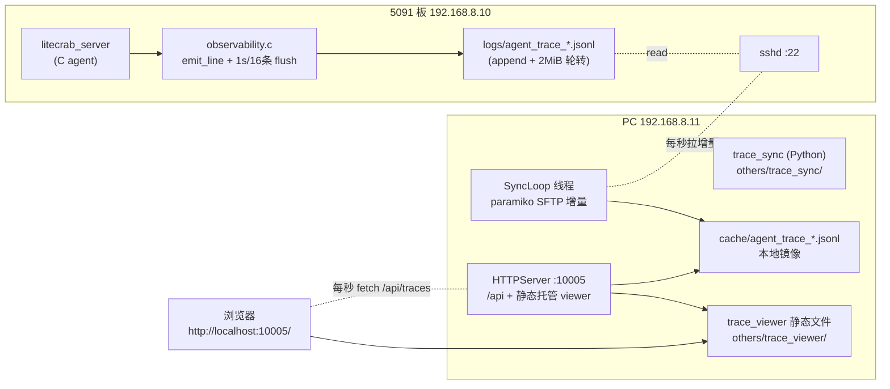
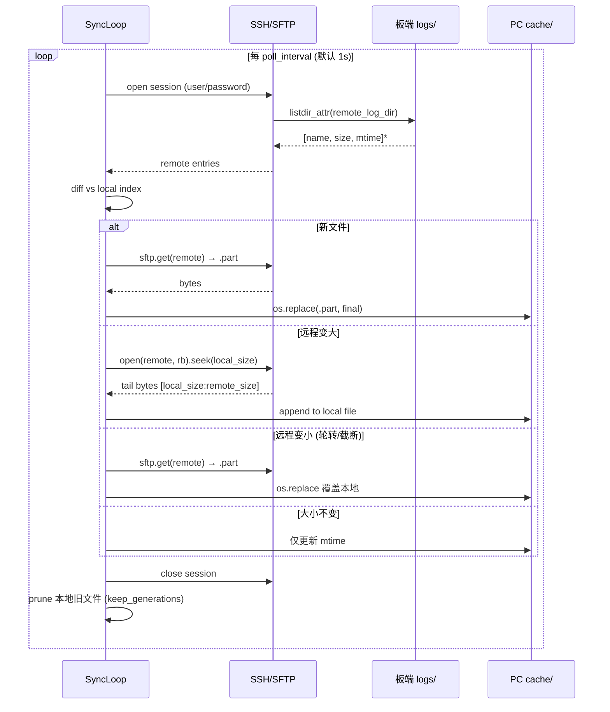
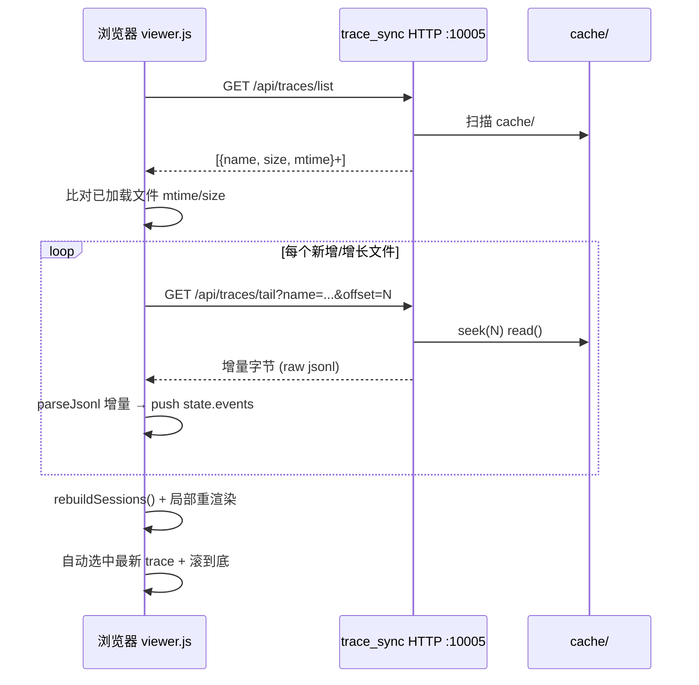

# Trace 实时同步与 Live Viewer 设计

## 1. 背景与问题

当前 Agent 在 5091 板（`192.168.8.10`）上后台运行，告警检查与修正过程的 `agent_trace_*.jsonl` 由 `src/observability/observability.c` 写入板端 `logs/`。演示流程的痛点是：

- 需要等一次 run 跑完，手动把 jsonl 拖到 PC 上的 `others/trace_viewer`，才能回看流程；
- 这一过程是静态的，无法展示"动态修正"的实时演进，演示效果差；
- 演示者要么频繁手动拖文件，要么截屏历史 trace，缺少一种"agent 在跑、viewer 在跟着长"的体验。

Observability 模块本身已具备实时化的基础：`emit_line` 在 16 条事件或 1 秒到达时 `fflush`，`anomaly` 和 `trace_end` 立即 `fflush`（见 `src/observability/observability.c:138`）。也就是说，板端文件本身已是秒级新鲜的，缺的是把这份新鲜度搬到 PC 浏览器里的通道。

## 2. 目标与非目标

### 2.1 目标

- **T1 实时同步**：在 PC 上有一个常驻服务，按秒级间隔把板端 `agent_trace_*.jsonl` 的增量字节同步到本地缓存目录，不依赖 run 结束。
- **T2 Live 浏览**：`others/trace_viewer` 增加 Live 模式，浏览器打开后每 1 秒（可调）增量拉取并重渲染，自动选中并滚动到最新 trace，让"动态修正"过程可见。
- **T3 零侵入板端**：不修改 `src/observability/observability.c`、`src/gateway/tcp_line.c`、`src/main.c` 等板端 C 代码；演示所需的全部新增代码在 PC 侧。
- **T4 离线兼容**：不开 Live 时 viewer 行为与现状完全一致，仍可拖离线 jsonl 文件。
- **T5 自包含部署**：PC 侧通过一个 `start_trace_sync.bat` 启动，同时提供同步服务与 viewer 静态托管，浏览器只访问一个端口。

### 2.2 非目标

- **N1** 不做日志聚合、搜索后端或持久化数据库；缓存目录只是 jsonl 镜像。
- **N2** 不引入 WebSocket / SSE，1 秒轮询足够演示，且实现简单、易调试。
- **N3** 不修改 trace JSONL 的事件 schema，不引入新事件类型。
- **N4** 不取代 `others/transfer_station`；transfer_station 仍负责 LLM 与 chat TCP 代理，trace_sync 只负责 trace 文件镜像与 viewer 托管，职责隔离。
- **N5** 不承诺多板多租户；当前只服务一块 5091 板。

## 3. 方案对比

### 3.1 方案 A：板端新增 HTTP trace-tail 服务

板端 C 代码新开 10004 端口，提供 `/traces/list` 与 `/traces/tail?file=&offset=`，viewer 直连板端。

- 优点：延迟最低，板端只读纯静态；复用 1 秒 flush 节奏。
- 缺点：必须改板端 C 代码（新增 `src/observability/trace_http.c` 或在 `src/gateway/` 加线程），与 T3 冲突；需要在板端防火墙放通新端口；5091 sysroot 之前明确禁用了 libssh2/tftp，板端对外暴露面增加。

### 3.2 方案 B：复用 chat 网关 10003 加 `tail_trace` 伪命令

在 `src/gateway/tcp_line.c` 的 chat handler 前加分支：`{"cmd":"tail_trace","since_ms":N}`，让 chat 网关顺带返回日志。`others/transfer_station` 再加一层 HTTP 转发。

- 优点：不开新端口，所有流量走 10003；PC 端是统一入口。
- 缺点：把日志流和控制流混在同一个 TCP 网关里，协议变复杂；10003 现有协议是"一行请求→一行回复"，大文件一次性返回可能超 `max_request_bytes`，需要分页；同样违反 T3。

### 3.3 方案 C：板端不改，PC 通过 SSH/SFTP 周期同步

PC 上跑一个 Python 服务，用 paramiko SSH/SFTP 连板，每秒把 `agent_trace_*.jsonl` 的新增字节增量拉到本地 `cache/`，并通过同一进程的 HTTP 服务暴露给浏览器。viewer 加 Live 模式从该 HTTP 服务增量拉取。

- 优点：完全满足 T3；板端 SSH 已可用（`enspire@192.168.8.10`，密码登录），无需额外开放端口；与 transfer_station 职责分离；演示链路简单，浏览器只访问 `http://localhost:10005/`。
- 缺点：依赖 paramiko；SSH 凭据需安全存放；秒级 SSH 会话开销略高于方案 A，但 1 秒间隔下完全可接受。

### 3.4 选型

选 **方案 C**。理由：

1. 板端 SSH 通道已具备，零侵入板端 C 代码；
2. 与现有 `others/transfer_station`、`others/UI` 的 Python 服务风格一致，PC 侧统一管理；
3. 1 秒轮询与 observability 的 1 秒 flush 节奏天然对齐，演示效果与方案 A 几乎无差别；
4. 出问题时只需停 PC 侧服务，板端 agent 不受任何影响。

## 4. 整体架构



关键边界：

- 板端 agent、observability、logs 完全不动；
- `others/transfer_station` 与 `others/UI` 完全不动，trace_sync 是独立进程；
- trace_sync 进程内含两条线程：SyncLoop（SSH 同步）+ HTTPServer（HTTP + 静态托管）。

## 5. 数据流

### 5.1 同步方向：板端 → PC 缓存



设计要点：

- **增量而非全量**：用 `sftp.open(remote, "rb").seek(local_size)` 读取 `[local_size, remote_size)` 区间，append 到本地文件，避免每秒重传整文件。
- **原子写**：新文件先写 `.part`，再 `os.replace`，确保 HTTP API 永远读到完整行边界。
- **轮转对齐**：板端 `rotate_if_needed` 在 2 MiB 处 rename `.1/.2/.3`（见 `src/observability/observability.c:56-76`）。SyncLoop 检测到 `remote_size < local_size` 时认为文件被轮转/截断，重新全量下载，避免错位。
- **代数保留**：本地 `keep_generations` 默认 8，比板端 `LOG_FILE_GENERATIONS=4`（含当前）多，确保演示时仍能翻历史。

### 5.2 浏览方向：浏览器 → PC HTTP → 缓存



## 6. 组件设计

### 6.1 PC 端 `others/trace_sync/`（Python 包）

#### 6.1.1 模块划分

```
others/trace_sync/
├── __init__.py            # 包入口，导出 TraceSyncConfig / TraceSyncService / load_config
├── config.py              # dataclass 配置 + JSON 加载 + env 覆盖
├── service.py             # TraceSyncService：SyncLoop + HTTPServer
├── main.py                # CLI 入口，signal 处理，健康自重启
├── config.example.json    # 配置模板（密码占位）
├── config.json            # 实际配置（含密码，加入 .gitignore）
├── start_trace_sync.bat   # Windows 启动脚本
├── viewer/                # 自包含 viewer 副本（从 others/trace_viewer/ 复制并改造）
│   ├── index.html         # 加 Live 工具条
│   ├── viewer.js          # 加 Live 模块（startLive/stopLive/liveTick/liveAutoFollow）
│   ├── viewer.css         # 加 Live 样式
│   └── trace_model.js     # 原样复制，不改
├── cache/                 # 本地 jsonl 镜像（运行时生成，.gitignore）
└── logs/                  # trace_sync 自身日志（运行时生成，.gitignore）
```

#### 6.1.2 `config.py`

- `TraceSyncConfig` dataclass 字段：

| 字段 | 类型 | 默认 | 说明 |
|---|---|---|---|
| `listen_host` | str | `0.0.0.0` | HTTP 监听地址 |
| `http_port` | int | `10005` | HTTP 端口，避开 transfer_station 的 10001/10002 与 UI 的 10030 |
| `ssh_host` | str | `192.168.8.10` | 板端 IP |
| `ssh_port` | int | `22` | SSH 端口 |
| `ssh_user` | str | `enspire` | SSH 用户 |
| `ssh_password` | str | `""` | SSH 密码，必填 |
| `remote_log_dir` | str | `/mnt/home/enspire/z00840189/logs` | 板端日志绝对路径 |
| `cache_dir` | str | `others/trace_sync/cache` | 本地镜像目录 |
| `viewer_dir` | str | `others/trace_sync/viewer` | 静态托管 viewer 目录（自包含副本） |
| `poll_interval` | float | `1.0` | 同步与浏览器拉取间隔（秒） |
| `connect_timeout` | float | `8.0` | SSH 连接超时 |
| `reconnect_delay` | float | `2.0` | SSH 失败后的退避（保留字段） |
| `keep_generations` | int | `8` | 本地保留的最新文件代数 |
| `log_dir` | str | `others/trace_sync/logs` | 自身日志目录 |
| `verbose` | bool | `False` | DEBUG 日志开关 |

- `load_config(path)`：读 JSON → `_flatten` 支持 `ssh.*` / `server.*` / `log.*` 嵌套 → 环境变量 `LITECRAB_TRACE_SSH_PASSWORD` / `LITECRAB_TRACE_SSH_HOST` / `LITECRAB_TRACE_SSH_USER` 覆盖 → `validate()`。
- `validate()`：端口范围、密码非空、`remote_log_dir` 必须以 `/` 开头、`poll_interval ∈ [0.2, 60]`、`keep_generations ∈ [1, 64]`。

#### 6.1.3 `service.py` — `TraceSyncService`

**职责**：启动两个线程（HTTPServer + SyncLoop），维护本地 `cache/` 与内存文件索引，对外提供 HTTP API + 静态托管。

**内部状态**：

```text
TraceSyncService
├── _http: ThreadingHTTPServer         # :10005
├── _sync_thread: Thread               # daemon, _sync_loop
├── _stop: threading.Event
├── _mu: Lock
├── _files: {name: {"size": int, "mtime": int}}   # 本地镜像索引
└── _ssh_state: {"connected": bool, "last_error": str, "last_sync_ms": int}
```

**SyncLoop 关键逻辑**：

1. `_scan_local_cache()`：启动时先把 `cache/` 已有文件灌入 `_files`，HTTP API 立即可用。
2. `_sync_once()`：开一个 SSH 会话 → `sftp.listdir_attr(remote_log_dir)` 过滤 `agent_trace_*.jsonl` → 对每个 entry 走 `_apply_deltas` → `_prune_local` → close。整次失败则更新 `_ssh_state.last_error`，等下个 tick 重试。
3. `_apply_deltas(remote_entries)`：
   - 本地无 → `_download_full`（写 `.part` 后 `os.replace`）；
   - `remote_size > local_size` → `_download_tail`（`sftp.open(rb).seek(local_size)` 分块读 64 KiB，append）；
   - `remote_size < local_size` → 视为轮转，`_download_full` 覆盖；
   - 相等 → 只更新 mtime。
4. `_prune_local(remote_entries)`：本地按 mtime 降序保留 `keep_generations` 代 + 远端仍存在的，其余 `unlink`。

**HTTP Handler 路由**：

| 方法 & 路径 | 用途 |
|---|---|
| `GET /` 或 `/index.html` | 返回 `others/trace_viewer/index.html` |
| `GET /viewer.js` `/viewer.css` `/trace_model.js` | 返回 viewer 静态资源 |
| `GET /api/health` | `{status:"ok", uptime_seconds}` |
| `GET /api/status` | SSH 状态 + 文件列表 + `remote_log_dir` + `poll_interval` |
| `GET /api/traces/list` | `{files:[{name,size,mtime}]}` |
| `GET /api/traces/tail?name=&offset=N` | 200 + raw bytes `[N:]`；`offset>size` 返回 416 让 viewer 重置 |
| `GET /api/traces/file?name=` | 整文件下载（首次加载用） |
| `OPTIONS *` | 204 + CORS 头 |

所有响应带 `Access-Control-Allow-Origin: *`，方便调试时直接从 `file://` 打开 viewer 也能连。生产演示走 `http://localhost:10005/` 同源，无 CORS 问题。

**路径越权防护**：`name` 参数禁止包含 `/`、`\`、`..`；静态文件服务对 `viewer_dir` 做 `resolve().relative_to(root)` 校验。

#### 6.1.4 `main.py`

- `argparse --config <path> [--verbose]`；
- `signal.SIGINT/SIGTERM` 优雅停止；
- 主循环每秒 `service.healthy()`，不健康则 `stop()` + `start()` 自重启；
- 启动时打印 `http://localhost:<port>/` 与 SSH 目标信息。

### 6.2 `others/trace_sync/viewer/` Live 模式改动

为保持 `others/trace_sync/` 自包含，原始 `others/trace_viewer/` 的 4 个静态文件（`index.html`、`viewer.js`、`viewer.css`、`trace_model.js`）被**复制**到 `others/trace_sync/viewer/`，并在副本上加 Live 改造。原 `others/trace_viewer/` 不改动。

#### 6.2.1 `index.html`

在顶部 stats-bar 与 filter-row 之间插入 Live 工具条：

```html
<div class="live-bar">
  <label class="live-toggle">
    <input type="checkbox" id="liveToggle" />
    <span class="live-dot" id="liveDot"></span>
    <span>Live</span>
  </label>
  <input type="text" id="liveUrl" class="live-url"
         placeholder="http://localhost:10005" value="http://localhost:10005" />
  <select id="liveInterval">
    <option value="500">0.5s</option>
    <option value="1000" selected>1s</option>
    <option value="2000">2s</option>
    <option value="3000">3s</option>
  </select>
  <span class="live-status" id="liveStatus">未启用</span>
  <label class="live-follow">
    <input type="checkbox" id="liveFollow" checked />
    <span>自动跟随最新 trace</span>
  </label>
</div>
```

#### 6.2.2 `viewer.css`

新增 `.live-bar` / `.live-toggle` / `.live-dot`（pulse 动画）/ `.live-url` / `.live-status`（ok/err/connecting 三色）/ `.live-follow` 样式，与现有浅色主题 CSS 变量复用 `--error` / `--ok` / `--warn` / `--accent`。

#### 6.2.3 `viewer.js` Live 模块

新增全局 `live` 状态对象与函数，**复用**现有 `parseJsonl` / `rebuildSessions` / `renderAll` / `renderSessions` / `renderTracePanel`，不重写渲染逻辑。

```text
live = {
  enabled: false,
  url: "http://localhost:10005",
  intervalMs: 1000,
  follow: true,
  timer: null,
  fileState: Map<name, {size, mtime, loadedBytes}>,  // 已加载文件的本地位移
  fetching: false,                                    // 防重入
}
```

**API**：

- `startLive()` / `stopLive()`：切换 `live.enabled`，启停 `setInterval` 定时器，更新 `#liveStatus`。
- `liveTick()`：核心轮询函数。
- `liveLoadFile(name, size, mtime)`：对单个文件调 `/api/traces/tail?name=&offset=loadedBytes`，把返回字节按 `\n` 切分解析 JSONL，逐事件 `traceModel.normalizeEvent` 后 `state.events.push(ev)`，更新 `live.fileState`。
- `liveAutoFollow()`：拉完所有增量后，若 `live.follow` 为 true 且产生了新 traceId，设 `state.selectedSessionId` 为新 trace 所属 session，展开该 trace，渲染后 `scrollIntoView({block:'center'})`。
- `liveSetStatus(cls, text)`：更新 `#liveStatus` 颜色与文本。

**`liveTick` 流程**：

1. `fetch(live.url + "/api/traces/list")` → `files`。
2. 与 `live.fileState` 对比：
   - 新文件 → `loadedBytes=0`，加入 `fileState`；
   - 已知文件 `size > loadedBytes` → 待拉增量；
   - `size < loadedBytes` → 视为轮转，`loadedBytes=0` 重拉整文件（同时清掉 `state.events` 中该文件的旧事件，避免错位）；
   - `size === loadedBytes` 且 `mtime` 不变 → 跳过。
3. 对每个待拉文件串行调 `liveLoadFile`。
4. `rebuildSessions()`：复用现有逻辑，重建 session/trace 索引。注意 `rebuildSessions` 已实现 traceId↔session 映射、orphan 时间窗归属、log 归属等 5 个 pass，Live 模式直接复用。
5. `renderAll()`：复用现有渲染，但保留：
   - `state.selectedSessionId`；
   - `state.expandedTraces` / `state.expandedEvents`；
   - 滚动位置（渲染前记录 `tracePanel.scrollTop`，渲染后恢复，除非发生了自动跟随）。
6. 若 `live.follow` 且有新 trace，`liveAutoFollow()` 切到最新。
7. 异常时 `liveSetStatus("err", ...)`，不断轮询。

**与离线模式共存**：

- Live 启动时不清空 `state.events`，直接增量；用户可先拖入历史文件再开 Live 接续。
- Live 运行中用户手动拖文件仍走原 `loadFiles()`，与 Live 互不干扰。
- 关闭 Live 时不清空数据，已加载的增量保留为静态视图。

**防抖与重入**：

- `live.fetching` 标志位，`liveTick` 进入时若为 true 直接返回，避免上一次 fetch 慢导致叠加。
- `setInterval` 间隔由 `live.intervalMs` 决定，最小 500 ms。

## 7. 接口定义

### 7.1 `GET /api/traces/list`

**Response 200**

```json
{
  "files": [
    {"name": "agent_trace_20260916_094409.jsonl", "size": 592, "mtime": 1726451049},
    {"name": "agent_trace_20260916_094410.jsonl", "size": 173755, "mtime": 1726451050}
  ]
}
```

### 7.2 `GET /api/traces/tail?name=<file>&offset=<N>`

- `name`：文件名，不含路径，禁 `/`、`\`、`..`。
- `offset`：非负整数，表示从文件第 N 字节开始读。

**Response 200**：`Content-Type: application/jsonl; charset=utf-8`，body 为 `[offset, size)` 区间的原始字节。

**Response 400**：`name` 或 `offset` 非法。

**Response 404**：本地缓存无该文件。

**Response 416**：`offset > size`，body `{error:"offset beyond size", size}`，viewer 收到后应将 `loadedBytes` 重置为 0 并重拉整文件。

### 7.3 `GET /api/traces/file?name=<file>`

整文件下载，用于首次加载或强制刷新。`Content-Type: application/jsonl`。

### 7.4 `GET /api/status`

```json
{
  "status": "running",
  "ssh": {"connected": true, "last_error": "", "last_sync_ms": 1726451050123},
  "files": [...],
  "remote_log_dir": "/mnt/home/enspire/z00840189/logs",
  "poll_interval": 1.0
}
```

### 7.5 `GET /api/health`

```json
{"status": "ok", "uptime_seconds": 12.345}
```

## 8. 文件清单

### 8.1 新增

| 路径 | 类型 | 说明 |
|---|---|---|
| `others/trace_sync/__init__.py` | Python | 包导出 |
| `others/trace_sync/config.py` | Python | 配置加载与校验 |
| `others/trace_sync/service.py` | Python | SyncLoop + HTTPServer |
| `others/trace_sync/main.py` | Python | CLI 入口 |
| `others/trace_sync/config.example.json` | JSON | 配置模板，可入库 |
| `others/trace_sync/config.json` | JSON | 实际配置（含密码），不入库 |
| `others/trace_sync/start_trace_sync.bat` | Bat | Windows 启动脚本 |
| `others/trace_sync/viewer/index.html` | HTML | 从 `others/trace_viewer/` 复制并加 Live 工具条 |
| `others/trace_sync/viewer/viewer.js` | JS | 从 `others/trace_viewer/` 复制并加 Live 模块 |
| `others/trace_sync/viewer/viewer.css` | CSS | 从 `others/trace_viewer/` 复制并加 Live 样式 |
| `others/trace_sync/viewer/trace_model.js` | JS | 从 `others/trace_viewer/` 原样复制，不改 |
| `docs/observability/trace_live_sync_design.md` | Markdown | 本设计文档 |

### 8.2 修改

| 路径 | 改动 |
|---|---|
| `.gitignore` | 追加 `others/trace_sync/config.json`、`others/trace_sync/cache/`、`others/trace_sync/logs/` |

### 8.3 不动

- `src/observability/observability.c`、`src/gateway/tcp_line.c`、`src/main.c` 等板端 C 代码；
- `others/transfer_station/` 全部；
- `others/UI/` 全部；
- `others/trace_viewer/` 全部（原始 viewer 保留，trace_sync 内的 viewer 是副本）；
- `include/litecrab/observability.h`。

## 9. 配置

### 9.1 `others/trace_sync/config.json`（示例）

```json
{
  "server": {"listen_host": "0.0.0.0", "http_port": 10005},
  "ssh": {
    "host": "192.168.8.10",
    "port": 22,
    "user": "enspire",
    "password": "Zcb138..",
    "connect_timeout": 8.0,
    "reconnect_delay": 2.0,
    "remote_log_dir": "/mnt/home/enspire/z00840189/logs"
  },
  "cache_dir": "others/trace_sync/cache",
  "viewer_dir": "others/trace_viewer",
  "poll_interval": 1.0,
  "keep_generations": 8,
  "log": {"dir": "others/trace_sync/logs"},
  "verbose": false
}
```

### 9.2 环境变量覆盖（可选）

| 变量 | 覆盖字段 |
|---|---|
| `LITECRAB_TRACE_SSH_PASSWORD` | `ssh_password` |
| `LITECRAB_TRACE_SSH_HOST` | `ssh_host` |
| `LITECRAB_TRACE_SSH_USER` | `ssh_user` |

便于在不修改 config.json 的前提下临时换板或换账号。

### 9.3 端口规划

| 端口 | 归属 | 是否变动 |
|---|---|---|
| 10001 | transfer_station HTTP | 不动 |
| 10002 | transfer_station TCP | 不动 |
| 10003 | 板端 chat 网关 | 不动 |
| 10030 | UI Flask | 不动 |
| **10005** | **trace_sync HTTP（新增）** | 新增 |

## 10. 部署与运行

### 10.1 依赖

- Python 3.12（与 `others/transfer_station` 同一解释器，复用 `C:\Users\zhangshuaishuai\.cache\codex-runtimes\codex-primary-runtime\dependencies\python\python.exe`）。
- `paramiko` 包（`pip install paramiko`，会带入 `bcrypt`、`pynacl`、`cryptography`，后者已预装）。

### 10.2 启动

`others/trace_sync/start_trace_sync.bat`：

```bat
@echo off
chcp 65001 >nul
setlocal
set PYTHON=C:\Users\zhangshuaishuai\.cache\codex-runtimes\codex-primary-runtime\dependencies\python\python.exe
set SCRIPT_DIR=%~dp0
set PYTHONPATH=%SCRIPT_DIR%..
"%PYTHON%" -m trace_sync.main --config "%SCRIPT_DIR%config.json" %*
echo.
echo [trace_sync exited, press any key to close]
pause >nul
```

双击启动后控制台输出：

```
LiteCrab trace_sync: http://localhost:10005/  (viewer)
                    ssh enspire@192.168.8.10:22 -> /mnt/home/enspire/z00840189/logs
```

### 10.3 演示操作

1. 启动 `start_trace_sync.bat`；
2. 浏览器打开 `http://localhost:10005/`（trace_sync 静态托管 viewer，同源无 CORS）；
3. 点顶部 `Live` 复选框开启，`liveUrl` 默认 `http://localhost:10005`，`Interval` 默认 1s，`自动跟随` 默认勾选；
4. 在板端触发一次 agent run（UI 或 chat 请求）；
5. viewer 顶栏 `live-status` 显示 `ok · 上次同步 1s 前`，左侧 Sessions 列表实时新增，右侧自动选中最新 trace 并展开，事件流按时间线增长；
6. 演示结束关闭 Live 或直接关 bat 窗口。

### 10.4 与 transfer_station / UI 的并发运行

三个进程互不依赖，可同时运行：

- transfer_station（10001/10002）：LLM 与 chat TCP 代理；
- UI（10030）：chat 演示界面；
- trace_sync（10005）：trace 同步与 viewer。

典型演示顺序：先起 transfer_station，再起 trace_sync，浏览器开 `localhost:10005`（trace viewer）+ `localhost:10030`（chat UI），通过 UI 发消息触发 agent，viewer 实时展示流程。

## 11. 边界、风险与回退

### 11.1 安全

- **SSH 密码明文**：`config.json` 含明文密码，必须加入 `.gitignore`，仅本地使用；提交模板 `config.example.json` 用 `REPLACE_ME` 占位。生产环境应改为 SSH 密钥免密（`ssh-copy-id` 预先配置），`ssh_password` 留空，`paramiko` `look_for_keys=True`。
- **CORS 全开**：HTTP API `Access-Control-Allow-Origin: *`，便于 `file://` 调试；trace_sync 仅绑定 `0.0.0.0:10005`，演示环境可接受。生产应绑定 `127.0.0.1` 并收紧 CORS。
- **路径越权**：`name` 参数禁 `/`、`\`、`..`；静态文件做 `resolve().relative_to(root)` 校验。
- **trace 内容敏感**：trace jsonl 可能含用户输入、设备数据；缓存目录与板端同等保密，演示后应清空 `others/trace_sync/cache/`。

### 11.2 可靠性

- **SSH 断连**：SyncLoop 每次 `_sync_once` 失败后更新 `_ssh_state.last_error`，下个 tick 重试，viewer 通过 `/api/status` 看到 `connected:false` 与错误原因，`live-status` 显示 `err · 连接失败`，但 viewer 仍保留已加载数据。
- **文件轮转**：板端 2 MiB rename 时本地可能正读到一半，`_download_tail` 以 `remote_size` 为准；若 `remote_size < local_size`，重新全量下载覆盖本地，viewer 收到 416 后重置 `loadedBytes`。
- **`.part` 原子写**：新文件先写 `.part` 再 `os.replace`，HTTP API 永远读到完整行边界，避免解析半截 JSON。
- **viewer 重入**：`live.fetching` 防抖，避免上一次慢 fetch 导致 setInterval 叠加。
- **进程自重启**：`main.py` 主循环每秒 `healthy()`，不健康则 `stop + start`，避免 SSH 长期失败后 HTTP 也跟着挂。

### 11.3 性能

- **SSH 会话开销**：每秒一次 connect + listdir + 增量 read + close，paramiko 在局域网下单次约 50-100 ms，可接受。若未来需要更低延迟，可改为持久 SSH 连接 + `sftp.stat` 轮询，但需处理连接保活与重连。
- **浏览器渲染**：`rebuildSessions` 是 O(events) 全量重建，演示规模（数百到数千事件）下毫秒级，无瓶颈。若单 session 事件过万，可改为只追加新事件到当前 session，不重跑 Pass 3 时间窗归属。
- **磁盘**：本地缓存受 `keep_generations=8` 与板端轮转双重限制，最多约 16 MiB（8 × 2 MiB），可忽略。

### 11.4 回退

- 出问题时直接关闭 `start_trace_sync.bat`，板端 agent、transfer_station、UI 完全不受影响。
- viewer 关闭 Live 复选框即回到离线模式，已加载数据保留为静态视图。
- 删除 `others/trace_sync/` 目录与 viewer 的 Live 改动即可完全恢复到当前主干状态，无任何残留依赖。

## 12. 测试策略

### 12.1 单元测试（Python 侧）

- `tests/test_trace_sync_config.py`：
  - `load_config` 正常路径、嵌套 `ssh.*`/`server.*`/`log.*`、env 覆盖；
  - `validate` 端口越界、密码空、`remote_log_dir` 非绝对路径、`poll_interval` 越界等错误用例。
- `tests/test_trace_sync_service.py`：
  - 用 `unittest.mock` 模拟 paramiko `SSHClient`/`SFTPClient`，验证 `_apply_deltas` 三分支（新文件 / 增长 / 缩小）；
  - 验证 `_prune_local` 按 `keep_generations` 删除；
  - 验证 HTTP Handler 的 `name` 越权防护与 `offset` 越界 416。

### 12.2 集成测试

- `tests/test_trace_sync_live.py`（手动或 CI）：
  - 起一个 mock SFTP server（如 `paramiko` 的 test 双或本地临时目录模拟）；
  - 写入 `agent_trace_*.jsonl` 测试文件，验证 SyncLoop 把增量同步到 `cache/`；
  - 起 HTTP 服务，用 `urllib` 验证 `/api/traces/list`、`/api/traces/tail?offset=N` 的字节区间正确性。

### 12.3 手动验证清单

1. SSH 能连：`start_trace_sync.bat` 启动后 `live-status` 在 2 秒内变 `ok`，`/api/status` 的 `ssh.connected=true`。
2. 增量同步：板端手动 `echo '{"type":"log",...}' >> logs/agent_trace_*.jsonl`，1 秒后 `cache/` 对应文件 size 增长相同字节数。
3. 轮转对齐：板端 `cp agent_trace_*.jsonl agent_trace_*.jsonl.bak && : > agent_trace_*.jsonl`，SyncLoop 检测到 `remote_size < local_size`，重新全量下载。
4. viewer Live：浏览器开 `localhost:10005`，勾选 Live，板端发 chat 请求，左侧 Sessions 出现新条目，右侧自动选中并展开最新 trace，事件流随时间增长。
5. 离线兼容：关闭 Live，拖入离线 jsonl，viewer 行为与改动前一致。
6. 断网恢复：拔板端网线 5 秒再插上，`live-status` 短暂 `err` 后自动恢复 `ok`，无人工干预。

## 13. 能力状态

| 能力 | 状态 | 边界 |
|---|---|---|
| 板端 trace 秒级 flush | 已实现 | `observability.c` 现有，不动 |
| PC SSH 增量同步 | 设计中 | paramiko，1 秒间隔，原子写 |
| HTTP trace API | 设计中 | list/tail/file/status/health |
| viewer Live 模式 | 设计中 | 1 秒轮询，自动跟随，离线兼容 |
| 静态托管 viewer | 设计中 | 同源访问，无 CORS 痛点 |
| 多板多租户 | 未实现 | 非目标 N5 |
| WebSocket 实时推送 | 未实现 | 非目标 N2，1 秒轮询够用 |
| 持久化与聚合 | 未实现 | 非目标 N1 |

## 14. 后续演进

- **M1 持久 SSH 连接**：把每秒 connect 改为长连接 + `sftp.stat` 轮询，降低 SSH 开销到 ~10 ms。
- **M2 WebSocket 推送**：trace_sync 在 SyncLoop 拉到增量后主动 `ws.send` 给 viewer，viewer 改为被动接收，延迟从 1 秒降到 ~100 ms。
- **M3 多板支持**：config 改为 `boards: [...]` 数组，SyncLoop 每板一线程，HTTP API 加 `?board=` 过滤。
- **M4 trace 事件 schema 版本化**：与 `docs/observability/observability_module_architecture.md` 的"事件 schema 尚未版本化"问题一起治理，viewer 按 schema 版本选择解析路径。
