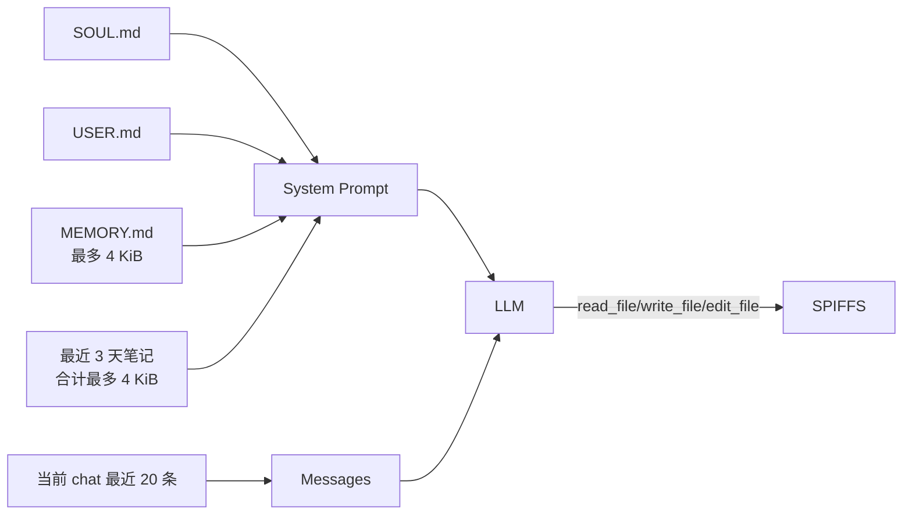

# MimiClaw 嵌入式记忆能力分析

> 分析对象：[memovai/mimiclaw](https://github.com/memovai/mimiclaw) `main` 分支  
> 基准提交：[`7ce6262fb5be6a484d1140bec4eed46880c47077`](https://github.com/memovai/mimiclaw/commit/7ce6262fb5be6a484d1140bec4eed46880c47077)  
> 分析日期：2026-09-18  
> 对照代码：LiteCrab_0829 `mcp_dual_mode_agent`，提交 `3ffad7be9505093112d88442c88e61a50b8bba7e`

## 1. 结论

MimiClaw 的记忆能力本质上是：

> **SPIFFS 上的分层纯文本文件 + 每轮全量/时间窗口注入 + LLM 通过通用文件工具主动整理。**

它没有 embedding、向量数据库、倒排索引、相似度检索、记忆图谱或后台演化线程。所谓“长期记忆演化”，实际是系统 Prompt 指导 LLM 使用 `read_file`、`write_file` 和 `edit_file` 自主维护 `MEMORY.md`；所谓“召回”，实际是在每个 Agent 回合构建 system prompt 时，无条件读入长期记忆和最近三天笔记。

这种方案适合资源受限设备的关键原因不是检索算法更先进，而是主动放弃复杂检索：用小文件、固定缓冲区、有限时间窗口和云端 LLM 的语义能力代替板端索引。

但当前 main 分支更接近“可运行原型”，并不是可直接用于工业 Agent 的可靠记忆实现。它缺少记忆隔离、原子写、容量治理、可信度、证据边界和写入确认，且代码中存在 daily note 路径不一致等问题。

## 2. 记忆分层

MimiClaw 实际包含四层上下文状态：

| 层 | 文件 | 生命周期 | 注入方式 | 作用 |
|---|---|---|---|---|
| 人格 | `/spiffs/config/SOUL.md` | 长期、全局 | 每轮读取全文 | 定义助手人格与行为 |
| 用户画像 | `/spiffs/config/USER.md` | 长期、全局 | 每轮读取全文 | 保存用户信息和偏好 |
| 长期记忆 | `/spiffs/memory/MEMORY.md` | 长期、全局 | 每轮最多读取 4095 字节 | 保存需要一直记住的摘要 |
| 每日笔记 | `/spiffs/memory/YYYY-MM-DD.md` | 按日 | 每轮合计最多读取 4095 字节，回看 3 天 | 保存近期事件 |
| 会话历史 | `/spiffs/sessions/tg_<chat_id>.jsonl` | 每 chat 持续追加 | 每轮取最近 20 条 | 保持短期对话连续性 |

其中 `SOUL.md` 和 `USER.md` 严格说是 bootstrap context，不是动态记忆；但从模型使用角度，它们与 `MEMORY.md` 一样被拼入 system prompt，具有长期行为影响。



## 3. 长期记忆的读取机制

### 3.1 每轮无条件加载，不做相关性检索

`context_build_system_prompt()` 每次处理消息时依次加载：

1. 固定系统指令；
2. `SOUL.md`；
3. `USER.md`；
4. `MEMORY.md`；
5. 最近 3 天 daily notes；
6. Skill 摘要。

`MEMORY.md` 使用 4096 字节栈缓冲区，因此最多注入 4095 字节。最近笔记共享另一个 4096 字节缓冲区，按今天、昨天、前天的顺序读取，达到上限后自然截断。

这不是“query → top-k”的检索，而是两种静态召回策略：

- 长期记忆：总是召回；
- 近期事件：按时间窗口召回。

优点是实现非常小、延迟可预测、没有索引常驻内存。缺点是只要 `MEMORY.md` 超过 4 KiB，后部内容永远不可见；无关记忆也会消耗每次 LLM 请求的 token。

### 3.2 由云端 LLM 完成语义选择

板端不判断“哪条记忆相关”。板端只把有限文本提供给模型，相关性理解完全交给云端 LLM。这是 MimiClaw 在 ESP32-S3 上保持轻量的核心设计取舍。

当长期记忆规模能被严格控制在几 KiB 时，这个取舍合理；当记忆增长到数百或数千条时，它不会平滑退化，而是直接发生截断和遗漏。

## 4. 记忆写入与“演化”机制

### 4.1 Agent 通过通用文件工具写记忆

当前 main 已注册：

- `read_file`：读取 SPIFFS 文件；
- `write_file`：直接覆盖文件；
- `edit_file`：替换第一次出现的文本；
- `list_dir`：列出 SPIFFS 文件。

System Prompt 明确要求模型：

- 学到姓名、偏好、习惯和上下文时更新 `MEMORY.md`；
- 发生值得记录的事情时写入当天笔记；
- 写长期记忆前先读取旧文件；
- 使用 `edit_file` 更新，避免丢失原有内容；
- 主动保存，不必等待用户说“记住”。

因此写入决策由 LLM 自己完成，没有确定性 capture hook。模型是否写、写什么、如何摘要都依赖 Prompt 遵循能力。

### 4.2 `memory_store.c` 的专用写接口没有进入 Agent 工具链

代码提供：

```c
memory_write_long_term(content);
memory_append_today(note);
```

但 Agent loop 没有注册这两个专用接口，而是通过通用文件工具写入。`memory_write_long_term()` 主要被串口 CLI 的 `memory_write` 使用；`memory_append_today()` 在当前 main 中没有调用方。

这意味着 memory store 模块负责自动读取，但 Agent 写入绕过了 memory store 的专用 API。记忆路径、格式和容量规则只存在于 Prompt 中，没有在代码层强制执行。

### 4.3 “演化”是 LLM 编辑文本，不是版本化演化

MimiClaw 没有 revision、parent、supersedes、confidence 或 evidence。记忆演化过程是：

```text
读 MEMORY.md → LLM 判断应修改什么 → edit_file/write_file → 下轮重新全文注入
```

优点是人类可读、可通过串口直接修改。缺点是旧事实会被原地覆盖，错误更新无法追溯，断电或部分写入后也没有回滚版本。

## 5. Session 记忆机制

每个 `chat_id` 对应一个 JSONL 文件：

```json
{"role":"user","content":"...","ts":1789690000}
{"role":"assistant","content":"...","ts":1789690002}
```

每次成功完成一个 Agent 回合，只保存原始 user text 和最终 assistant text。ReAct 中间的工具调用及工具结果不进入 Session 文件。

读取时扫描整个文件，使用 20 个 `cJSON*` 组成的环形数组保留最后 20 条，再重新生成 LLM messages JSON。

这是“磁盘无限追加、内存有界回放”的实现：

- 内存中最多保留 20 条；
- 但每轮都从头扫描整个历史文件；
- 磁盘文件没有 TTL、条数上限、大小上限或 compact；
- 工具证据不会跨回合保留。

它在短期演示中简单有效，但运行时间增长后，读取延迟和 Flash 占用会持续增加。

## 6. 嵌入式友好的设计点

### 6.1 无数据库和后台服务

记忆模块核心只有普通文件 I/O，不依赖 SQLite、ChromaDB、Python、embedding 模型或网络 sidecar，适合纯 C/FreeRTOS 固件。

### 6.2 RAM 使用有明确上界

主要记忆缓冲区：

| 缓冲区 | 上限 |
|---|---:|
| 长期记忆读取 | 4 KiB |
| 最近笔记读取 | 4 KiB |
| System Prompt | 16 KiB |
| Session history JSON | 32 KiB |
| Session 环形指针数组 | 20 项 |

没有随记忆条目数量增长的常驻索引。相比板端 embedding 或倒排索引，这更符合 MCU 约束。

### 6.3 人类可运维

全部内容是 Markdown/JSONL，可通过串口 CLI、文件工具或刷写 SPIFFS 镜像查看和修改，不需要专用数据库工具。

### 6.4 写入由事件触发

只有 LLM 判断值得记忆时才写文件，不会对每个 token 或每个内部步骤持久化。理论上可降低写频率，不过当前代码没有硬门控，最终仍取决于模型行为。

### 6.5 用时间窗口代替复杂检索

最近三天笔记天然满足“近期事件通常更重要”的假设。对于个人助手，这是低成本且有效的启发式策略。

## 7. 当前 main 分支的主要问题

### 7.1 Daily note 路径不一致

System Prompt 指导模型写：

```text
/spiffs/memory/daily/<YYYY-MM-DD>.md
```

但 `memory_append_today()` 和 `memory_read_recent()` 实际使用：

```text
/spiffs/memory/<YYYY-MM-DD>.md
```

因此 Agent 按 Prompt 写入的 daily 文件不会被 `memory_read_recent()` 自动召回。这是当前实现中最直接的功能断链。

### 7.2 长期记忆是全局共享的

`MEMORY.md`、`USER.md` 和 daily notes 没有 `chat_id/user_id/device_id` scope。所有 Telegram、WebSocket 和系统任务共享同一份长期记忆。

结果是：

- 多用户信息会互相污染；
- 某个用户写入的敏感信息可能出现在另一个用户的 system prompt；
- 无法表达设备级、站点级和用户级记忆边界。

### 7.3 记忆内容拥有 system prompt 权重

`MEMORY.md` 和 daily notes 被直接拼入 system prompt，没有“不可信历史内容”边界，也没有指令剥离。任何被写入记忆的恶意指令都会在后续每轮持续进入高权重上下文，形成持久化 Prompt Injection。

### 7.4 通用文件工具权限过宽

`write_file/edit_file` 可操作整个 `/spiffs/`，不仅是 memory：理论上模型还可以覆盖 `SOUL.md`、`USER.md`、Session、Skill、Heartbeat 或 cron 文件。路径校验只限制必须位于 `/spiffs/` 且不能包含 `..`，没有目录级读写权限策略。

### 7.5 写入不是原子的

`memory_write_long_term()`、`write_file` 和 `edit_file` 都使用 `fopen(path, "w")` 直接截断原文件，再写入新内容。没有 temporary file、flush/fsync、rename、checksum 或上一个版本。断电、Flash 故障或部分写入可能把原记忆和新记忆同时丢失。

### 7.6 缺少容量和寿命治理

- `write_file` 没有写入大小上限；
- daily note 没有单文件上限、保留天数或清理；
- Session JSONL 永久增长；
- 没有剩余空间保护和写频率控制；
- 没有 compact 或磨损统计。

虽然 SPIFFS 分区约 12 MiB，但 24×7 运行最终仍可能耗尽空间或加剧 Flash 磨损。

### 7.7 Session 回放存在边界问题

- 每条历史记录使用 2048 字节行缓冲；超过该长度的 JSONL 行会被分段并解析失败，导致该消息在后续上下文中消失；
- `chat_id` 直接用于文件名，没有在 session manager 内验证；
- `max_msgs` 没有在函数内限制到数组容量，当前调用值为 20 才安全；
- 每轮扫描完整文件，长期运行性能随历史大小线性恶化。

### 7.8 Context Builder 的边界保护不完整

多处使用：

```c
off += snprintf(buf + off, size - off, ...);
```

`snprintf()` 截断时返回“本应写入的长度”，可能令 `off > size`；后续的 `buf + off` 和 `size - off` 会越界/下溢。记忆内容和 bootstrap 文件增大时会放大这一风险。

### 7.9 没有事实与总结分离

记忆中没有 Evidence、来源、发生时间、验证结果和派生总结的结构区分。LLM 可以把推测写成事实，也可以覆盖旧事实。对于设备诊断和控制场景，这一点风险远高于个人助理。

### 7.10 缺少记忆测试

仓库当前没有覆盖 memory store、文件工具、Session 重启/损坏/容量和跨用户隔离的系统测试。README、TODO 和当前代码还存在明显版本漂移，说明记忆契约尚未稳定。

## 8. 能力边界评价

| 能力 | MimiClaw 当前实现 | 评价 |
|---|---|---|
| 跨重启长期记忆 | `MEMORY.md`/daily files | 有 |
| 短期会话记忆 | 每 chat JSONL，回放 20 条 | 有 |
| 自动召回 | 每轮全文 + 最近 3 天 | 有，但不按相关性 |
| Agent 主动写记忆 | 通用文件工具 + Prompt 指导 | 有，但不确定、无门控 |
| 记忆搜索 | 无 | 无 |
| 语义/向量召回 | 无 | 无 |
| 去重与压缩 | 依赖 LLM 手工整理 | 弱 |
| 多用户隔离 | Session 有，长期记忆无 | 不足 |
| 设备/站点 scope | 无 | 无 |
| 证据追溯 | 无 | 无 |
| 版本和回滚 | 无 | 无 |
| 断电安全 | 直接覆盖/追加 | 不足 |
| 容量/TTL/compact | 无 | 无 |
| 可解释和人工编辑 | Markdown | 强 |
| 板端资源成本 | 固定小缓冲、无索引 | 很低 |

## 9. 与 A-MEM 路线的本质差异

| 维度 | A-MEM | MimiClaw |
|---|---|---|
| 记忆单元 | 结构化原子 note | Markdown 文本块/文件 |
| 召回 | embedding/相似度候选 | 全文 + 最近 N 天 |
| 关联 | 显式 link graph | 无 |
| 演化 | 新旧 note 的关系和版本演化 | LLM 原地编辑 Markdown |
| 板端计算 | 较高或依赖远端服务 | 极低 |
| 存储复杂度 | 结构化 store/index | 普通文件 |
| 可审计性 | 可通过结构/版本增强 | 当前较弱 |
| 适配 MCU | 需要大幅裁剪 | 天然适配 |

MimiClaw 的关键洞察是：**在记忆总量很小时，不做检索本身就是最适合嵌入式的检索方案。** 用 4 KiB 的精炼长期摘要和 3 天时间窗口，把复杂度转移给 LLM，而不是在板端维护大型索引。

## 10. 对 LiteCrab `mcp_dual_mode_agent` 的借鉴价值

LiteCrab 不应照搬 MimiClaw 代码，但可以采用其“小而有界”的产品思路。

### 10.1 值得借鉴

1. **长期摘要 + 每日事件两层模型**：将稳定知识与近期事件分开。
2. **固定字节预算**：长期摘要和近期窗口都有硬上限，不让记忆占满 Prompt。
3. **纯文本可运维**：现场人员可以读取、导出和修正。
4. **不在板端做 embedding**：首版无需向量库和常驻索引。
5. **让 LLM负责压缩**：在受控工具和 schema 下，利用已有云端 LLM 把事件提炼为短摘要。
6. **近期按时间召回**：工业告警的近期上下文同样具有高价值，可作为零索引 MVP。

### 10.2 不能照搬

1. 不能使用所有用户共享的单一 `MEMORY.md`；
2. 不能把记忆作为未隔离的 system 指令直接注入；
3. 不能让通用 `write/edit` 工具任意覆盖整个 workspace；
4. 不能直接 `fopen("w")` 覆盖权威记忆；
5. 不能只保存 LLM 总结而丢失工具证据和验证状态；
6. 不能让 Session 和 daily 文件无限增长；
7. 不能依赖模型“自觉”写记忆，必须由 Kernel 在确定事件边界触发候选。

### 10.3 更适合 LiteCrab 的最小形态

对 LiteCrab 的首版建议从 MimiClaw 思路出发进一步收敛，而不是采用此前的完整 A-MEM 架构：

```text
.crab/memory/
├── global_summary.md                 # 部署级公共知识，严格只读/人工维护
├── users/<user_hash>/profile.md      # 用户偏好，原子替换，2～4 KiB
├── devices/<device_id>/summary.md    # 设备稳定事实，原子替换，4～8 KiB
└── devices/<device_id>/daily/
    └── YYYY-MM-DD.jsonl              # 有界结构化事件，保留最近 N 天
```

召回先采用：

```text
当前 user profile
+ 当前 device summary
+ 当前设备最近 1～3 天的有界事件
+ 当前 Session 最近消息
```

不做 embedding、不建倒排索引、不做图关系。写入时保留最小结构字段：`time/source/result/evidence_ref/summary`；Kernel 在 Skill 完成、告警验证或用户明确纠正时触发；LLM 只负责生成/压缩摘要，原始 Evidence 仍由 Trace 保存。

这保留了 MimiClaw 的嵌入式优势，同时利用 LiteCrab 已有的 Session 原子落盘、用户归属、workspace 边界、Skill 完成事件和 Trace，补上 MimiClaw 缺失的可靠性与隔离。

## 11. 最终判断

MimiClaw 展示的是一个很有价值的嵌入式基线：**小规模记忆不需要“检索系统”，只需要被良好整理、严格限长并稳定注入。**

其当前实现可以证明以下路径可行：

```text
纯文本持久化 → 固定窗口读取 → Prompt 注入 → LLM 主动整理 → 跨重启复用
```

但不能证明它已具备工业级长期记忆。对 LiteCrab 最合适的方向不是移植 A-MEM，也不是原样复制 MimiClaw，而是采用“MimiClaw-lite”路线：先实现按 user/device 隔离的短摘要和近期事件窗口，加入原子写、容量限制、可信边界和确定性捕获；只有当实际数据量证明固定窗口不够时，再增加词法或语义检索。

## 12. 关键源码

- [memory_store.c](https://github.com/memovai/mimiclaw/blob/main/main/memory/memory_store.c)
- [session_mgr.c](https://github.com/memovai/mimiclaw/blob/main/main/memory/session_mgr.c)
- [context_builder.c](https://github.com/memovai/mimiclaw/blob/main/main/agent/context_builder.c)
- [agent_loop.c](https://github.com/memovai/mimiclaw/blob/main/main/agent/agent_loop.c)
- [tool_files.c](https://github.com/memovai/mimiclaw/blob/main/main/tools/tool_files.c)
- [tool_registry.c](https://github.com/memovai/mimiclaw/blob/main/main/tools/tool_registry.c)
- [mimi_config.h](https://github.com/memovai/mimiclaw/blob/main/main/mimi_config.h)
- [partitions.csv](https://github.com/memovai/mimiclaw/blob/main/partitions.csv)
