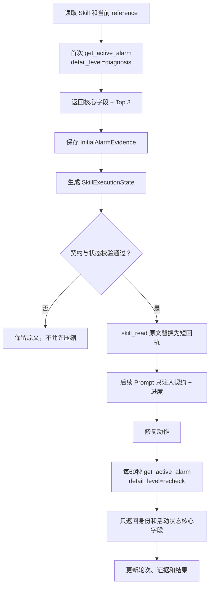

# PLC_Diagnosis 告警复查与 Skill 上下文压缩设计

> 状态：方案一已实现；方案二仍为设计稿。  
> 适用范围：`PLC_Diagnosis` 的活动告警首次诊断、修复后定时复查，以及通用 Skill 正文在 Agent 上下文中的生命周期。  
> 相关现状文档：[`plc_llm_tool_output_filtering.md`](plc_llm_tool_output_filtering.md)、[`plc_diagnosis_module_architecture.md`](plc_diagnosis_module_architecture.md)、[`../skill/skill_module_architecture.md`](../skill/skill_module_architecture.md)。

## 1. 背景与问题

当前一次告警闭环会依次把以下内容追加到同一个 `messages` 数组：

1. `PLC_Diagnosis/SKILL.md` 的完整 `skill_read` 输出；
2. 当前问题 reference 的完整 `skill_read` 输出；
3. 修复前的完整活动告警；
4. 每隔 60 秒执行一次的完整活动告警复查；
5. 每轮模型产生的 `assistant.tool_calls` 和其他工具结果。

现有 `get_active_alarm` 无论处于首次诊断还是修复后复查阶段，都会为每条告警返回 `cause_repair_total_count`、`topCauses[].reason/repair` 和 `cause_repair_truncated`。原因与建议对首次问题识别有价值，但目标告警身份已经确定后，后续复查只需要判断同一次告警是否仍然活动，重复返回原因与建议不会产生新的判定信息。

同时，`skill_read` 的长正文既作为 Tool 结果进入 transcript，又可能被 Working Memory 缓存并再次拼入后续 system prompt。即使模型已经确定执行步骤，长原文仍会持续占据上下文。

已分析轨迹 `agent_trace_20260915_122340.jsonl` 中：

- 两次 Skill 读取及首次告警查询使 `messages` 从约 0.9 KiB 增长到约 23.7 KiB；
- 一次内容未变化的延迟告警复查，连同 Tool 协议包装约增加 2.55 KiB；
- 10 次已经进入历史的延迟复查累计增加约 25.5 KiB；
- 最后一次复查工具本身成功，但追加 Tool exchange 时超过 56 KiB 本轮工作缓冲。

## 2. 设计目标

1. 修复前第一次活动告警查询保留问题识别所需的 Top 3 原因与建议。
2. 目标告警进入处理流程后，所有 60 秒复查不再向 LLM 返回 Top 3 原因与建议。
3. 首次证据与复查结果语义明确，不能用字段缺失误判为“告警没有原因”。
4. Skill 原文只在模型首次读取并建立执行状态时可见；执行状态提交成功后，后续 LLM 请求不再携带原文。
5. 压缩后仍保留所有安全边界、停止条件、写入授权、验证规则和恢复信息。
6. Session 挂起、恢复或进程重启后，能够基于相同 Skill definition 恢复执行，不依赖被移除的正文。
7. 所有压缩动作可观测、可验证；压缩失败时保留原文并停止扩大流程，不能静默丢失指令。

## 3. 非目标

- 本设计不提高 `AGENT_MAX_CONVERSATION_BYTES`，也不以扩大缓冲代替上下文治理。
- 本设计不改变活动告警的 ASP 查询范围、60 秒间隔、最多复查次数和告警身份匹配规则。
- 本设计不修改首次查询中 Top 3 的提取算法。
- 本设计不引入向量检索或从其他 Session 检索 Skill 状态。
- 本设计不规定所有领域 Tool 的通用结果压缩；第一阶段只处理活动告警复查和 Skill 原文。

## 4. 总体方案



方案分为两层：

- **领域输出层**：`get_active_alarm` 显式区分首次诊断与后续复查。
- **Agent 上下文层**：把 Skill 长正文转换为可验证的紧凑执行状态，并从后续 transcript/system prompt 移除原文。

## 5. 方案一：活动告警首次诊断与复查分级输出

### 5.1 使用显式阶段参数

为 `get_active_alarm` 增加参数：

```text
--detail-level diagnosis|recheck
```

语义：

| 值 | 使用阶段 | 原因与建议 | 默认行为 |
|---|---|---|---|
| `diagnosis` | 修复前第一次问题识别与入口核验 | 返回 Top 3 | 为兼容现有人工查询，暂定默认值 |
| `recheck` | 修复动作后的60秒复查 | 不返回 | Skill 必须显式指定 |

不建议用 `delay_seconds > 0` 自动推断复查阶段，因为“延迟查询”和“输出详细程度”是两个不同概念。未来可能存在需要延迟但仍要求详细证据的人工查询；显式参数不会造成语义耦合。

首次调用示例：

```json
{
  "command": "main",
  "path": "skills/PLC_Diagnosis/scripts",
  "args": ["-o", "get_active_alarm", "--detail-level", "diagnosis"],
  "timeoutMs": 90000
}
```

后续复查示例：

```json
{
  "command": "main",
  "path": "skills/PLC_Diagnosis/scripts",
  "args": [
    "-o", "get_active_alarm",
    "--detail-level", "recheck",
    "--delay-seconds", "60"
  ],
  "timeoutMs": 90000
}
```

### 5.2 首次诊断输出契约

首次查询继续返回当前核心告警字段，并保留：

```json
{
  "query": {
    "detail_level": "diagnosis",
    "delay_seconds": 0
  },
  "data": {
    "causes_included": true,
    "alarms": [
      {
        "seqno": 26,
        "almid": 1154,
        "equipid": 1,
        "localtime": "2026-09-10 14:08:32",
        "almname": "Southbound device communication anomaly",
        "faultDesc": "The inverter communication is abnormal.",
        "cause_repair_total_count": 3,
        "topCauses": [
          {"rank": 1, "reason": "...", "repair": "..."}
        ],
        "cause_repair_truncated": false
      }
    ]
  }
}
```

首次结果解析成功并且目标 occurrence 通过 `almid + equipid + seqno + localtime` 完全匹配后，Skill 将相关内容保存为 `InitialAlarmEvidence`：

```json
{
  "identity": {
    "almid": 1154,
    "equipid": 1,
    "seqno": 26,
    "localtime": "2026-09-10 14:08:32"
  },
  "classification": {
    "almname": "...",
    "faultDesc": "...",
    "reason": 17,
    "reasonum": 1,
    "topCauses": [
      {"rank": 1, "reason": "...", "repair": "..."}
    ]
  },
  "captured_before_write": true,
  "source_operation": "get_active_alarm",
  "evidence_revision": 1
}
```

这里的“保存”指进入当前 Skill execution state，并随 Session 持久化；后续复查不覆盖这份修复前证据。

### 5.3 复查输出契约

`detail_level=recheck` 时仍保留判断目标 occurrence 是否存在所需的字段：

- `seqno`
- `almid`
- `equipid`
- `equiptypeid`
- `localtime`
- `level`
- `reason`、`reasonum`（用于发现同一 occurrence 状态异常变化）
- `almname`、`faultDesc`（第一阶段可保留，后续可评估继续缩减）

必须省略：

- `topCauses`
- `cause_repair_total_count`
- `cause_repair_truncated`
- 原始 `description`
- 原始 `subReasonList`

示例：

```json
{
  "schema_version": 2,
  "operation": "get_active_alarm",
  "success": true,
  "exit_code": 0,
  "query": {
    "equip_id": 0,
    "delay_seconds": 60,
    "detail_level": "recheck"
  },
  "data": {
    "causes_included": false,
    "total_alarm_count": 2,
    "returned_alarm_count": 2,
    "alarms": [
      {
        "seqno": 26,
        "almid": 1154,
        "equipid": 1,
        "equiptypeid": 33028,
        "localtime": "2026-09-10 14:08:32",
        "level": 2,
        "reason": 17,
        "reasonum": 1,
        "almname": "Southbound device communication anomaly",
        "faultDesc": "The inverter communication is abnormal."
      }
    ],
    "truncated": false
  },
  "error": null
}
```

`causes_included=false` 表示调用方主动选择了精简视图。不得返回 `topCauses: []`，因为空数组容易被错误解释成“接口确认没有原因”。

### 5.4 阶段约束

Skill 工作流必须满足：

1. 每个告警处理 Run 只能建立一份不可变的 `InitialAlarmEvidence`。
2. 在首次证据建立之前禁止执行 `set_freq_band`。
3. 首次证据必须标记 `captured_before_write=true`。
4. 第一次写操作发生后，后续 `get_active_alarm` 只能使用 `detail_level=recheck`。
5. 复查输出不得覆盖首次保存的 `topCauses`。
6. 复查失败不能解释为告警消失，保持现有失败语义。
7. 每个候选频段的轮次统计只计算写入并读回成功后的有效 `recheck` 查询。

为保持兼容，脚本单独执行时可以默认 `diagnosis`；但 `PLC_Diagnosis` 的 Skill 指令和执行状态校验必须显式区分两个阶段。

## 6. 方案二：Skill 原文压缩为执行状态

### 6.1 压缩对象

当前需要处理两处重复占用：

1. transcript 中 `assistant.tool_calls(skill_read)` 对应的完整 Tool result；
2. Working Memory 中缓存的完整 Skill 内容，以及后续 system prompt 对它的重复注入。

不能直接删除 Tool result，因为 OpenAI Tool 协议要求每个 `assistant.tool_calls[].id` 有对应的 `role=tool` 消息。设计采用“保留消息骨架、替换内容”的方式。

### 6.2 执行状态由两部分组成

压缩后的 `SkillExecutionState` 分为：

#### A. 不可变执行契约 `contract`

由 Skill 包作者维护，不能由模型自由总结，建议放在 Skill 包内的机器可读 sidecar，例如：

```text
skills/PLC_Diagnosis/context_contract.json
```

保存必须完整保留的规则：

- 支持的问题和原因分支；
- Tool 白名单及参数模板；
- 写操作授权和禁止重试规则；
- 目标 occurrence 四字段完全匹配规则；
- 告警查询失败不能视为解除；
- 频段编号与接口值映射；
- 候选顺序、失败集合和停止条件；
- 60秒复查间隔及每候选最多6次；
- 参数验证和问题验证必须分开；
- 完成报告必需字段；
- 凭据和敏感字段禁止输出规则。

`contract` 带有：

```json
{
  "schema_version": 1,
  "skill": "PLC_Diagnosis",
  "definition_hash": "...",
  "contract_hash": "...",
  "workflow": "P001/C001",
  "rules": {}
}
```

使用作者维护的契约而不是让模型自由概括，可以避免“压缩时漏掉不得重试写操作”等关键安全条件。

#### B. 可变执行进度 `progress`

由当前 Run 更新，建议最大序列化长度不超过 4 KiB：

```json
{
  "skill_run_id": "PLC_Diagnosis#001",
  "phase": "alarm_recheck",
  "step": "S6",
  "loaded_resources": [
    {"path": "SKILL.md", "sha256": "..."},
    {"path": "references/通信异常.md", "sha256": "..."}
  ],
  "alarm_before": {},
  "repair_target": {"equip_id": 4099, "equip_type_id": 33036},
  "band_before": 3,
  "band_target": 4,
  "band_after": 4,
  "failed_bands": [3, 1, 2],
  "attempted_bands": [1, 2, 4],
  "alarm_check_round": 1,
  "parameter_result": "success",
  "problem_result": "pending",
  "last_tool": {
    "operation": "get_active_alarm",
    "exit_code": 0,
    "target_occurrence_present": true
  },
  "revision": 8
}
```

进度只保存继续执行和最终报告需要的事实，不保存整份 Skill Markdown，也不保存每一轮重复的完整告警 JSON。

### 6.3 压缩提交边界

新增内部能力 `skill_checkpoint`，其职责不是总结任意文本，而是提交符合当前 Skill contract schema 的可变进度。

生命周期：

1. 模型通过 `skill_read` 读取 `SKILL.md` 和当前问题所需 reference。
2. 原文在紧接着的一次 LLM 调用中仍然可见，保证模型能够建立计划。
3. 模型调用 `skill_checkpoint` 提交结构化 `progress`。
4. Kernel 校验当前 active Skill、run ID、definition hash、已读资源 hash、必需字段、枚举、阶段和领域不变量。
5. 校验成功后生成新的 checkpoint revision 并持久化。
6. 只有 checkpoint 成功后才允许压缩原文。
7. 校验失败时返回明确错误，保留原始 Tool result，不进行破坏性裁剪。

`PLC_Diagnosis` 的首次 checkpoint 至少要求：

- 已读取 `SKILL.md`；
- 已读取当前问题 reference；
- 已建立目标 occurrence 身份；
- 已保存 `InitialAlarmEvidence`；
- 已确定当前 phase/step；
- 已带入 contract hash 和两个资源 hash。

### 6.4 transcript 重写

checkpoint 成功后，将历史中对应 `skill_read` 的 Tool result 内容替换为短回执，保留原 `tool_call_id`：

```json
{
  "role": "tool",
  "tool_call_id": "原ID",
  "content": "{\"skill_read_compacted\":true,\"skill\":\"PLC_Diagnosis\",\"resource\":\"references/通信异常.md\",\"resource_hash\":\"...\",\"checkpoint_revision\":1}"
}
```

不得删除对应的 assistant `tool_calls` 消息，否则会破坏 Tool 消息配对。重写只影响后续发给 LLM 的 `messages` 和最终保存的 Session transcript；已经写入 trace 的原始历史保留用于审计，但必须继续遵守 trace 的访问和脱敏策略。

### 6.5 Working Memory 注入

checkpoint 成功后：

- `WorkingMemorySkill.content` 不再保存和注入完整 Tool 输出；
- 仅保存 Skill 名、资源路径、资源 hash、contract hash 和 checkpoint revision；
- `WorkingMemoryAppendPrompt()` 注入紧凑的 `contract + progress`；
- 同一个 resource 不允许因上下文压缩而自动再次 `skill_read`；
- 只有校验失败、definition 改变或用户显式开始新 Run 时才重新读取。

后续 system prompt 示例：

```text
# Active skill execution
skill: PLC_Diagnosis
run: PLC_Diagnosis#001
definition_hash: ...
contract_hash: ...
phase: alarm_recheck
step: S6
target_occurrence: almid=1154 equipid=1 seqno=26 localtime=2026-09-10 14:08:32
candidate_band: 4
alarm_check_round: 1/6
parameter_result: success
problem_result: pending
rules: query_failure_is_not_clear; no_write_retry_on_unknown; require_two_level_verification
```

### 6.6 恢复和失效

Session 恢复时按以下顺序处理：

1. 读取 Session 中的 checkpoint、definition hash 和 contract hash。
2. 重新计算当前 Skill 包 hash。
3. hash 全部一致：恢复 `contract + progress`，不重新注入长原文。
4. hash 不一致：checkpoint 标记为 stale，禁止继续写操作。
5. stale 状态下重新执行 `skill_read` 并建立新 checkpoint；不得把旧进度直接套用到新定义。
6. checkpoint 缺失或损坏：保守地保留/重新加载原文，并停止自动写操作。

## 7. 数据结构建议

现有 `WorkingMemorySkill` 只有 `path + content[8192]`，不能区分原文、契约和进度。建议后续实现时拆分为：

```c
typedef struct {
    char path[256];
    char resourceHash[65];
    int compacted;
} LoadedSkillResource;

typedef struct {
    char skillName[128];
    char skillRunId[64];
    char definitionHash[65];
    char contractHash[65];
    unsigned int revision;
    char contractJson[4096];
    char progressJson[4096];
    LoadedSkillResource resources[8];
    int resourceCount;
} SkillExecutionCheckpoint;
```

实际大小需要结合 `SessionRecord` 和磁盘文件上限重新核算，不应简单叠加到现有固定结构而不调整持久化版本。Session 文件格式发生变化时应提升 `SESSION_FILE_VERSION`，并明确旧版本的迁移或失效策略。

## 8. 代码影响范围（后续实现参考）

第一部分预计涉及：

- `skills/PLC_Diagnosis/scripts/main.c`：解析和校验 `--detail-level`；
- `skills/PLC_Diagnosis/scripts/asp/asp.h`：Options 增加 detail level；
- `skills/PLC_Diagnosis/scripts/asp/normalize.c`：按级别决定是否输出原因字段；
- `skills/PLC_Diagnosis/SKILL.md`：首次调用和复查命令改为显式级别；
- `skills/PLC_Diagnosis/references/通信异常.md`：S1/S6 的输出契约和状态更新；
- PLC normalized output 测试：分别覆盖 diagnosis/recheck。

第二部分预计涉及：

- Skill Tool 注册：增加 `skill_checkpoint`；
- `src/kernel/skill.c`：checkpoint 校验、revision、资源 hash 和恢复；
- `src/kernel/working_memory.c`：停止重复注入原文，改为注入契约和进度；
- `src/kernel/kernel.c`：在安全边界重写 `messages` 中已 checkpoint 的 `skill_read` Tool result；
- `include/litecrab/working_memory.h`、Session 持久化结构：保存 checkpoint；
- Observability：记录 checkpoint 创建、压缩字节数、失效原因，不把压缩动作伪装成普通 Tool 成功。

## 9. 兼容性与上线顺序

建议分阶段实施：

### 阶段 A：告警复查精简（已实现）

1. 增加 `--detail-level`，默认 `diagnosis`，保持旧调用兼容。
2. 更新 PLC_Diagnosis，使所有 S6 调用显式使用 `recheck`。
3. 验证首次证据完整、复查判断不变、上下文明显下降。

### 阶段 B：checkpoint 只记录、不裁剪

1. 引入 contract、progress、hash 和 `skill_checkpoint`。
2. 同时保留原文，用 Trace 对比 checkpoint 是否足以驱动后续决策。
3. 覆盖成功、失败、挂起、恢复、definition 更新等路径。

### 阶段 C：启用原文裁剪

1. 仅对 checkpoint 校验成功的 Run 开启。
2. 先通过配置开关灰度；异常时可关闭裁剪，但不能跳过规则校验。
3. 稳定后再停止 Working Memory 的长原文注入。

这种顺序避免同时改变领域 Tool 契约和 Kernel transcript 管理，便于定位回归。

## 10. 测试与验收标准

### 10.1 活动告警输出

- `diagnosis` 输出包含 Top 3、总原因数和截断标记。
- `recheck` 输出完全不包含 `topCauses`、`cause_repair_total_count`、`cause_repair_truncated`、`description`、`subReasonList`。
- `recheck.data.causes_included=false`。
- 两种级别对同一响应计算出的目标 occurrence 是否存在必须一致。
- 非法 `--detail-level` 返回参数错误，不发起 ASP 请求。
- 复查失败、空列表、列表截断、字段缺失均保持现有保守语义。

### 10.2 Skill checkpoint

- checkpoint 之前，下一轮模型能看到刚读取的完整 Skill 内容。
- checkpoint 成功后，后续 LLM input 中不再出现 Skill Markdown 正文片段。
- 每个原 `tool_call_id` 仍有对应 Tool 消息，只是内容变为 compact receipt。
- system prompt 只出现 contract/progress，不重复出现 `skill_read` 原始包装内容。
- 缺少必需规则、hash 不匹配或 JSON 超限时不得裁剪。
- Session 挂起并恢复后能从 checkpoint 继续正确轮次和候选 Band。
- Skill 文件变更后旧 checkpoint 自动失效，写操作被阻止直至重新读取。

### 10.3 PLC_Diagnosis 端到端

- 修复前只执行一次 `detail_level=diagnosis` 并保存 `InitialAlarmEvidence`。
- 每次写频段后的复查全部使用 `detail_level=recheck`。
- 当前候选仍保持最多6次、每次60秒的有效复查；初始查询不能计入候选复查轮次。
- 参数验证与告警解除验证仍分别给出结果。
- 使用已出现上下文溢出的轨迹数据回放时，不再出现 `ERROR: conversation is too large`。
- 回放中最终结论、写入目标、候选顺序和停止条件与未压缩版本一致。

建议同时记录以下观测指标：

- `llm_messages_bytes_before/after_compaction`
- `skill_source_bytes_removed`
- `skill_checkpoint_bytes`
- `active_alarm_output_bytes` 与 `detail_level`
- `recheck_round`
- `compaction_status/reason`

## 11. 风险与边界

| 风险 | 控制措施 |
|---|---|
| 模型摘要遗漏关键安全规则 | 不使用自由文本摘要作为唯一依据；安全规则来自作者维护且带 hash 的 contract |
| 删除 Tool result 破坏协议 | 不删除消息，只用 compact receipt 替换内容并保留 `tool_call_id` |
| 字段缺失被误判为无原因 | 使用 `causes_included=false`，并直接省略原因字段而不是返回空数组 |
| Skill 更新后继续旧流程 | definition/contract/resource hash 任一变化即使 checkpoint 失效 |
| checkpoint 损坏后继续写设备 | fail closed；禁止写操作，重新读取并提交状态 |
| 只精简 Top 3 仍可能被大量轮次撑满 | 结合 Skill 原文裁剪；后续可增加旧复查 Tool result 的滚动摘要，但不属于第一阶段 |

## 12. 设计决策摘要

1. 首次诊断与后续复查使用显式 `detail_level`，不通过等待时间隐式判断。
2. Top 3 原因与建议只进入修复前 `InitialAlarmEvidence`，后续复查不再返回，也不得覆盖。
3. Skill 压缩结果不是自由文本总结，而是可信的不可变 contract 加结构化 progress。
4. 原文只有在 checkpoint 校验成功后才能从后续上下文移除。
5. transcript 保留 Tool 调用配对，以短回执代替完整 `skill_read` 输出。
6. definition 或资源发生变化时旧状态失效，自动修复写操作必须暂停。
